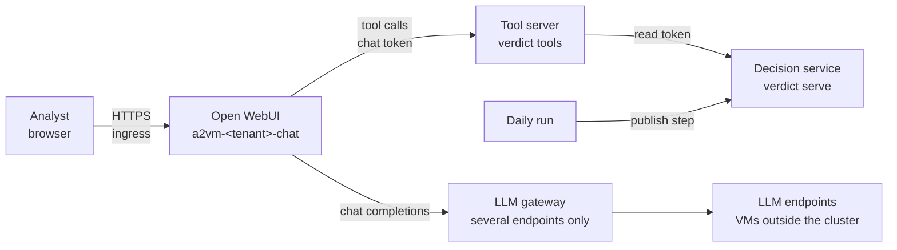

# Conversational search (analysts' chat)

Since v0.15.0 the analysts of a tenant ask in plain language for a CVE, an asset or the decisions
of a level, and get the answer from the tenant's latest run (HLD §8, LLD triage-prioritization
§16). Everything runs in the tenant's namespace except the model, which stays on the tenant's
approved LLM endpoints (one VM or several):



Open WebUI never sees the decision service's token, and reaches nothing but the tool server, the
LLM endpoints and the DNS. The tool server reads only, for its tenant only, and answers short
pages (about 2,000 tokens at most) for the model's context.

## 1. Before deploying

- The decision service of the tenant runs and has a run (v0.14.0, `docs/kubernetes.md`).
- The model is served with tool calling. With vLLM and Qwen3, add to its command line:

  ```bash
  --enable-auto-tool-choice --tool-call-parser hermes
  ```

  Without these options the chat answers without its tools, from the model's memory: wrong.
- A host name for the chat behind the cluster's ingress (e.g. `chat-lab.apps.example.org`); with
  cert-manager, the ClusterIssuer of the push endpoint signs its certificate too.

## 2. Variables of the tenant project

| Key | Value | Options |
| --- | --- | --- |
| `A2VM_CHAT_HOST` | Host of the chat; set, `deploy-k8s` deploys it | Visible |
| `A2VM_CHAT_ALLOW` | Optional: the analysts' networks, CIDR, comma-separated; empty: every source | Visible |
| `A2VM_CHAT_ADMIN_EMAIL` | Optional: login of the first admin (default `admin@example.org`) | Visible |
| `A2VM_CHAT_RETENTION_DAYS` | Optional: chats unchanged for longer are deleted (default 30; 0 keeps them) | Visible |
| `A2VM_CHAT_LLM_EGRESS` | Optional: `cidr:port,...` of the LLM endpoints, when the job cannot resolve their names | Visible |
| `A2VM_CHAT_INGRESS_CONTROLLER`, `A2VM_CHAT_INGRESS_CLASS`, `A2VM_CHAT_TLS_SECRET`, `A2VM_CHAT_CLUSTER_ISSUER` | Optional; default to the `A2VM_INTAKE_*` ones | Visible |

The model and its endpoints are the tenant's: `A2VM_LLM_MODEL` and `A2VM_LLM_BASE_URL` (usually on
the group, `docs/deployment.md` §3). The job resolves the endpoints' names to their addresses for
the NetworkPolicy and prints them. Nothing secret is typed: the job makes the session key of Open
WebUI, its first admin's password and the token between Open WebUI and the tool server once, and
keeps them in the Secret `a2vm-tenant` (`chat-secret-key`, `chat-admin-password`,
`chat-tools-token`).

## 3. First sign-in, analysts' accounts

With the tenant's identity provider (`A2VM_OIDC_ISSUER`, v0.17.0), the analysts sign in with their
directory account and their groups decide who gets in: `docs/sign-in.md`. The local admin below
stays for the first set-up, unless `A2VM_OIDC_ADMINS` names the admins' group.

After the deployment (`kubectl -n <namespace> get pods -l 'app.kubernetes.io/component in (chat,tools)'`:
both `Running`), read the first admin's password from its Secret and sign in at `https://<host>`:

```bash
NS=a2vm-lab
kubectl -n $NS get secret a2vm-tenant -o jsonpath='{.data.chat-admin-password}' | base64 -d | pbcopy
```

(`pbcopy` on macOS; elsewhere `xclip -selection clipboard`, or read it on screen.) Sign-up is
closed: the admin creates each analyst's account in *Admin Panel > Users* (role `user`). Change
the admin's password in *Settings > Account*; the Secret's value only serves the first start.

## 4. Check

In a new chat, the model is preselected and the tool **A2VM** is on (the wrench icon under the
input box). Ask for instance "Quels sont les ACT KEV du dernier run ?": the answer ends with the
run it rests on (`Source : run …`), and the tool server's log shows the calls:

```bash
kubectl -n $NS logs deploy/a2vm-lab-tools --tail=20
kubectl -n $NS logs deploy/a2vm-lab-chat --tail=50
```

If the answer comes without tool calls, check the vLLM options (§1) and that **A2VM** is on in
the chat.

## 5. Several LLM endpoints

`A2VM_LLM_BASE_URL` takes several endpoints serving the same model, comma-separated
(`http://192.0.2.10:8000/v1,http://192.0.2.11:8000/v1`):

- **the chat** goes through an LLM gateway in the namespace (nginx, `a2vm-<tenant>-llm`): its calls
  spread over the endpoints; an endpoint that refuses, times out or answers 429 or 5xx is left out
  for 30 seconds and the request goes to the next one, so the analyst sees nothing. Open WebUI
  alone would use the first endpoint only. Which endpoint answered is in the gateway's log:

  ```bash
  kubectl -n $NS logs deploy/a2vm-lab-llm --tail=20
  ```

- **the daily run** calls the first endpoint and moves to the next one when it is down, then stays
  there for the rest of the run (`LLM calls move to …` in its log);
- with one endpoint, nothing changes: no gateway, the chat connects to it.

Every endpoint must serve the tenant's model under the same name, be approved for the tenant (HLD
§9), and, behind the gateway, be reached over http with the same path. Detail: LLD
triage-prioritization §7.1 and §16.5.

## 6. What is closed

| Item | Setting |
| --- | --- |
| Configuration | From the chart's values only (`ENABLE_PERSISTENT_CONFIG=false`): what an admin changes in the admin panel does not survive a restart |
| Models | The tenant's model on its endpoints only; no Ollama, no direct connection from a browser |
| Tools | The A2VM tool server only: no web search, no code execution, no image generation, no user tools or tool servers, no file upload |
| Network | Open WebUI offline (no model download, no update check, no telemetry); NetworkPolicy to the tool server, the LLM endpoint (or the gateway) and the DNS |
| Browser | Content-Security-Policy: no image, script or request to another host, so an answer cannot send data out through a URL; links and images in vendor text are removed by the tool server |
| Decisions | Read only: nothing in the chat changes a decision, a review flag or an exposure |

## 7. Documents and retention (v0.15.1)

Ask for a document in plain words ("fais-moi un Word des ACT exposés à Internet", "un PowerPoint des
KEV", "un CSV des décisions de web01"): the tool server builds it from the data, with the run, the
filters, the counts, the table and the explanation of the most urgent decisions, and the chat
answers with a download link. The link is valid one hour (`chat.exportMinutes`), on the chat's
own address, for whoever holds it: hand over the file, not the link. Detail: LLD
triage-prioritization §16.6.

Chats unchanged for 30 days are deleted, every hour, by a second container of the chat's pod
(`A2VM_CHAT_RETENTION_DAYS` on the tenant project: another number of days, 0 to keep them). Its
log says how many it deleted:

```bash
kubectl -n $NS logs deploy/a2vm-lab-chat -c retention --tail=5
```

## 8. Questions an analyst asks (v0.15.2)

| Question | Tool |
| --- | --- |
| "Qu'est-ce qui a changé depuis hier ?", "pourquoi je la vois seulement ce matin ?" | `what_changed`: new, gone, other level, each with why (first detected by a source, CVE published or updated, added to KEV, EPSS, exposure) |
| "Quand a-t-elle été mise à jour ?", "depuis quand au KEV ?" | `get_cve`, `get_decision`: published, updated, added to KEV, KEV due date, EPSS day, first seen |
| "Que dois-je appliquer sur web01, dans quel ordre ?" | `get_fix_plan`: the fix that clears most ACT first |
| "Qu'est-ce qui arrive à échéance cette semaine ?", "qu'est-ce qui est en retard ?" | `search_decisions` with `due_before`, `overdue` |
| "Sommes-nous concernés par CVE-… ?" | `get_cve`: concerned assets, or the assets that have the product outside the vulnerable range, or none |
| "Quelles alertes cette semaine ?", "celle-ci a-t-elle été envoyée ?" | `list_alerts`, `get_alert` (watch on Kubernetes, v0.16.0): alerts of the watch, their status (pending, sent, failed) and their sheet |

`what_changed` needs two runs in the decision service: the day after the first daily run with
v0.14.0 or later. The dates appear for the runs made with v0.15.2 or later.

## 9. Limits

- Without `A2VM_OIDC_ISSUER`, local accounts made by the admin; with it, the provider's accounts
  (`docs/sign-in.md`).
- Documents in a neutral layout; the tenant's own Word and PowerPoint templates later.
- One replica on a volume (SQLite); PostgreSQL with the decision service (v0.18.0).
