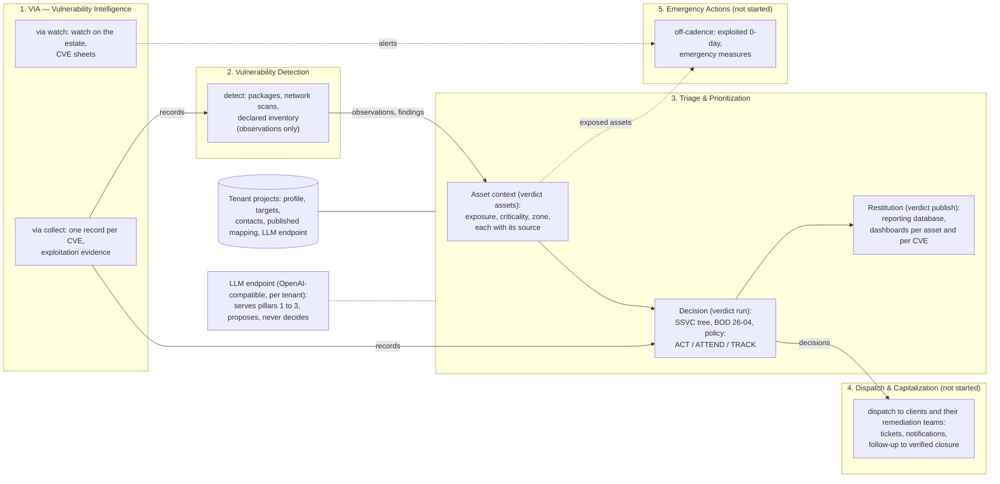
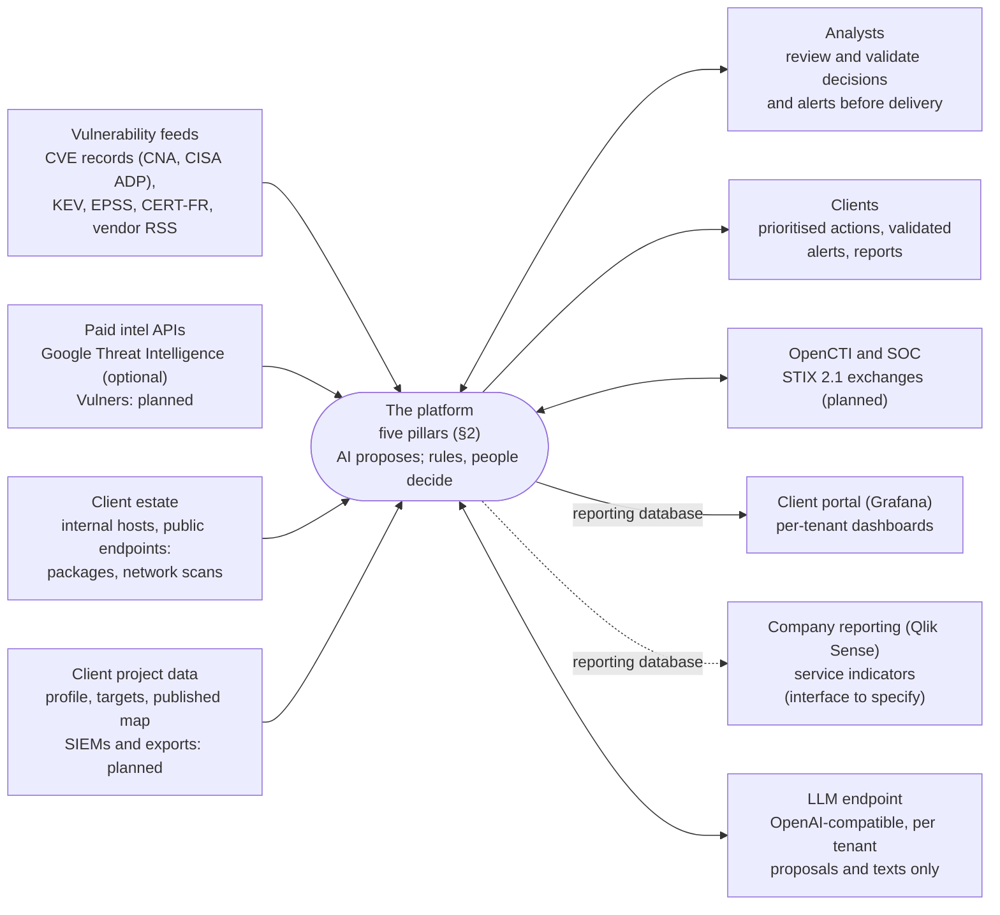
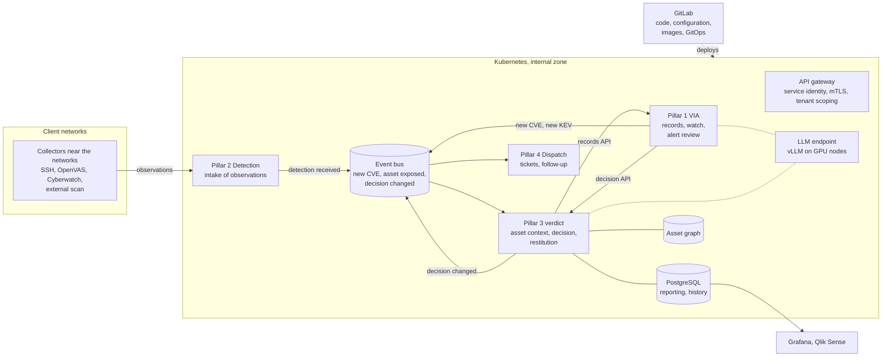

# AI-Assisted Vulnerability Management — Product strategy

Part of the high-level design (HLD); see [README.md](README.md) for the other chapters. This
chapter holds everything that binds the five pillars together: goals, constraints, context,
structuring decisions, contracts between pillars, AI strategy, deployment modes, cross-cutting
security and the overall roadmap. A pillar chapter details its own part and never contradicts this
one.

## 1. Vision and goals

The platform turns vulnerability intelligence and scanner findings into one prioritised,
explainable decision per client and finding, then into actions followed to closure. AI assists at
precise points; deterministic rules and people take every decision. It targets production use for
a managed vulnerability management service.

### Business goals

1. Aggregate vulnerability intelligence from multiple sources and cross-check exploitation evidence (pillar 1).
2. Confront that intelligence with each client's actual assets, internal and internet-exposed (pillar 2).
3. Produce one global SSVC decision per client and finding, with internal and external detections reconciled and the asset context made explicit (pillar 3).
4. Dispatch the resulting actions to the teams that remediate, follow them to verified closure and capitalise on them (pillar 4).
5. In a crisis, act outside the normal cadence with emergency measures across clients (pillar 5).
6. Keep the ideas reusable: client configuration kept outside the code, and a licence decided once the merge with the internal VERDICT project is settled.

### Quality goals (top 5)

| Priority | Quality goal | What it means here |
| --- | --- | --- |
| 1 | Confidentiality | Client data and TLP:RED/AMBER material go only to components and LLM endpoints approved for that client; on premises by default |
| 2 | Explainability | Every decision can be traced to its inputs and decision points |
| 3 | Determinism | Same inputs give the same decision; AI proposes or writes, never decides |
| 4 | Multi-tenancy | Strict separation between tenants: data, configuration and LLM endpoints |
| 5 | Operability | Reproducible, observable runs |

### Quality scenarios

Targets are set on the pilot client; until then the scenarios fix what is measured.

| Quality | Scenario | Measure |
| --- | --- | --- |
| Confidentiality | A pipeline runs on a client's data | No client data reaches a component or LLM endpoint not approved for that client; LLM prompts are not stored |
| Explainability | An analyst questions an ACT | Every input of the decision shows its source, assumed and AI-estimated values included |
| Determinism | The same run is replayed | Same records, assets, findings, policy version: same decisions |
| Timeliness | A daily run for a client | Duration of the run and time of publication, against targets set on the pilot |
| Detection quality | Past decisions are replayed against later exploitation | Share of TRACK or ATTEND findings exploited afterwards (false negatives) |
| Robustness | A hostile scanner export or an unreachable LLM | The input is rejected without side effect; the run ends with templates and flagged rows |

### Stakeholders

| Role | Expectation |
| --- | --- |
| Vulnerability management service lead | Product direction, delivery to clients |
| Pillar product owners | Scope and roadmap of each pillar |
| Analysts (production team) | Daily intel watch, monthly indicators, validated decisions |
| Clients | Prioritised, justified actions on their assets |
| SOC / CTI teams | STIX exchanges with OpenCTI and the SOC |
| Infrastructure and security teams | Hosting, network flows, DICT compliance |

## 2. Value chain

Five pillars, one chain: intelligence and detections converge on the asset context, Triage &
Prioritization decides and restitutes its decisions (reporting database, dashboards), Dispatch &
Capitalization dispatches the resulting actions to the clients and follows them up; Emergency
Actions short-cut the chain in a crisis.

| Pillar | Package and command | Role in the chain | Status | Chapter |
| --- | --- | --- | --- | --- |
| 1. Vulnerability Intelligence | `via` (`via.intel`, `via.alert`) | Knows every CVE and its exploitation; watches the estate | In development | [10-vulnerability-intelligence.md](10-vulnerability-intelligence.md) |
| 2. Vulnerability Detection | `detect` | States what is installed and exposed, without judging it | In development | [20-vulnerability-detection.md](20-vulnerability-detection.md) |
| 3. Triage & Prioritization | `verdict` (`verdict.assets`, `verdict.restitution`) | Holds the asset context, takes the only decision and restitutes it: reporting database, dashboards | In development | [30-triage-prioritization.md](30-triage-prioritization.md) |
| 4. Dispatch & Capitalization | — | Dispatches the actions to the clients and their remediation teams (tickets, notifications) and follows them to verified closure | Not started | [40-dispatch-capitalization.md](40-dispatch-capitalization.md) |
| 5. Emergency Actions | — | Acts outside the normal cadence in a crisis | Not started | [50-emergency-actions.md](50-emergency-actions.md) |

Status scale used throughout: Not started → In development → Pilot → In service.

## 3. Constraints

Confidentiality drives most constraints: client data and restricted intelligence go only where the
client has approved, and on premises by default, LLM inference included.

| Type | Constraint | Consequence |
| --- | --- | --- |
| Security | Client data is only sent to an LLM endpoint approved for that client; on premises by default | Any OpenAI-compatible endpoint can be used (vLLM, Ollama, Azure OpenAI…); in MSSP mode a client's own SaaS LLM requires its written approval and is configured for that client only (§9) |
| Security | TLP:RED/AMBER documents must not reach services outside the trusted perimeter | Restricted intelligence is processed on premises only; licensed content is never sent to an LLM |
| Security | DICT requirements built up progressively towards production | Security controls are part of each release, not a final phase |
| Network | The corporate proxy blocks some RSS and CSAF feeds, and possibly NVD | Intel collection runs from a DMZ host with its own outbound access |
| Network | Internet-facing scans must originate outside the corporate network | External scanning runs from a cloud host acting as a GitLab runner |
| Organisation | No interactive access to client CMDBs | Asset inventory is rebuilt from scanners, client exports and SIEM data; where the client grants a read-only account, its CMDB is read by a collector near it (v0.19.0, iTop first), never written |
| Platform | In production, GitLab holds code and configuration (code, tenant configuration, infrastructure as code, changes reviewed by merge request) and deploys them; it neither runs the per-tenant work nor stores its results | Every job and service runs on a container runtime (Kubernetes is the candidate, still to be validated); results go to the platform's databases |
| Data | Internal model is business-oriented; STIX only at interfaces | STIX mapping is confined to OpenCTI / SOC connectors |
| Legal | Proprietary for now; earlier versions were published under AGPL-3.0 | No distribution outside the authorised people until the licence is decided; copies of earlier versions keep their AGPL rights; ownership to be settled in writing with the employer before the merge |
| Cost | Google Threat Intelligence billed per request, Vulners per API call | Quotas and caching on paid sources |

## 4. System context

The platform consumes vulnerability intelligence, scanner results and client asset data, and
delivers decisions to analysts, clients, the SOC and dashboards. It calls an LLM endpoint approved
for each tenant.

| Partner | Direction | Exchanged | Interface | Status |
| --- | --- | --- | --- | --- |
| Public sources: CVE records (CNA and CISA ADP), CISA KEV, FIRST EPSS | In | Vulnerability records, exploitation evidence, EPSS | HTTPS, JSON | In place |
| Advisory feeds: CERT-FR, vendor RSS and CSAF | In | Advisories for the watch mode | RSS, CSAF | CERT-FR and RSS in place; CSAF partly |
| Google Threat Intelligence (licensed) | In; only CVE ids out | Exploitation state, exploit availability | REST API, API key | In place, optional |
| Vulners, NVD | In | Aggregated exploits, NVD enrichment | REST API | Not used today |
| Client internal hosts | In | Package inventories; internal network scan | Read-only SSH; network vulnerability scanner | In place |
| Client public endpoints | In | External network scan | Network vulnerability scanner run from the cloud | In place |
| Other scanners (Tenable, Qualys, Cyberwatch), client SIEMs and asset exports | In | Findings, assets | API, report import, SIEM queries | Planned |
| Client project (profile, targets, contacts, `published`) | In | Declared assets, attribute rules, scan targets, alert recipients | Files in the tenant's GitLab project | In place; `published` since v0.11.2 |
| LLM endpoint approved for the tenant | Out and back | Facts of one CVE and asset, kept in memory only; proposals and texts back (§8) | OpenAI-compatible HTTPS API: vLLM or Ollama on premises, Azure OpenAI (Azure AI Foundry), or the client's own LLM; chosen per deployment and recorded in its DAT | In place (on premises), optional |
| OpenCTI, SOC | In and out | CTI linked to CVEs; per-client STIX bundles | STIX 2.1, TAXII | Planned |
| Analysts | In and out | Review, alert validation, reports | GitLab interface, job artifacts | In place |
| Client contacts | Out | Validated alert mails, reports | SMTP relay, after analyst validation | In place |
| Client portal (Grafana) | Out | Reporting database: decisions, assets, deadlines, exposure gaps and totals of every run, per tenant | PostgreSQL, one read-only role per tenant; one Grafana organisation per tenant; never GitLab | In place: reporting database, overview dashboard and portal deployed by `deploy/portal` (v0.11.5); dashboards per asset and per CVE comparing snapshots (v0.11.6) |
| Company reporting tool (Qlik Sense) | Out | Same reporting database, for the company's service indicators | To specify: interface specifications not available yet (native PostgreSQL connection, or files delivered by a connector) | Planned, waiting for the interface specifications |
| SIEM of the platform | Out | Platform logs | Syslog | Target |

## 5. Structuring decisions

The platform is organised in five pillars, built from one code repository; GitLab is the control
plane, with projects per tenant holding their configuration and results, and orchestrates
per-tenant jobs, while tenant-independent pillars run as services. AI proposes and writes;
deterministic rules and people decide. Decisions that concern one pillar only are in its chapter.

| # | Decision | Rationale |
| --- | --- | --- |
| D1 | Single repository (`vulnops/a2vm`) for the common contract and all pillars | Shared data model and tooling; pillars evolve together |
| D2 | Projects per tenant, configuration outside the code repository | Tenant isolation, code reusable |
| D3 | In production, GitLab holds code and configuration and deploys them, nothing more: per-tenant batch jobs (pillars 2 and 3) and long-running services (pillar 1, later 4 and 5) run on a container runtime, scheduled there, and write their results to the platform's databases (reporting database first, history database next). In development and in the homelab, GitLab pipelines still run the jobs and keep their outputs as artifacts | Changes stay reviewed and traceable in GitLab while execution, scheduling and data leave it: GitLab is not sized nor secured as a data store, client data never sit in CI artifacts, and the runtime can be placed per deployment mode (MSSP datacenter, company cloud, client's private cloud) |
| D4 | SSVC decision points come from evidence (KEV, GTI, CISA ADP, CVSS, asset context); AI only proposes a missing one, flagged for review; a deterministic tree decides | Explainable, reproducible decisions; AI errors are visible inputs |
| D5 | Three delivery levels, ACT / ATTEND / TRACK, from the CISA Coordinator tree, the BOD 26-04 timelines and a policy configurable per client | Clients differ in the asset criticality and exposure data they provide |
| D6 | One global decision per client, internal and external detections reconciled | External scan collects only; the tenant project maps public endpoints to internal assets |
| D7 | Exposure uses SSVC values (open / controlled / small), with descriptive zones (dmz, lan…) kept alongside | Standard decision input without losing network context |
| D8 | LLM reached through an OpenAI-compatible API, endpoint configured per tenant | Model, engine and hosting interchangeable; confidentiality decided per client and deployment mode |
| D9 | Business-oriented internal data model, STIX only at interfaces | Simpler core, interoperability where needed |
| D10 | Asset context belongs to Triage & Prioritization: Detection supplies observations, Triage turns them into context (exposure, criticality, zone, each with its source) | The pillar that defines the model owns it; detection stays factual |
| D11 | AI proposes, never decides: every AI output is a proposal or a text, with a deterministic fallback, shown with its source and reviewed | Accountability stays with rules and people; the platform works without an LLM |
| D12 | Pillars are independent packages, each with its own command (`via`, `detect`, `verdict`, `dispatch` since v0.20.0); they depend only on the common contract (package `a2vm`) and never import one another; what several pillars run is a library of `a2vm` owned by one pillar, what a pillar keeps for itself is reached through its API (§6; extension points until v0.16.1) | Each pillar can evolve, be owned and later be deployed on its own; a test enforces the rule |
| D13 | Restitution through Grafana portals that read a reporting database only, with a read-only role per tenant (or for every tenant). A portal is wherever its reader wants it: a VM (`deploy/portal`), a managed database and Grafana, or Kubernetes (`deploy/charts/a2vm-portal`, v0.20.3); there may be several, e.g. the operator's in its cluster for every tenant and one at a client for that client: a run publishes into each portal's database (`A2VM_REPORTING_DSN`, `A2VM_REPORTING_DSN_<NAME>`), one that fails does not stop the others; its publication to the client is decided per client (revised v0.20.3: was one portal on its own VM) | Clients get a readable view without access to GitLab and, when they want it, on their own premises with no flow into the operator; dashboards depend on a stable schema, not on the pipeline internals nor on GitLab; isolation per tenant is kept |
| D14 | Restitution is modular and independent of GitLab: each run publishes its reporting dataset (`reporting.json`) into a reporting database (PostgreSQL), one row set per run, so history and trends come for free; dashboarding and reporting tools read that database (Grafana first, Qlik Sense next), or receive files a connector derives from it. Restitution belongs to pillar 3, which takes the decisions it shows (`verdict.restitution`, since v0.11.6) | The dataset stays the single contract; a new tool means a new reader or connector, never a change of the pipeline; GitLab, which in production holds code and configuration only, is never on the restitution path; the pillar that decides answers for what the dashboards show |
| D15 | **Under evaluation.** Target architecture: each pillar runs as its own service on Kubernetes and exposes versioned APIs to the others (records by pillar 1, detection intake by pillar 2, decisions and asset context by pillar 3, actions by pillar 4); questions go through synchronous APIs, changes propagate as events on a message bus; collectors stay close to the client networks and push their results to the detection API; every request and event carries the tenant; a shared cluster with logical separation for the clients who accept it, otherwise a cluster per client, run by the MSSP or by the client itself; secrets in Kubernetes first, an HSM later; GitLab builds and deploys (GitOps) and the GitLab pipelines remain the mode for development and the homelab. Details: Target architecture below | One team per pillar delivers and runs its own service against a published contract; one decision service answers the daily run, the watch and the alert review tool alike, so they never disagree; events keep a pillar's outage from blocking the others; execution and client data leave GitLab (D3); the same charts serve a shared and a dedicated cluster, so the isolation is a choice per client, not a separate product. Open: the platform that runs the cluster, the message bus, the service mesh |
| D16 | English is the language of A2VM: code, documents, the sheets and texts it writes, the analysts' pages. A text for a client in another language is a translation of the English reference by the tenant's LLM, its facts checked by code and the text validated by an analyst before it leaves; labels written by code come from a catalogue per language, never from a model | One reference for every client and every team; the facts cannot drift in translation; v0.17.1 for the alerts, v0.17.3 for the daily report, dashboards and rationales (labels per tenant language, texts of the decisions in English) |
| D17 | Vulnerability knowledge is shared, the watch is per tenant: one intelligence service for every tenant (`via intel-serve`, in the watch team's namespace `a2vm-via`) collects and enriches once what is public (NVD, CISA KEV, EPSS, CERT-FR) and queries the licensed sources that need search terms (Google Threat Intelligence first) on the union of the technologies (vendor, product, CPE) the tenants send each day, kept without who sent them and dropped when no tenant has sent them for 48 hours; each tenant keeps its own watch, which reads the records from that service and matches them with its assets, contacts and review. A tenant may also query those licensed sources itself (option, for the most sensitive clients); the public sources always come from the shared service. Beside it runs the radar of the watch team (v0.22.0, a watch in radar mode, tenant `via`): it searches the licensed sources for the major vulnerabilities whoever they concern (GTI: exploitation confirmed or wide, critical risk, threat reports for the zero-days before their CVE), with public signals (CERT-FR alerts, oss-security, KEV); the analysts decide which clients to alert. GTI is then both enrichment of known CVEs and discovery | Public records are the same for every client: one collection, one enrichment, one quota, one text for all; the shared service never holds an asset, an address nor which client runs what, so it is no path between tenants; the licence is an MSSP one billed to the clients; the knowledge base of the company's watch team can take the place of this service behind the same interface Where the radar and the shared service run is a choice (v0.23.4, `proposals/intel-placement.md`): in the clients' cluster (today), or the public sources reached through a relay on a small cloud instance (topology R) and a corporate proxy; a cloud cluster for them later. |
| D18 | Dashboards show, A2VM acts: a dashboard (pillar 3) carries links to the platform, never an action; a request for remediation from a dashboard opens a page of pillar 4, which checks the person's rights (OIDC group, tenant), shows what will be dispatched, and creates or updates the ticket only on confirmation, recording who asked and when. The dashboards with these links are a second version, in a folder for those who may ask | The ITSM credentials, the rules against duplicate tickets and the audit trail stay in A2VM; a dashboard can be hosted where the ITSM cannot be reached; a link gives no right |
| D19 | The client's priorities and SLA, within the levels: the BOD 26-04 timelines are the default SLA; a client may set its own priorities (free names: P0..Pn, Q0...) and their delays in its profile (`client.yaml`, section `sla`), as rules of which the first that matches a decision applies, on its level, KEV, exposure, zone, EPSS, CVSS and the fields of its asset's CMDB item. The level stays the SSVC decision and the policy (D4): a priority sorts a decision, it never changes it. A delay starts on the day verdict puts the decision into its priority (the run that publishes it to the portal and to the ITSM), known from the history of the tenant's database; a priority that goes up gets a new delay from the change, never beyond the due date already set; one that goes down keeps the due date announced. Days are counted in calendar days (24/7, follow the sun) or business days (weekends and public holidays left out), in the client's time zone, set for the client and overridden by a rule. The rule applied is recorded on each decision and the BOD 26-04 due date kept beside it; no LLM (D11). Decisions, reports, chat, reporting database (schema 5), dashboards and tickets show the priority and its due date (v0.21.0) | Clients commit to their own remediation delays, often stricter for their exposed or critical assets, sometimes in business days; the SSVC decision stays the same for every client, explainable and comparable; a due date announced to a team never moves later behind its back; the BOD stays the reference the client's SLA is compared with |
| D20 | **In progress: first step in v0.23.0 (the packages of the hosts matched against the distributions' advisories in the watch), Wazuh's inventory in v0.23.1, SentinelOne's applications and the tenant's applications table in v0.23.3, Cyberwatch's scans in v0.23.5, the appliances and network devices (SNMP, CMDB, the vendors' CSAF) in v0.23.6, the rest planned from v0.23.11 (§11).** Exposure from an inventory of components, not only from scans: a scan finds a flaw up to its cadence late (a day) and never sees what it cannot reach, while the watch already knows which publications matter within minutes. Pillar 2 collects the components of each asset as observations, each with its source and the date it was seen: the packages and the libraries really loaded by the running processes (`/proc/<pid>/maps`, including a library deleted from disk and still in memory after an update), the software inventory of the client's EDR (read only, per tenant), the SBOMs of the images that run (one per image digest, computed once, re-checked against new records without touching the host) and of the client's builds (CycloneDX, SPDX, pushed to the intake), the libraries bundled in applications (scan of their directories), and the exact version of the appliances and network devices (API, SNMP, CMDB). Pillar 3 consolidates them per asset in the asset context (`verdict.assets`), with the age of each source and a map of coverage per kind of asset (what each source sees, what stays invisible). Each new publication is matched against that inventory at each passage of the watch (pillar 1) and of the detection (pillar 2), with machine-readable affected ranges (CVE records, OSV by `purl`, the vendors' CSAF and VEX); the alert names the assets concerned with a level of proof: confirmed (a scan or an authenticated check sees the flaw), exposed (the inventory holds an affected version, with its date), embedded (the version of an appliance is in the vendor's affected range), possible (product present, version unknown, or a component an appliance embeds before its vendor has spoken). For the appliances, which have no agent nor SBOM, the components each product line embeds are learnt from its vendor's past advisories, proposed by the LLM and validated (D11). A scan targeted at the assets named confirms, without waiting for the next cycle. The level of proof enters the decision as evidence; the SSVC tables still decide (D4) | The second alert (where) comes within minutes instead of after the next scan; the edge devices, the most exploited and least scanned, are covered by their exact version and their vendor's advisories; an update not yet applied in memory is no longer counted as a fix; what stays invisible is shown and followed instead of discovered by an incident |

### Execution

- Each tenant project includes the pipeline template at a pinned A2VM tag: `validate` on every push; `collect → via → detect → assets → triage` on the daily schedule; `watch`, then the manual `send-alerts` (the analyst's validation), on a 10-minute schedule.
- Jobs fetch the A2VM code at that tag with their job token; the tenant project holds only its own data.
- A client with an internet exposure also has a collection-only external project, run by the cloud scanner; since v0.11.2 the internal pipeline pulls its latest detection and joins it to the internal assets, so one decision is taken per asset and CVE.
- Target (D3): GitLab deploys code and configuration to the container runtime; pillar 1 becomes a long-running service there (record API, collection and watch as scheduled tasks); the per-tenant jobs run there on their schedules and write to the reporting database. Since v0.12.0 the daily run of a tenant can run as a Kubernetes CronJob deployed from its project (`docs/kubernetes.md`); the watch and everything else run as GitLab pipelines, the mode kept for development and the homelab.

### Target architecture (under evaluation, D15)

| Building block | Runs as | Exposes | Notes |
| --- | --- | --- | --- |
| Pillar 1 VIA (VIA team) | Service; collection and watch as CronJobs | Records API (CVE records, changes since a date), alerts | Replaces the reference `via` package; the record schema stays the contract (§6) |
| Pillar 2 Detection | Detection service (`detect serve`); collectors (`detect agent`) near the networks | Detection intake (push by the collectors) and read API (`schemas/openapi/detect.v1.yaml`) | Collectors run where the networks are, on their own schedule, and push; the cluster never reaches a client network and a target allows only its collector; the tenant project declares its collectors (LLD detection §8) |
| Pillar 3 verdict | Decision and asset-context service; per-tenant daily re-evaluation as CronJob | Decision API (`decisions:evaluate`), assets, findings | One decision function serves the batch run and the API; the asset context needs the history database (and the asset graph) |
| Pillar 4 Dispatch | Service | Actions, finding lifecycle | Not started |
| Shared platform | Gateway, identity, secrets, PostgreSQL (e.g. CloudNativePG), graph database, event bus (e.g. NATS JetStream), observability, LLM endpoint | — | Operated by a platform team or provided by the company's Kubernetes offer; secrets are Kubernetes Secrets at first, kept in an HSM-backed store later (see Tenant isolation) |

Rules of the target:

- **Contracts first**: each API has an OpenAPI specification and each event a JSON schema, kept in the common contract (`a2vm`), versioned (`/v1`; fields only added within a version) and published to the product documentation; teams test against them in their own CI (contract tests).
- **Synchronous for questions, asynchronous for propagation**: an API call answers a question (the decision for this asset, the record of this CVE); an event announces a change (new KEV, asset exposed, decision changed) to whoever subscribes.
- **Tenant everywhere**: every request and event carries the tenant; each service checks that the caller may act for it; databases keep row-level security; a namespace per tenant only for what holds the tenant's own secrets (scan credentials).
- **Client data stay in the internal zone**: requests to the decision and asset APIs carry client data; they never leave the cluster's internal zone, and only the LLM endpoint approved for the tenant receives them (§8).
- **No more microservices than pillars**: one service per pillar, split further only for a measured reason.

Tenant isolation, chosen per client:

| Mode | For | Isolation | Run by |
| --- | --- | --- | --- |
| Shared cluster | Clients who accept a logical separation | A namespace per tenant for its jobs and secrets, network policies between namespaces, tenant checked by every service, row-level security in the databases | The MSSP |
| Dedicated cluster | Clients who require a physical separation | A cluster for the client alone, with its own databases, bus and LLM endpoint | The MSSP in its datacenter, or the client in its own |

Both modes deploy the same charts at the same version; only the values differ. A dedicated
cluster at the client receives the images and the charts from the MSSP's GitLab (or a mirror)
and never sends client data back; the restitution it serves stays at the client.

Secrets (scan keys, database passwords, API tokens, LLM keys) are Kubernetes Secrets at first,
created by the deployment from the GitLab CI/CD variables of the tenant, never committed. An
HSM-backed store (key management service or a secrets manager backed by an HSM) comes later,
first for the dedicated clusters that ask for it; the services read a secret by name, so the
change of store does not touch them.

Migration, each step usable on its own:

1. **Same work, run by Kubernetes.** The CI of the code project builds one container image per
   pillar at every tag and publishes it to the GitLab registry. A chart `a2vm-tenant` deploys a tenant: CronJobs that run
   the same commands as the daily and watch pipelines, the tenant's profile and configuration from
   its project, its secrets as above, its working files on a volume instead of job artifacts. The
   chart is deployed by the GitLab agent from the tenant project. Run side by side with the
   pipeline on one tenant, outputs compared, then the pipeline's schedule is switched off.
   Execution leaves GitLab; the code does not change. Done in v0.12.0 for the daily run and in
   v0.16.0 for the watch (`A2VM_RUN_MODE=kubernetes`: the watch service `via serve`, the watch as a
   CronJob); since v0.17.0 the analysts validate on a review page of `via serve`, signed in with the
   tenant's identity provider, and a sender mails what they validated: GitLab only deploys.
2. **Collectors and detection intake** (v0.13.0): collectors near the networks push their
   detections to the detection service; the daily run reads them instead of collecting; the
   tenant project declares its collectors (LLD detection §8).
3. **Shared platform.** PostgreSQL in the cluster: since v0.18.0 each tenant has its own cluster
   (CloudNativePG, in its namespace) behind its services, a schema per pillar, row-level security
   per tenant; the reporting database may move from its VM into the cluster. Then the event bus
   and the observability stack.
4. **The two APIs that unblock the most**: decisions (pillar 3, `a2vm.decision_request/1` →
   `a2vm.decision/1`) and records (pillar 1, VIA team); the watch asks verdict for the decision of
   each asset concerned instead of applying its own urgency rules; the daily run and the watch
   call the same decision service.
5. History database and asset graph; asset and finding APIs.
6. Event bus in use: one shared intelligence service publishes new records and KEV changes for
   every tenant; collectors near the client networks publish their observations; re-evaluation
   and dispatch are driven by events.
7. The GitLab pipeline mode stays for development and the homelab: same code, two ways to run it.

The platform part was proven on a homelab cluster in October 2026: three control-plane nodes and
one worker (RKE2), Ceph storage through Rook, a load balancer and an ingress controller, internal
certificates by cert-manager, and a first deployment by a GitLab pipeline through the GitLab
agent.

## 6. Contracts between pillars

### Common data model

| Object | Role | Produced by | Consumed by |
| --- | --- | --- | --- |
| Vulnerability record | Everything known about one CVE: description, CWE, CVSS, affected products, CISA ADP decision points, KEV, EPSS, GTI view, and their dates (published, updated, added to KEV, EPSS day) | Pillar 1 | Pillars 2, 3, 5 |
| Asset observation | One sighting of an asset by one source | Pillar 2 | Pillar 3 (asset context) |
| Asset | One consolidated element of a client's estate, each attribute with its source | Pillar 3 (asset context) | Pillar 3 (decision), pillars 1, 4, 5 (read only) |
| Finding | One asset affected by one CVE, one observation per source and package; stable id `<client>:<asset>:<CVE>` | Pillar 2, re-keyed by pillar 3 | Pillars 3, 4 |
| Decision | The verdict on a finding: level, SSVC outcome, timeline, each input with its source, rationale, review flag, the dates of its facts and of the first observation | Pillar 3 | Reports, pillar 4, indicators |

Every field carries its source (kev, gti, cisa-adp, scanner, declared, rule, llm, default), so an
estimated or assumed value stays visible end to end; the schemas are JSON Schema, versioned in the
repository and checked in CI. The model aligns on CVE JSON 5, VEX statuses, OCSF Vulnerability
Finding and CISA SSVC; STIX 2.1 is used only at the interfaces.

A change to an object of this table is a change to this chapter: it is reviewed by the product
owner of every pillar that produces or consumes it.

### Interfaces between pillars

Three kinds, and nothing else: no pillar imports another (D12), so each pillar runs in its own
image with `a2vm` only.

| Interface | Kind | Contract | Provided by | Used by |
| --- | --- | --- | --- | --- |
| Vulnerability records | Exchange file | `vulnerability_records.schema.json` (`vulnops.records/1`) | Pillar 1 (`via collect`) | Pillars 2, 3 |
| Detection files | Exchange file | `detection.schema.json` (`vulnops.detection/1`) | Pillar 2 | Pillar 3 (asset context) |
| Assets, findings | Exchange file | `assets.schema.json` (`vulnops.assets/1`), `findings.schema.json` (`vulnops.findings/2`) | Pillar 3 (asset context) | Pillar 3 (decision), pillar 1 (watch) |
| Triage of a run | Exchange file | `triage.schema.json` (`a2vm.triage/1`) | Pillar 3 (decision) | Decision service, reports |
| Reporting dataset | Exchange file | `reporting.schema.json` (`a2vm.reporting/1`) | Pillar 3 (decision) | Reporting database, client portal |
| Client profile, contacts | Exchange file (tenant project) | `client_profile.schema.json`, `contacts.schema.json` | Tenant project | All pillars |
| Detection service | API | `detect.v1.yaml` | Pillar 2 (`detect serve`) | Collectors, daily run |
| Decision service | API | `verdict.v1.yaml` | Pillar 3 (`verdict serve`) | Daily run, tool server of the chat |
| Watch service | API | `via.v1.yaml` | Pillar 1 (`via serve`) | Daily run, watch and send jobs, tool server of the chat; the applications table (v0.23.3): the daily run fills it, the watch reads it and sends the LLM's proposals |
| Shared intelligence service (D17) | API | `intel.v1.yaml` | Pillar 1 (`via intel-serve`, namespace of the watch team) | Every tenant's daily run (records), watch (technologies, feed) and send; the watch team's sender (radar events); the tool server of each tenant's chat (the radar's events, v0.23.2) |
| Dispatch service | API | `dispatch.v1.yaml` | Pillar 4 (`dispatch serve`, v0.20.0) | Daily run (step `dispatch`; since v0.22.2 the step `publish` reads the declared fixes), tools (the tickets, v0.22.2) |
| Dispatch rules | Exchange file (tenant project) | `dispatch.schema.json` | Tenant project | Pillar 4 |
| Matching of declared assets | Library of `a2vm` | `a2vm.declared` | Owned by pillar 2 | Pillars 2 (declared inventory), 1 (watch) |
| CISA SSVC tables, BOD 26-04 delay | Library of `a2vm` | `a2vm.ssvc` | Owned by pillar 3 | Pillars 3 (decision), 1 (watch's delay) |
| Priorities and SLA of a client (D19) | Library of `a2vm` | `a2vm.sla` | Owned by pillar 3 | Pillar 3 (decision, decision service); every pillar that reads a profile, through `a2vm.profile`, which checks the section `sla` |
| Components matched against package advisories (D20) | Library of `a2vm` | `a2vm.packages` | Owned by pillar 3 | Pillar 1 (watch: the hosts whose packages hold an affected version, v0.23.0) |
| Applications matched through the applications table (D20) | Library of `a2vm` | `a2vm.applications` | Owned by pillar 3 | Pillar 1 (watch: the hosts whose applications are in a record's range, v0.23.3; the watch service keeps the table, the review page decides it) |

Exchange files are JSON Schema of `a2vm/src/a2vm/schemas/`, APIs OpenAPI files of
`a2vm/src/a2vm/schemas/openapi/`; within a version fields and calls are only added. A library of
`a2vm` is code several pillars run, owned by one pillar whose product owner reviews its changes.
Each LLD lists, in its §1.1, what its pillar provides and consumes, with what happens when the
other side is missing; `tests/test_interfaces.py` checks that every contract is in this table and in
its LLDs. The Python entry points between pillars (`a2vm.extensions`, until v0.16.1) are removed.

### Shared building blocks

| Block | Responsibility | Status |
| --- | --- | --- |
| `core` | Common model, JSON schemas, settings, LLM client and its output guard | In development |
| Tenant projects | Per-tenant data: profile, targets, contacts, `published` mapping, LLM endpoint; results as job artifacts | In development |
| Connectors | STIX 2.1 to OpenCTI and SOCs | Not started |
| Reporting database | PostgreSQL: one schema of tables (runs, decisions, assets, deadlines, exposure gaps) filled from each run's `reporting.json`, kept across runs; a read-only role per tenant, row-level security on the tenant | In place (v0.11.5); pillar 3 (`verdict.restitution`) and schema version 2 since v0.11.6 |
| Portal deployment | Infrastructure as code: Terraform creates the portal instance and its security group (Scaleway first, a module per cloud provider); cloud-init installs PostgreSQL, Grafana and the HTTPS proxy in containers; secrets generated on the instance (`deploy/portal/`) | In place (v0.11.5) |
| Cloud scanner deployment | Same principles for the scanner of the external projects: Terraform creates the instance (SSH inbound only), cloud-init installs Greenbone in containers and GitLab Runner; the GMP password is generated on the instance, the runner token sent over SSH (`deploy/scanner/`) | In place (v0.18.2) |
| Restitution | Grafana dashboards shipped with A2VM, reading the reporting database: overview of a client, which assets to fix first, which CVEs to fix first (snapshots compared, filters); Qlik Sense through its PostgreSQL connection or a file connector, once specified | Overview (v0.11.5), per asset and per CVE (v0.11.6); Qlik Sense waiting for its interface specifications |
| Client portal | Grafana, one organisation per tenant, reading the reporting database | Demo in place (v0.11.5) |
| Decision service | `verdict serve` in each tenant's namespace: the last runs of the tenant (`a2vm.triage/1`) behind the read API `verdict.v1` (`a2vm/src/a2vm/schemas/openapi/verdict.v1.yaml`), for analysts and their tools | Read side in place (v0.14.0); the tenant's PostgreSQL and the history of the findings (v0.18.0); write side planned |

## 7. Tenant and client context

The same CVE does not call for the same action at two clients: what makes a decision
client-specific is the context the platform holds about each client. That context is client data,
kept in the tenant's projects, never in the code repository. The unit that holds it is the tenant:
the isolation boundary of the platform for configuration, context, data, results and LLM endpoint.
In MSSP mode each client is one tenant, or several when its entities must stay apart; in
self-hosted mode the platform usually has a single tenant.

| Level | What is known | Main uses |
| --- | --- | --- |
| Client | Deployment mode, approved LLM endpoint, delivery expectations (cadence, contacts, alert recipients, reporting language), decision policy (escalations, timelines adopted), priorities and SLA (D19, section `sla`) | All pillars; pillar 3 policy and priorities; pillar 4 dispatch |
| Perimeter | Internal and external scan targets, public endpoints mapped to internal assets (`published`), zones | Pillar 2 collection; pillar 3 reconciliation |
| Asset | Exposure, mission and well-being impact, zone, owner — detailed in [30-triage-prioritization.md](30-triage-prioritization.md) | Pillar 3 decision; pillar 4 routing; pillar 5 impacted-client list |
| Watchlist | Products and technologies the client wants watched, whether detected or not | Pillar 1 watch and alerts |
| Exceptions | Accepted risks, each with justification, approver and expiry date | Pillar 3 decision; pillar 4 follow-up |

Principles:

- Context is collected at onboarding (delivery sheet) and kept as code in the tenant project: every change goes through a merge request reviewed by the context qualifier role (§10 Roles).
- An assumed value is never hidden: the decision and the report show which inputs rest on a default.
- A client with little context still gets decisions; providing more context makes them more precise, never less safe.
- Pillars 1, 4 and 5 read the context; only pillar 3 (asset context) consolidates it.

## 8. AI strategy

AI assists at four points in the current implementation, all optional; each pillar chapter lists
its own use cases. The invariants below apply to every current and future use case, in every
pillar.

| Pillar | Use cases | Status |
| --- | --- | --- |
| 1. Intelligence | CVE sheet prose; translation of the alerts; radar: product named by a publication and the event it belongs to, as proposals; components embedded by each appliance line, learnt from its vendor's advisories (D20) | Sheet prose and translation in place (v0.17.1); radar proposals in place (v0.22.2), shown on the sheet, deciding nothing; embedded components planned (after v0.23.3) |
| 2. Detection | Product match proposal; names of the EDR's software inventory mapped to `purl` or CPE (D20) | Proposal only since v0.11.2; mapping planned (v0.23.3) |
| 3. Triage & Prioritization | Missing SSVC inputs; rationale | In development |
| 4. Dispatch & Capitalization | Ideas: remediation instructions or tickets, capitalisation summaries | Not started |
| 5. Emergency Actions | Idea: crisis communications | Not started |
| Across pillars | Conversational search of a tenant's data by its analysts (below) | In place: text and tables (v0.15.0), Word, PowerPoint and CSV documents, chat retention (v0.15.1) |

Invariants:

- AI proposes or writes; it never decides. The SSVC tree and the policy are deterministic, and a proposal becomes a fact only through review.
- Every use case has a deterministic fallback; the platform works without an LLM.
- Vendor text is untrusted: passed as data only. In the generation tasks of the pillars the model has no tools; in conversational search it has read-only tools scoped to the session's tenant, and nothing else (no write, no network, no URL fetch).
- Every AI output is marked as such, with the model, and checked against a schema or a guard before reaching a report.
- Licensed content (Google Threat Intelligence) is never sent to an LLM.
- Client data goes only to the LLM endpoint approved for that tenant (§3, §9).
- The model is recorded with each run; prompts are not stored, as they carry client data. Conversational search keeps no chat history beyond a retention set per tenant, stored in the tenant's namespace.

### Conversational search (v0.15.0)

Analysts of a tenant ask in plain language for a CVE, an asset, a finding, the decisions of a level
or an exposure, and get the answer as text, a table or a document (Word, PowerPoint) to hand over.
Clients are out of scope in the first version.

| Item | Design |
| --- | --- |
| Interface | Open WebUI, one instance per tenant in its namespace, behind the ingress, analysts' accounts only |
| Model | The tenant's approved LLM endpoint, served with tool calling (vLLM: `--enable-auto-tool-choice --tool-call-parser hermes` for Qwen3) |
| Tools | A read-only tool server (OpenAPI, `verdict tools`) on `verdict serve`: search a CVE, a finding, an asset; list decisions with filters; explain a decision (stored rationale and SSVC path); answers short and paged (under about 2,000 tokens) |
| Deployment | All in the tenant's namespace (Open WebUI, tool server, decision service), configured from the chart only; the model outside the cluster on the tenant's approved endpoints, one VM or several (the chat through an LLM gateway in the namespace that spreads its calls and leaves a failed endpoint out, the daily run moving to the next endpoint when one is down); `docs/chat.md` |
| Accounts and history | The tenant's identity provider since v0.17.0 (OIDC; the directory's groups decide who gets in, `docs/sign-in.md`), else local accounts made by the tenant's chat admin; chats on the chat's volume, deleted after the tenant's retention (`A2VM_CHAT_RETENTION_DAYS`, default 30 days, v0.15.1) |
| Facts | Identifiers, numbers and levels come from the tools, never from the model's memory; each answer names the data it rests on |
| Documents | Word, PowerPoint and CSV built by the tool server from the data, not written by the model, downloaded through a link of one hour on the chat's address (v0.15.1); the tenant's own templates later |
| Decisions | Read only: no decision, review flag or exposure is changed through the chat |
| Safety | Tools scoped to the tenant of the session; no write, no network, no URL fetch; external images and links not rendered (no exfiltration through a rendered URL); vendor text in tool results stays untrusted data |

## 9. Deployment modes

The platform is deployed in one of two modes. Detailed sizing, addressing and flows belong to the
DAT of each deployment.

| | MSSP mode (the service operates the platform for its clients) | Self-hosted mode (a client operates the platform) |
| --- | --- | --- |
| Who operates | The vulnerability management service | The client |
| LLM endpoint | Chosen by the service, on premises by default; the client's own SaaS LLM only with its written approval (contract or delivery sheet) | Chosen by the client, under its responsibility |
| Isolation | One endpoint configured per tenant (CI variable), or several serving the same model for resilience (v0.15.0); a tenant's data never reaches another tenant's endpoint or an endpoint it has not approved | Single tenant |
| Where it is recorded | MSSP DAT and the tenant project configuration | The client's DAT |
| Hosting options | MSSP datacenter (confidentiality, shared platform; network flows to each client) or company cloud zone (elastic runners; confidentiality review per client) | At the client (data never leaves the client; one platform per client to operate) |

### MSSP reference deployment

The work target spreads the platform over four zones: intel collection in the public DMZ, GitLab
in the internal zone, inference on GPU capacity operated by the service, and development and
external scanning in the cloud.

| Zone | Components | Why there |
| --- | --- | --- |
| Public DMZ | Intel VM (fetches, mirrors and signs public data; read by the internal runner); reverse proxy publishing GitLab with a client certificate | Direct outbound access to feeds blocked by the corporate proxy; cloud runners reach GitLab only through the proxy |
| Internal zone | GitLab (code + tenant projects), internal runner(s) | Client data stays on premises |
| Internal zone — portal | Client portal VM (Grafana) and the reporting database (PostgreSQL), always on; the jobs write to the database, Grafana and the company's reporting tool read it; nothing reads GitLab | Internal by default for cost; per client, published through the reverse proxy, or hosted at the client in self-hosted mode — the client decides |
| AI inference | Default LLM endpoint (OpenAI-compatible API) on GPU capacity operated by the service, on premises or in the cloud; reached only by the internal runner | Hardware and hosting chosen in the DAT on cost and confidentiality |
| Cloud | Development and qualification VMs; external scanner host acting as a GitLab runner | Internet-facing scans originate outside the corporate network |

### Software architecture on Kubernetes

What runs where since v0.22: GitLab deploys one namespace per client and one for the watch team; the
collectors and the cloud scanner bring the detections in; the decisions go to the portal and the
tickets to the ITSM. The colour of a box is the pillar that owns it (1 teal, 2 amber, 3 blue, 4 rose).
Drawn by `scripts/make_architecture_diagrams.py`.

The watch (D17): the sources are read once by the shared intelligence service; the radar of the
watch team publishes the events it validates to a feed; each client's watch matches the records and
the feed with its own assets, and sends back the technologies it watches without saying whose they
are (chapter 10, `docs/radar.md`).

Several tenants on one cluster: each client's namespace has its own services, pages, secrets and
database, and calls only the LLM approved for it; nothing flows between client namespaces. The shared
intelligence service (one read token, no client identity) and the portal (row-level security and a
Grafana organisation per tenant) are the only shared parts.

## 10. Cross-cutting concerns

Security and AI governance apply to every pillar; each pillar chapter and LLD details how its
pillar implements them.

| Concern | Principle |
| --- | --- |
| Tenant isolation | GitLab projects per tenant; runners, tokens and LLM endpoint scoped per tenant; no cross-tenant data in the code repository |
| Secrets | API keys (Google Threat Intelligence, Vulners, scanners, SIEM, LLM endpoints) stored as protected, masked CI/CD variables of type File or in a vault — never in Git |
| Data classification | TLP marking carried on intel items; TLP:RED/AMBER material processed on premises only; client data sent only to the LLM endpoint approved for that tenant |
| Network | Least-privilege flows between zones; in the MSSP reference deployment only the internal runner reaches the inference API |
| AI governance | The invariants of §8 |
| Traceability | Every decision stores each input with its source, the SSVC outcome, the BOD 26-04 timeline, the policy steps and where its rationale comes from; results kept as job artifacts (30 days), history database planned |
| Observability | Pipeline status and duration, source availability, LLM latency and error rate |
| Interoperability | STIX 2.1 export to OpenCTI and the SOC; dashboards and reporting tools fed by restitution connectors from the reporting dataset only (Grafana for the client portal; Qlik Sense for the company's indicators) |
| Backup | GitLab backup covers code and configuration; the platform's databases (reporting, then history) have their own backups; until production, job artifacts hold the results |
| Confidentiality of the repository | No real infrastructure names or client identifiers in the code repository or its history |
| External lookups | Only deduplicated keys free of client data leave towards an external source (CVE ids; product and version pairs at most), never a per-asset inventory; since the source address can identify the client, this residual risk is accepted explicitly per source |
| Roles | Reader, remediator, context qualifier, risk approver, policy maintainer (proposes, never applies alone), administrator without access to client data, auditor; approver and maintainer are never the same person. Mapped onto GitLab roles, protected branches and CODEOWNERS in the DAT |
| Reporting | Self-hosted dashboards only (the Grafana client portal, one organisation per tenant; the company's Qlik Sense for internal indicators); aggregates by default, detail only for the entity concerned; tools read the reporting database through read-only roles, one per tenant, and recompute no metric; public sharing disabled; a tenant's data goes only to a tool approved for that tenant |

## 11. Roadmap, risks and open points

### Roadmap

Target: production within about three months (from October 2026), security built up release by
release.

| Step | Content | Pillars |
| --- | --- | --- |
| v0.11.2 | External detection pulled by the tenant project and joined through the profile's `published` endpoints (exposure `open`, source `external-scan`); the watch reads the last daily inventory and the alert sheet lists the client's assets concerned (zone, exposure, installed and fixed versions, owner, source, inventory date); fuzzy product match by the LLM is a proposal only, never a drop | 1, 2, 3 |
| v0.11.1 | CI/CD variables renamed `VULNOPS_*` → `A2VM_*` (the old names are still read, with a warning, until a later version); client alert mails titled `[CERT Alert]` | All |
| v0.11.0 | Project renamed A2VM: GitLab project `vulnops/a2vm`, common contract package and command `a2vm`; GitLab group, CI/CD variables (then `VULNOPS_*`), exchange-file identifiers and scan accounts unchanged | All |
| v0.10.0 | Repository organised by pillar: `vulnops` (common contract), `via`, `detect`, `verdict`, each with its own command; no functional change | All |
| v0.11.3 | Reporting dataset for the client portal (`reporting.json`); analysts choose which alerts are sent (`A2VM_SEND_ONLY`), alert number and id in the analysts' mail, journal of the alerts and trace of the mails sent; mail test job; validate checks the include ref against `A2VM_REF`; a watch source is in error only after several failed runs in a row; CISA advisories read as CSAF; the watch reads the daily inventory from the runner cache; external detection read with a project access token (GitLab CE) | 1, 3 |
| v0.11.4 | Exposure gaps listed in the report and the reporting dataset; alert sheet as a Word file from a template per client (tags), sent to the client as Word or as a PDF made from it; analysts edit a sheet (text or Word) in the client project before sending | 1, 3 |
| v0.11.5 | Restitution (D14): reporting database (PostgreSQL) filled by a `publish` job from each run's dataset, with history and a reading role per tenant; Grafana dashboard; portal deployed as code (Terraform, cloud-init); D3: in production GitLab holds and deploys code and configuration only | 3 |
| v0.11.6 | Restitution moved to pillar 3 (`verdict publish`, `verdict db`, `verdict grafana`; package `dispatch` removed, the name kept for pillar 4); Grafana dashboards "which assets to fix first" and "which CVEs to fix first": filters, a snapshot compared with an earlier one, decision × severity matrix with KEV; each decision carries its CVSS rating, fix availability, product type and detection sources (database schema version 2); reporting connection as a maskable URI; LLDs of pillars 1 and 2 | 1, 2, 3 |
| v0.11.7 | Decision chain, CISA Coordinator and BOD 26-04 trees drawn in the triage LLD from the SSVC tables themselves; documentation published to a product project on every tag (`sync-product-docs`); code project path and runner tags as group variables for another GitLab layout; fictitious tenant `examples/demo-industrie`; `CLAUDE.md` for contributors | 3 |
| v0.12.1 | Pillar images built with Buildah on a dedicated build runner (project runner of the code project, protected, shell executor, rootless): the tenants' runner stays unprivileged | All |
| v0.12.0 | D15 step 1: one container image per pillar built at every tag (`images`, GitLab registry); chart `a2vm-tenant` running the daily run as a Kubernetes CronJob, one container per step in the image of its pillar, deployed from the tenant project by the job `deploy-k8s` through the GitLab agent, secrets copied from the CI/CD variables; the watch stays in GitLab (`docs/kubernetes.md`) | All |
| v0.13.0 | D15 step 2: detection service of each tenant in the cluster (`detect serve`, API `detect.v1`, detections on a volume until PostgreSQL) and collectors near the networks pushing to it with a token per collector (`detect agent`, connectors `targets` for SSH Trivy and dnf and OpenVAS, `file-import`; systemd timer, spool); the tenant project declares its collectors (`collectors.yaml`), `deploy-k8s` hands the token digests to the service and publishes the push endpoint to the collectors' addresses only; the daily run reads the latest detections (`detect fetch`, `collect.mode: intake`) instead of collecting (`docs/collectors.md`) | 2 |
| v0.13.1 | Push endpoint behind Traefik (allow-list as an `ipAllowList` Middleware) and certificate from a cert-manager issuer (`A2VM_INTAKE_INGRESS_CONTROLLER`, `A2VM_INTAKE_CLUSTER_ISSUER`); collector guide: OpenVAS on the collector (GMP account from an environment file, gvmd socket, a connector of its own), the two CAs, end-to-end check (`docs/collectors.md`) | 2 |
| v0.13.2 | Install script of a collector (`deploy/collector/install-collector.sh`): configuration, GMP account made on the scanner host, image, one systemd timer per connector, configuration checked by the agent before the first run | 2 |
| v0.13.3 | Large detections: a retry answered from its idempotency key before any validation, the gzip body stored as received, clients waiting 10 minutes (`timeout_seconds`), size and time of each push logged; one daily run at a time on a tenant's volume (lock taken by `collect`) | 2 |
| v0.14.0 | D15 step 3, read side first: decision service of each tenant (`verdict serve`, API `verdict.v1`), the last runs pushed by the daily run's `publish` step (`verdict push`, `triage.json` as `a2vm.triage/1`), decisions with their rationale and SSVC inputs, CVEs and assets behind filtered and paged reads; inside the cluster only, files on its own volume until PostgreSQL; release notes in `CHANGELOG.md` | 3 |
| v0.15.0 | Conversational search for analysts (§8): Open WebUI in the tenant's namespace on the tenant's approved LLM endpoints, a read-only tool server on `verdict serve` (`verdict tools`), answers as text and tables; several LLM endpoints per tenant (LLM gateway for the chat, failover for the daily run) | 3 |
| v0.15.1 | Chat: assets found by id, host name or short name; Word, PowerPoint and CSV documents built by the tool server from the data (download link of one hour); retention of the chats per tenant; answers end with their run | 3 |
| v0.15.2 | The analysts' daily questions in the chat: what changed since the run before and why, dates of the facts behind a decision (CVE published and updated, added to KEV, EPSS, first observation), fix plan of an asset, due this week and overdue, concerned or not by a CVE (versions outside the range); dates added to the records and the decisions | 1, 3 |
| v0.16.0 | The watch on Kubernetes: `A2VM_RUN_MODE` (gitlab, kubernetes) per tenant; the watch service `via serve` (state, last inventory, alerts and journal, contract `via.v1`), the watch as a CronJob, the daily run's inventory pushed to it; validation from a prefilled GitLab pipeline that starts a send Job; the chat reads the alerts | 1, 3 |
| v0.16.1 | The via image holds detect and verdict, which the watch needs (asset matching, remediation delay): the watch on Kubernetes no longer stops after its baseline | 1 |
| v0.16.2 | The watch runs with via and `a2vm` only: matching of declared assets (`a2vm.declared`, owned by pillar 2) and CISA SSVC tables (`a2vm.ssvc`, owned by pillar 3) are libraries of the common contract, the extension points between pillars are removed, each image holds one pillar again; the interfaces of each pillar (provided, consumed, behaviour when the other side is missing) in each LLD §1.1 and in §6, checked by a test | 1, 2, 3 |
| v0.17.0 | Sign-in of the analysts with the tenant's identity provider (OIDC, Keycloak first; the directory's groups give the rights: readers, validators, admins) in the chat, and the review page of the alerts on `via serve` behind oauth2-proxy: a validator corrects a sheet, validates it or dismisses it, journaled with who; a sender mails the validated alerts; GitLab only deploys | 1, 3 |
| v0.17.1 | English reference and translations (D16): the watch writes the alert sheet in English; each contact has a language; on the review page a validator enriches the reference, chooses the recipients, checks and corrects the translation the tenant's LLM made for each of their languages (facts and structure checked by code), then validates; the sender mails each language its version and its Word file | 1 |
| v0.17.2 | Fix: every analyst signed in through the provider sees the tenant's model in the chat (`BYPASS_MODEL_ACCESS_CONTROL`) | 3 |
| v0.17.3 | The rest of A2VM in English (D16): rationales (template and LLM), reasons and assumptions of the decisions, watch sources; the client's deliverables (daily report, HTML dashboard, chat documents) labelled in the tenant's language (`client.language`, catalogue `verdict.i18n`), the texts of the decisions kept in English; a French version of each Grafana dashboard | 1, 2, 3 |
| v0.18.0 | The tenant's PostgreSQL (CloudNativePG cluster in its namespace, `A2VM_DATABASE=true`; the operator once per Kubernetes cluster) behind `via serve`, `detect serve` and `verdict serve`, same interfaces as their files: a schema per pillar created at start, row-level security per tenant, no volume and several replicas per service; life of each finding across runs (opened, closed, reopened, levels) in the decision service and the chat | 1, 2, 3 |
| v0.18.1 | Every asset of a run, a finding or not, with its scans (source and date): an asset patched clean stays known to the decision service and the chat; a finding gone from a run is fixed only when its asset was scanned again by the source that had seen it, else unverified (scan failed, host off); remediation KPIs in the reporting database and a Grafana dashboard (fixed findings, time to fix, share fixed within the BOD 26-04 due date, gone without a new scan, assets not scanned, reopened) | 2, 3 |
| v0.18.2 | Automated deployment of the cloud scanner (`deploy/scanner`, Terraform and cloud-init: Greenbone in containers with a daily feed update, the GitLab runner of the external project registered after the first boot with a token sent over SSH, the GMP password generated on the instance and given to the jobs by the runner); a GMP timeout of its own (`gmp_timeout_seconds`) and a new connection when gvmd does not answer in time; one journal line per target in the collector agent | 2 |
| v0.18.3 | Fixes of the cloud scanner: the runner token never printed (read from `config.toml`), `status.sh` not waiting on gvmd while the feeds load, a registration revoked in GitLab removed locally | 2 |
| v0.19.0 | The tenant's CMDB (iTop first) as a detection source `cmdb`, read only (`core/get`) by a connector of the collector: every physical and virtual device with an address (servers, virtual machines, network devices, PCs, printers, NAS, connected objects of the iTop extension `a2vm-iot-device`); in the asset context after a declaration and before the rules (business criticality → Mission Prevalence, owner), its item kept with the asset; scan coverage of each host against the CMDB and the means of detection its class expects (not in the CMDB, retired but alive, never scanned, stale, partial, covered...), in `triage.json`, the decision service (`GET coverage`), the chat (`list_coverage`), the reporting database (schema 4) and a Grafana dashboard; a seed file of the hosts missing from the CMDB, imported by a person | 2, 3 |
| v0.19.1 | Cloud scanner: the volume at 90 GB by default; each night after the feeds, a cleanup of the CI jobs' stopped containers, unused images and cache volumes (Greenbone never touched); the free space in `status.sh`; a changed cloud-init template no longer touches a running scanner, whose scripts are updated by `update-scripts.py`; decisions D17 and D18 recorded | 2 |
| v0.20.0 | Pillar 4, first code (package and command `dispatch`, service `dispatch serve`, API `dispatch.v1`, LLD dispatch-capitalization): remediation tickets in iTop, one per asset and fix, automatic by the tenant's rules (`dispatch.yaml`: none, ACT, or ACT and ATTEND; dry-run first) or asked by a person from the RSSI versions of the dashboards `remediation` and `coverage` (D18), followed until a scan confirms the fix (resolved, or reopened when closed too early). Planned beyond: dispatch channels mail, ITSM, SIRP. Two flows from A2VM, each to its own team, never chained: remediation tickets in the ITSM of the teams that patch (iTop first, then ServiceNow; one ticket per asset and fix, its CVEs, due date of BOD 26-04; linked to the CMDB item of v0.19.0; closing the ticket does not close a finding, only a new scan does), and alerts in the SOC's incident response platform (SIRP: TheHive first) only on a suspected compromise: BOD 26-04 delay "3 days & forensic investigation", or a watch alert on an exploitation in the wild of an exposed asset, the SOC promoting it to a case. One connector interface (create, update, read the state, keep the external reference with the finding or the alert), rules per tenant of what goes where, credentials in the tenant's secrets (pillar 4, chapter 40). Its first code: the service of pillar 4 and its LLD. Requests for remediation by a person (D18): links "Remediate" in a second version of the coverage and remediation dashboards, a confirmation page of pillar 4 for an OIDC group of the tenant, a ticket only on confirmation | 1, 3, 4 |
| v0.20.1 | Fixes: the dispatch service let in by the NetworkPolicy of the tenant's database; `A2VM_CHAT_MAX_CHARS`, the size of the chat tools' answers per tenant | 3, 4 |
| v0.20.2 | The page of the requests answers on large selections: pages of 2000 decisions, the page's proxy waits 120 s | 3, 4 |
| v0.20.3 | Several portals (D13 revised): a run publishes into several reporting databases (`A2VM_REPORTING_DSN_<NAME>`); chart `a2vm-portal`: the reporting database (CloudNativePG) and Grafana on Kubernetes, its data source and the dashboards of the version provisioned (the RSSI versions with the page's address), sign-in with the identity provider | 3 |
| v0.21.0 | D19: priorities and SLA per client, within the levels: rules in the profile (`sla`: priority, days, calendar or business days, public holidays FR, time zone; criteria level, KEV, exposure, zone, EPSS, CVSS, CMDB fields), the first that matches applies; a delay from the day the decision enters its priority, kept in the tenant's database (`verdict sla-state` before the triage, `verdict run --sla-state`), a priority that goes up never beyond the due date set, one that goes down keeps it; the rule and the BOD 26-04 due date recorded on each decision (`a2vm.sla`, owned by pillar 3); priority and SLA due date in `triage.json`, `verdict.v1` (filters, sort, summary), the report, the chat, the reporting database (schema 5: priority, SLA due date, respect of the SLA), the dashboard `sla` and the recently fixed of `remediation`, the tickets (title, text, iTop impact and urgency per priority) | 3, 4 |
| v0.22.0 | D17: the shared intelligence service (`via intel-serve`, contract `intel.v1.yaml`, namespace `a2vm-via`): the records collected and enriched once for every tenant (`via collect` through it, its own sources when it cannot answer), the technologies the tenants watch kept 48 hours without who sent them, a feed the tenants' watches read (source kind `intel`); GTI, optional and off by default, searches the technologies watched (facts only). The radar of the watch team (`alerts.mode: radar`, tenant `via`): the items of every source gathered into events, a deterministic magnitude (weight of the strongest source, markers in English and French, independent sources), alerts at 4 (info) and 7 (urgent), again when it rises and when its CVE appears; zero-days before their CVE included; GTI as discovery (exploited, zero-day or critical, optional); research and news sources for the radar only; the validated events published to the feed, matched by each client's watch with its own assets. The analysts' Teams channel (Adaptive Card, webhook in a secret) | 1 |
| v0.22.1 | Fixes after the first deployment of v0.22.0: the watch CronJob gives `A2VM_CACHE_DIR` once (a name given twice broke `helm upgrade` once the environment changed); `A2VM_K8S_SUSPEND` keeps the daily CronJob suspended across deployments (the watch team's tenant has nothing to scan); the shared service no longer logs every HTTP request it makes; the radar logs the events it follows and their best scores; the operator's manual brought to this version | 1 |
| v0.22.2 | Consolidation. Respect of the client's SLA measured on when a fix happened (D19): the fix placed between the last scan that still saw the flaw and the first that no longer did, against the deadline (SLA due date, else BOD 26-04): met (observed), missed, met (declared, verified) when the date the team declared in the ITSM (iTop's resolution date, read by dispatch, `GET fixes`) lies in that interval on time, else to verify; reporting database schema 6 (`declared_fixes`, `finding_closures.fix_status`), two tables of the dashboard `sla`; the due date A2VM computed written into a date field of the iTop ticket (`due_field`, an extension). Radar (D17): each source weighs its own markers, the best counting; a bulletin of more than `bulk_cves` CVEs never gathers by a shared CVE; the tenant's LLM proposes the product of a publication without one and the open event a new one may be the same news as, shown on the sheet to check, deciding nothing (D11). Sharing the technologies with the shared service optional per client (`alerts.share_technologies`, off by default). Every package installed on each host (`rpm -qa`, `dpkg-query`), kept with the asset, first brick of D20. Analysts' chat, counts computed by the services: fixes by period and assets (`list_closed_findings`), tickets sent to the ITSM with their number (`list_tickets`, through the dispatch service), assets that carry a package (`find_component`) | 1, 2, 3, 4 |
| v0.23.0 | D20, first step: the base. Pillar 2: each package listed on a host names its distribution (`/etc/os-release`) and its source package, in a `purl` with namespace and distro. Pillar 3: the components of each asset in the asset context, every source kept with the date it last listed them (`source`, `seen`). Pillar 1: the records carry the package advisories of the distributions (`packages`: Red Hat's security data for RHEL and its rebuilds, OSV for Debian and Ubuntu), read by CVE id only, by the shared service on request; at each passage the watch matches them against the packages of the last daily inventory (`a2vm.packages`: rpm and dpkg version order) and names the hosts with a level of proof: confirmed (a scan saw the flaw), exposed (an affected version is installed, with the date of the listing, or a declared version is in the range), possible (the product is there, its version undecided: a distribution not covered yet or still investigating, a declared asset without version, a product named by the publication); a column of the alert sheet. The level is evidence, the SSVC tables decide (D4) | 1, 2, 3 |
| v0.23.1 | D20: Wazuh, the first EDR connector, before the appliances (reordered: Wazuh runs in the homelab and its Linux agents give packages of the distributions, matched with no mapping). Pillar 2: a connector `wazuh` of the collector, read only, per tenant: the indexer's global state indices (`wazuh-states-inventory-system-*`, `-packages-*`, `_search` and scrolls only) or the manager's API (`GET /agents`, `/syscollector/<agent>/packages`, every 4.x version); one host observation per agent (name, address, OS), its packages as components of source `wazuh` with the agent's distribution and the source package, a disconnected agent dated by its last keep-alive; no finding (Wazuh's own vulnerability detection not read). Pillar 3: the components of Wazuh beside those of SSH on the same host, each with its date; Wazuh is an inventory, not a scan. The watch matches them as in v0.23.0. Windows packages kept, matched from v0.23.3 | 2, 3 |
| v0.23.2 | The chat and the radar, asked by the analyst (inserted before SentinelOne). The tools of the chat take a period in days or dates and times, in the tenant's time zone (`chat.timezone`, Europe/Paris), sent to the services in UTC: `list_alerts` with `since` and `until`, each alert with when it was drafted (`drafted_at`); `list_radar_events`, the radar's validated events read from the shared intelligence service's feed (`kind`, `level`, `cve`, `until` added to `GET /v1/feed`) with the tenant's read token, newest first, counted by level by the tool server; GTI's items stay with the watches (they name the technologies the tenants watch); the radar's candidates stay with the watch team | 1, 3 |
| v0.23.3 | D20: SentinelOne and the applications table. Pillar 2: a connector `sentinelone` of the collector, read only (API token of a Viewer service user, `GET` only: `/agents` then `/agents/applications` agent by agent, or `/installed-applications` by pages), one host observation per agent, its applications as components of source `sentinelone` with their publisher; the Windows and macOS packages of Wazuh keep their publisher too; neither EDR is a scan. Pillar 1: the tenant's applications table in the watch service (files or `via.applications`), one row per application (name reduced to `<publisher>\|<product>`), filled by each inventory; the tenant's LLM proposes its CPE at the watch's passages, a validator validates, corrects or rejects it on the review page (D11); the watch names a host exposed when a validated application is in an affected range of the record (by CPE, else vendor and product), possible when the version is undecided or the row only proposed; in the GitLab mode `applications.yaml` of the tenant project. Library `a2vm.applications` (owned by pillar 3). Pillar 4: the iTop caller looked for in its organisation (or by e-mail), the requested tickets left proposed sent again by the next live run, the last error shown on the page | 1, 2, 3, 4 |
| v0.23.4 | A corporate network and the chat (`docs/hld/proposals/intel-placement.md`, topology R). The relay of the sources: a setting `sources.relay` (URL, hosts, token; `A2VM_RELAY_URL`, `A2VM_RELAY_HOSTS`, `A2VM_RELAY_TOKEN`) and one hook in every client of a public source (records, feeds and CSAF documents found in them, package advisories, KEV, EPSS, CERT-FR) that sends a listed host through the relay, never an authenticated API; `deploy/relay/` (Terraform and cloud-init, Caddy, one route per allowed host, its own token and an address allowlist, no CONNECT); `via check-sources` shows the route. The outgoing proxy: `A2VM_HTTPS_PROXY`, `A2VM_NO_PROXY`, `A2VM_PROXY_CA` into every pod that goes out, each HTTP client checked; `intel.fallback: false` for a tenant that must never read the sources itself. An image registry other than GitLab's (Harbor): the job `images` pushes to `A2VM_PUSH_REGISTRY` with a robot account. Fixes seen in the homelab: a portal without data shows no data instead of SQL errors; a reporting database that refuses every run is reported, not only warned. The chat: a tool `list_new_cves` (the CVE records published or updated in a period, in the tenant's time zone, with when A2VM saw each one, CVSS, KEV, EPSS, and whether an alert was drafted or why not; the shared service's feed gets `kind=record`), `get_watch_status` (the watch's sources and last passage), `list_applications` (the applications table by state); the API description tells the model to say when no tool covers a question, never to answer that nothing exists without a tool's answer; `tests/chat-questions.yaml`, the questions the chat must answer with the tool each one needs, checked against the OpenAPI description | 1, 3 |
| v0.23.5 | D20: Cyberwatch, a scanner the tenant already runs. A connector `cyberwatch` of the collector, read only (an API key of a read-only user, signed requests, GET only): its assets with their identifiers and OS, their packages and applications as components (source `cyberwatch`), and its findings (CVE per asset, with the version found and the fix) as a scan; the version of its API and its field names to verify on a real instance, a test command `detect cyberwatch fetch` | 2, 3 |
| v0.23.6 | D20: the appliances and network devices. Pillar 2: a connector `snmp` of the collector, read only (SNMPv3 authPriv, v2c for old devices; GET of sysDescr, sysObjectID, sysName and the vendor's version object), one host per device and its firmware as a component of type `firmware` with the CPE of its family (Cisco IOS, IOS XE, NX-OS, ASA, FortiOS, PAN-OS, Junos OS, RouterOS, VyOS, ArubaOS-CX), else through the applications table; the CMDB's NetworkDevice gives its firmware too (brand, model, IOS version); neither is a scan. Pillar 1: the watch matches the firmware by its CPE (or the vendor and the product as the records write them) and names the device with the level of proof embedded, possible while the vendor has not decided the version; a vendor listing its affected versions one by one says which are not; the product status of the vendors' CSAF advisories (exact versions and `vers:` ranges) replaces the record's undecided block. The components each appliance line embeds stay for later | 1, 2, 3 |
| v0.23.7 | A lighter triage, after a first look at what the LLM costs (3 h of GPU a day in the lab for decisions mostly TRACK). Pillar 3: the thinking of a reasoning model turned off (`llm.thinking`); the LLM's answers kept from one run to the next on the working volume (`llm.cache_file`), so that a question asked yesterday is not asked again; a row asks for a review only when its doubt could change its decision (policy `review: decisive`); what the LLM cost in each run (`llm_usage`: questions, answers from the cache, tokens, seconds) in the run and the chat | 3 |
| v0.23.8 | The tenant chooses its LLM: a client may refuse a model of some origin. `llm.family` (qwen3, gemma, gpt-oss, mistral, generic; found from the model's name) and `llm.reasoning` (off to high), sent the way each family takes it; the models known to work and their vLLM flags (`docs/llm.md`) | 1, 3 |
| v0.23.9 | The chat knows the platform: the version of each service and of the latest run (`a2vm_version`), its LLM and what it cost, the collectors with their last push per source, the connector and the agent's version (sent with each push). Two tools, `get_platform_status` and `list_collectors` | 2, 3 |
| v0.23.10 (current) | The chat acts, and knows the next scans. A closed list of actions, none sent on the LLM's word alone: the chat prepares a request, the analyst confirms it outside the model, an audit journal imputable to an author (traceability, the T of DICT): every action asked or confirmed, and every tool call of the chat, with who (the user Open WebUI forwards, the validator signed in by OIDC on the review pages, the token's role for a job), when, what (tool or action, parameters) and the outcome; kept in the tenant's database for a configurable time, read by an operator and in the chat (« qui a lancé la synchro CMDB ? »), the validations of alerts, applications and tickets written to the same journal. First action: run a collector's connector now (« lance une synchro CMDB »): the detection service keeps the request, a timer of the collector asks every few minutes for its requests (no inbound connection to the collectors). The next scans: each connector's next run (its systemd timer, reported by the agent), the daily run's schedule; « quand aura lieu le prochain scan ? » | 2, 3 |
| v0.23.11 (to confirm) | D20: the libraries loaded by the running processes (`/proc/<pid>/maps` over SSH, a library deleted from disk and still in memory included: an update not yet applied in memory is no fix); SBOM per running image digest (Trivy, cached by digest, re-checked against new records without touching the host) and SBOM intake (CycloneDX, SPDX); OSV by `purl` for the language ecosystems | 1, 2, 3 |
| Later | The radar and the shared service in a cloud cluster for the watch team (`docs/hld/proposals/intel-placement.md`, topologies B to D): an ingress of the shared service (`intel.serve.ingress`), client tenants reaching it over HTTPS (`intel.url` https, `intel.ca`, the tool server's egress), `deploy/cloud-k8s/` (k3s on an instance, cert-manager, GitLab agent); when an operator needs it, the relay of v0.23.4 being enough for the corporate case | 1 |
| Later (D20) | The scanners' own schedules where their API gives them (OpenVAS tasks, Cyberwatch), the next scan per asset; the components embedded by each appliance line, proposed by the LLM from its vendor's past advisories and validated; scan of the application directories; the coverage map per kind of asset (what each source sees, what stays invisible); a scan targeted at the assets an alert names, without waiting for the next cycle | 1, 2, 3 |
| Next (to confirm) | Client portal VM (Grafana) in service; decisions asked by the watch (D15 step 3, write side); asset graph (Apache AGE in PostgreSQL or Neo4j, to settle) | 1, 3, 4 |
| Then (to confirm) | Dispatch & Capitalization; Emergency Actions | 4, 5 |
| v1.0 (target) | The architecture of D15 in production: each pillar a service on Kubernetes with its APIs and events, the decision service of pillar 3 shared by the daily run, the watch and the alert review, collectors near the client networks; the GitLab pipeline mode kept for development | All |

### Risks

| Risk | Mitigation |
| --- | --- |
| AI proposes a wrong decision point or product match | Proposal flagged and justified, analyst validation before delivery, regression set of known CVEs |
| Client data sent to a non-approved LLM endpoint | Endpoint configured per tenant, approval recorded in the DAT, no default cloud endpoint |
| Incomplete asset data from clients | Per-client decision tree with safe defaults when criticality or exposure is unknown |
| Feed outages or blocking | Multi-source collection, source health monitoring |
| Cost drift on paid APIs | Quotas, caching, per-client usage reporting |
| GitLab as single execution backbone (until production) | GitLab backup and restore tested; runners rebuildable from code; D3 moves execution and data to the runtime and the databases |
| Cross-tenant data leak | Project isolation, scoped tokens and endpoints, review of shared artefacts |

### Open points

- Hosting option per client within the MSSP mode: MSSP datacenter or company cloud zone
- Container runtime for the services: Kubernetes is the candidate (D15, under evaluation); settled: a shared cluster for the clients who accept a logical separation, a dedicated cluster (MSSP or client) otherwise; Kubernetes Secrets first, an HSM-backed store later; to settle: who runs the shared cluster (company platform or a team of the service), the message bus (e.g. NATS JetStream, Kafka, or PostgreSQL-based queues at first), the service mesh or network policies, the GitOps tool beyond the GitLab agent, how a dedicated cluster at a client receives updates
- Client portal: publication per client (internal only, through the reverse proxy, at the client) and how clients authenticate
- Qlik Sense connector: interface specifications (file or API, format, frequency, authentication, who operates the load); some perimeters have no Qlik Sense instance, where the Grafana portal remains the only restitution
- Production execution (D3): the per-tenant jobs become Kubernetes CronJobs deployed from the tenant project by a chart (D15 step 1); still open: the move of the alert journal and the analysts' validation out of GitLab
- Points on hold from the review of another internal architecture document, to settle with its team

Open points of a single pillar are in its chapter.

## 12. Glossary

| Term | Meaning |
| --- | --- |
| AI-Assisted Vulnerability Management | The product described here |
| A2VM | AI-Assisted Vulnerability Management (the "2" stands for the two A of AI-Assisted): the product, its GitLab project (`vulnops/a2vm`) and its common contract package (`a2vm`), on which every pillar depends |
| vulnops | Name of the GitLab group that holds the A2VM project and the tenant projects (CI/CD variables: `A2VM_*`, formerly `VULNOPS_*`) |
| VIA (VIA³) | Vulnerability Intelligence: Advanced, AI-assisted, Alerting. Package and command of pillar 1 (`via`), covering intel and alert |
| Pillar | One of the five functional areas of the platform: Vulnerability Intelligence, Vulnerability Detection, Triage & Prioritization, Dispatch & Capitalization, Emergency Actions |
| Tenant | Isolation boundary of the platform: configuration, context, data, results and LLM endpoint of one client, or of one of its entities; a self-hosted platform usually has a single tenant |
| MSSP mode / self-hosted mode | The platform operated by the service for its clients / by a client for itself |
| SSVC | Stakeholder-Specific Vulnerability Categorization — decision tree producing an action priority |
| ACT / ATTEND / TRACK | The three delivery levels: remediate now / plan the remediation / monitor |
| Decision point | One SSVC input: exploitation, automatable, technical impact, mission and well-being (CISA Coordinator); in KEV and publicly exposed (BOD 26-04) |
| Verdict | Package and command of the Triage & Prioritization pillar, and its per-client output |
| Asset context | Part of pillar 3 (`verdict.assets`, command `verdict assets`) that turns observations into one inventory per tenant, each attribute with its source |
| KEV | CISA Known Exploited Vulnerabilities catalogue |
| EPSS | Exploit Prediction Scoring System — probability of exploitation |
| CSAF | Common Security Advisory Framework — machine-readable advisories |
| STIX | Structured Threat Information eXpression — CTI exchange format |
| TLP | Traffic Light Protocol — sharing restrictions (RED, AMBER, GREEN, CLEAR) |
| DICT | Availability, Integrity, Confidentiality, Traceability |
| `published` | Tenant-project section mapping public endpoints to internal assets |
| Snapshot | The state shown by the dashboards for a day: for each client chosen, its latest run on or before that day; two snapshots are compared to show the change |
| Exposure (dashboards) | One CVE on one asset, i.e. one finding; the per-asset dashboard counts exposures, the per-CVE dashboard distinct CVEs |
| Exposure | SSVC System Exposure of an asset: open (reachable from the internet, "publicly exposed" for BOD 26-04), controlled, small; recorded with its source (declared, rule, scanner, external scan, assumed) |
| BOD 26-04 | CISA directive whose SSVC table gives remediation timelines (3, 14 or 60 days, or at the next upgrade) from KEV listing, public exposure, automatability and technical impact |
| Finding | One asset affected by one CVE, merged across the sources that saw it |
| Zone | Free label of an asset's network place (dmz, lan, ot...), for reports only |
| LLM endpoint | An OpenAI-compatible API serving a language model, approved per tenant |
| Client portal | Grafana instance showing each client its own dashboards, fed only by the reporting dataset |
| Reporting dataset | `reporting.json`: the versioned file of one tenant and run that restitution tools read (LLD triage §12) |
| Reporting database | PostgreSQL store of the reporting datasets of every run and tenant, read by the dashboarding and reporting tools (Grafana, Qlik Sense) through read-only roles |
