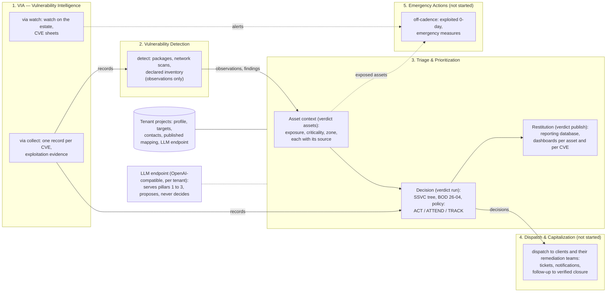
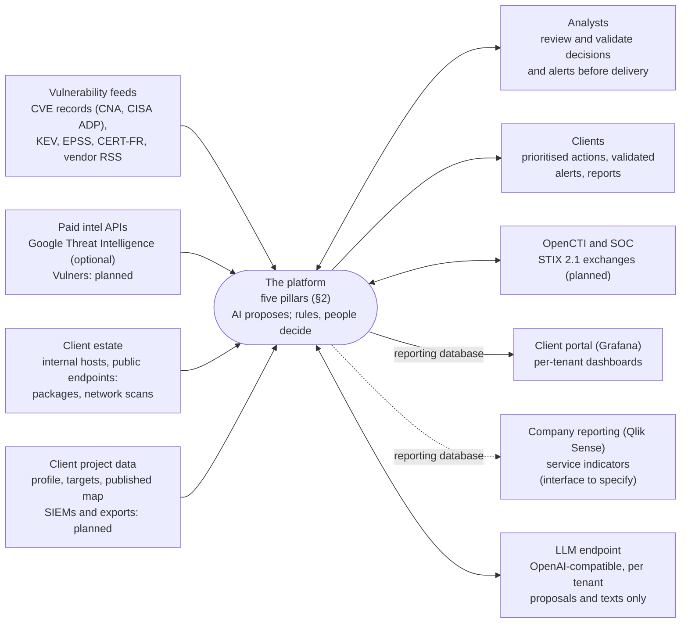
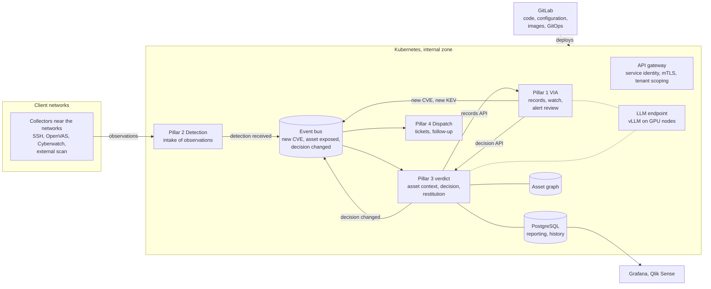

# AI-Assisted Vulnerability Management — Product strategy

Part of the high-level design (HLD); see [README.md](README.md) for the other chapters. This
chapter holds everything that binds the five pillars together: goals, constraints, context,
structuring decisions, contracts between pillars, AI strategy, deployment modes, cross-cutting
security and the overall roadmap. A pillar chapter details its own part and never contradicts this
one.

## 1. Vision and goals

The platform turns vulnerability intelligence and scanner findings into one prioritised,
explainable decision per client and finding, then into actions followed to closure. AI assists at
precise points; deterministic rules and people take every decision. It targets production use for
a managed vulnerability management service.

### Business goals

1. Aggregate vulnerability intelligence from multiple sources and cross-check exploitation evidence (pillar 1).
2. Confront that intelligence with each client's actual assets, internal and internet-exposed (pillar 2).
3. Produce one global SSVC decision per client and finding, with internal and external detections reconciled and the asset context made explicit (pillar 3).
4. Dispatch the resulting actions to the teams that remediate, follow them to verified closure and capitalise on them (pillar 4).
5. In a crisis, act outside the normal cadence with emergency measures across clients (pillar 5).
6. Keep the ideas reusable: client configuration kept outside the code, and a licence decided once the merge with the internal VERDICT project is settled.

### Quality goals (top 5)

| Priority | Quality goal | What it means here |
| --- | --- | --- |
| 1 | Confidentiality | Client data and TLP:RED/AMBER material go only to components and LLM endpoints approved for that client; on premises by default |
| 2 | Explainability | Every decision can be traced to its inputs and decision points |
| 3 | Determinism | Same inputs give the same decision; AI proposes or writes, never decides |
| 4 | Multi-tenancy | Strict separation between tenants: data, configuration and LLM endpoints |
| 5 | Operability | Reproducible, observable runs |

### Quality scenarios

Targets are set on the pilot client; until then the scenarios fix what is measured.

| Quality | Scenario | Measure |
| --- | --- | --- |
| Confidentiality | A pipeline runs on a client's data | No client data reaches a component or LLM endpoint not approved for that client; LLM prompts are not stored |
| Explainability | An analyst questions an ACT | Every input of the decision shows its source, assumed and AI-estimated values included |
| Determinism | The same run is replayed | Same records, assets, findings, policy version: same decisions |
| Timeliness | A daily run for a client | Duration of the run and time of publication, against targets set on the pilot |
| Detection quality | Past decisions are replayed against later exploitation | Share of TRACK or ATTEND findings exploited afterwards (false negatives) |
| Robustness | A hostile scanner export or an unreachable LLM | The input is rejected without side effect; the run ends with templates and flagged rows |

### Stakeholders

| Role | Expectation |
| --- | --- |
| Vulnerability management service lead | Product direction, delivery to clients |
| Pillar product owners | Scope and roadmap of each pillar |
| Analysts (production team) | Daily intel watch, monthly indicators, validated decisions |
| Clients | Prioritised, justified actions on their assets |
| SOC / CTI teams | STIX exchanges with OpenCTI and the SOC |
| Infrastructure and security teams | Hosting, network flows, DICT compliance |

## 2. Value chain

Five pillars, one chain: intelligence and detections converge on the asset context, Triage &
Prioritization decides and restitutes its decisions (reporting database, dashboards), Dispatch &
Capitalization dispatches the resulting actions to the clients and follows them up; Emergency
Actions short-cut the chain in a crisis.

| Pillar | Package and command | Role in the chain | Status | Chapter |
| --- | --- | --- | --- | --- |
| 1. Vulnerability Intelligence | `via` (`via.intel`, `via.alert`) | Knows every CVE and its exploitation; watches the estate | In development | [10-vulnerability-intelligence.md](10-vulnerability-intelligence.md) |
| 2. Vulnerability Detection | `detect` | States what is installed and exposed, without judging it | In development | [20-vulnerability-detection.md](20-vulnerability-detection.md) |
| 3. Triage & Prioritization | `verdict` (`verdict.assets`, `verdict.restitution`) | Holds the asset context, takes the only decision and restitutes it: reporting database, dashboards | In development | [30-triage-prioritization.md](30-triage-prioritization.md) |
| 4. Dispatch & Capitalization | — | Dispatches the actions to the clients and their remediation teams (tickets, notifications) and follows them to verified closure | Not started | [40-dispatch-capitalization.md](40-dispatch-capitalization.md) |
| 5. Emergency Actions | — | Acts outside the normal cadence in a crisis | Not started | [50-emergency-actions.md](50-emergency-actions.md) |

Status scale used throughout: Not started → In development → Pilot → In service.

## 3. Constraints

Confidentiality drives most constraints: client data and restricted intelligence go only where the
client has approved, and on premises by default, LLM inference included.

| Type | Constraint | Consequence |
| --- | --- | --- |
| Security | Client data is only sent to an LLM endpoint approved for that client; on premises by default | Any OpenAI-compatible endpoint can be used (vLLM, Ollama, Azure OpenAI…); in MSSP mode a client's own SaaS LLM requires its written approval and is configured for that client only (§9) |
| Security | TLP:RED/AMBER documents must not reach services outside the trusted perimeter | Restricted intelligence is processed on premises only; licensed content is never sent to an LLM |
| Security | DICT requirements built up progressively towards production | Security controls are part of each release, not a final phase |
| Network | The corporate proxy blocks some RSS and CSAF feeds, and possibly NVD | Intel collection runs from a DMZ host with its own outbound access |
| Network | Internet-facing scans must originate outside the corporate network | External scanning runs from a cloud host acting as a GitLab runner |
| Organisation | No interactive access to client CMDBs | Asset inventory is rebuilt from scanners, client exports and SIEM data |
| Platform | In production, GitLab holds code and configuration (code, tenant configuration, infrastructure as code, changes reviewed by merge request) and deploys them; it neither runs the per-tenant work nor stores its results | Every job and service runs on a container runtime (Kubernetes is the candidate, still to be validated); results go to the platform's databases |
| Data | Internal model is business-oriented; STIX only at interfaces | STIX mapping is confined to OpenCTI / SOC connectors |
| Legal | Proprietary for now; earlier versions were published under AGPL-3.0 | No distribution outside the authorised people until the licence is decided; copies of earlier versions keep their AGPL rights; ownership to be settled in writing with the employer before the merge |
| Cost | Google Threat Intelligence billed per request, Vulners per API call | Quotas and caching on paid sources |

## 4. System context

The platform consumes vulnerability intelligence, scanner results and client asset data, and
delivers decisions to analysts, clients, the SOC and dashboards. It calls an LLM endpoint approved
for each tenant.

| Partner | Direction | Exchanged | Interface | Status |
| --- | --- | --- | --- | --- |
| Public sources: CVE records (CNA and CISA ADP), CISA KEV, FIRST EPSS | In | Vulnerability records, exploitation evidence, EPSS | HTTPS, JSON | In place |
| Advisory feeds: CERT-FR, vendor RSS and CSAF | In | Advisories for the watch mode | RSS, CSAF | CERT-FR and RSS in place; CSAF partly |
| Google Threat Intelligence (licensed) | In; only CVE ids out | Exploitation state, exploit availability | REST API, API key | In place, optional |
| Vulners, NVD | In | Aggregated exploits, NVD enrichment | REST API | Not used today |
| Client internal hosts | In | Package inventories; internal network scan | Read-only SSH; network vulnerability scanner | In place |
| Client public endpoints | In | External network scan | Network vulnerability scanner run from the cloud | In place |
| Other scanners (Tenable, Qualys, Cyberwatch), client SIEMs and asset exports | In | Findings, assets | API, report import, SIEM queries | Planned |
| Client project (profile, targets, contacts, `published`) | In | Declared assets, attribute rules, scan targets, alert recipients | Files in the tenant's GitLab project | In place; `published` since v0.11.2 |
| LLM endpoint approved for the tenant | Out and back | Facts of one CVE and asset, kept in memory only; proposals and texts back (§8) | OpenAI-compatible HTTPS API: vLLM or Ollama on premises, Azure OpenAI (Azure AI Foundry), or the client's own LLM; chosen per deployment and recorded in its DAT | In place (on premises), optional |
| OpenCTI, SOC | In and out | CTI linked to CVEs; per-client STIX bundles | STIX 2.1, TAXII | Planned |
| Analysts | In and out | Review, alert validation, reports | GitLab interface, job artifacts | In place |
| Client contacts | Out | Validated alert mails, reports | SMTP relay, after analyst validation | In place |
| Client portal (Grafana) | Out | Reporting database: decisions, assets, deadlines, exposure gaps and totals of every run, per tenant | PostgreSQL, one read-only role per tenant; one Grafana organisation per tenant; never GitLab | In place: reporting database, overview dashboard and portal deployed by `deploy/portal` (v0.11.5); dashboards per asset and per CVE comparing snapshots (v0.11.6) |
| Company reporting tool (Qlik Sense) | Out | Same reporting database, for the company's service indicators | To specify: interface specifications not available yet (native PostgreSQL connection, or files delivered by a connector) | Planned, waiting for the interface specifications |
| SIEM of the platform | Out | Platform logs | Syslog | Target |

## 5. Structuring decisions

The platform is organised in five pillars, built from one code repository; GitLab is the control
plane, with projects per tenant holding their configuration and results, and orchestrates
per-tenant jobs, while tenant-independent pillars run as services. AI proposes and writes;
deterministic rules and people decide. Decisions that concern one pillar only are in its chapter.

| # | Decision | Rationale |
| --- | --- | --- |
| D1 | Single repository (`vulnops/a2vm`) for the common contract and all pillars | Shared data model and tooling; pillars evolve together |
| D2 | Projects per tenant, configuration outside the code repository | Tenant isolation, code reusable |
| D3 | In production, GitLab holds code and configuration and deploys them, nothing more: per-tenant batch jobs (pillars 2 and 3) and long-running services (pillar 1, later 4 and 5) run on a container runtime, scheduled there, and write their results to the platform's databases (reporting database first, history database next). In development and in the homelab, GitLab pipelines still run the jobs and keep their outputs as artifacts | Changes stay reviewed and traceable in GitLab while execution, scheduling and data leave it: GitLab is not sized nor secured as a data store, client data never sit in CI artifacts, and the runtime can be placed per deployment mode (MSSP datacenter, company cloud, client's private cloud) |
| D4 | SSVC decision points come from evidence (KEV, GTI, CISA ADP, CVSS, asset context); AI only proposes a missing one, flagged for review; a deterministic tree decides | Explainable, reproducible decisions; AI errors are visible inputs |
| D5 | Three delivery levels, ACT / ATTEND / TRACK, from the CISA Coordinator tree, the BOD 26-04 timelines and a policy configurable per client | Clients differ in the asset criticality and exposure data they provide |
| D6 | One global decision per client, internal and external detections reconciled | External scan collects only; the tenant project maps public endpoints to internal assets |
| D7 | Exposure uses SSVC values (open / controlled / small), with descriptive zones (dmz, lan…) kept alongside | Standard decision input without losing network context |
| D8 | LLM reached through an OpenAI-compatible API, endpoint configured per tenant | Model, engine and hosting interchangeable; confidentiality decided per client and deployment mode |
| D9 | Business-oriented internal data model, STIX only at interfaces | Simpler core, interoperability where needed |
| D10 | Asset context belongs to Triage & Prioritization: Detection supplies observations, Triage turns them into context (exposure, criticality, zone, each with its source) | The pillar that defines the model owns it; detection stays factual |
| D11 | AI proposes, never decides: every AI output is a proposal or a text, with a deterministic fallback, shown with its source and reviewed | Accountability stays with rules and people; the platform works without an LLM |
| D12 | Pillars are independent packages, each with its own command (`via`, `detect`, `verdict`); they depend only on the common contract (package `a2vm`) and never import one another; a capability needed across pillars is offered through an a2vm extension point | Each pillar can evolve, be owned and later be deployed on its own; a test enforces the rule |
| D13 | Client restitution through a Grafana portal that reads the reporting database only, with a read-only role per tenant; the portal runs on its own VM, always on, internal by default, its publication to the client decided per client | Clients get a readable view without access to GitLab; dashboards depend on a stable schema, not on the pipeline internals nor on GitLab; isolation per tenant is kept |
| D14 | Restitution is modular and independent of GitLab: each run publishes its reporting dataset (`reporting.json`) into a reporting database (PostgreSQL), one row set per run, so history and trends come for free; dashboarding and reporting tools read that database (Grafana first, Qlik Sense next), or receive files a connector derives from it. Restitution belongs to pillar 3, which takes the decisions it shows (`verdict.restitution`, since v0.11.6) | The dataset stays the single contract; a new tool means a new reader or connector, never a change of the pipeline; GitLab, which in production holds code and configuration only, is never on the restitution path; the pillar that decides answers for what the dashboards show |
| D15 | **Under evaluation.** Target architecture: each pillar runs as its own service on Kubernetes and exposes versioned APIs to the others (records by pillar 1, detection intake by pillar 2, decisions and asset context by pillar 3, actions by pillar 4); questions go through synchronous APIs, changes propagate as events on a message bus; collectors stay close to the client networks and push their results to the detection API; every request and event carries the tenant; a shared cluster with logical separation for the clients who accept it, otherwise a cluster per client, run by the MSSP or by the client itself; secrets in Kubernetes first, an HSM later; GitLab builds and deploys (GitOps) and the GitLab pipelines remain the mode for development and the homelab. Details: Target architecture below | One team per pillar delivers and runs its own service against a published contract; one decision service answers the daily run, the watch and the alert review tool alike, so they never disagree; events keep a pillar's outage from blocking the others; execution and client data leave GitLab (D3); the same charts serve a shared and a dedicated cluster, so the isolation is a choice per client, not a separate product. Open: the platform that runs the cluster, the message bus, the service mesh |

### Execution

- Each tenant project includes the pipeline template at a pinned A2VM tag: `validate` on every push; `collect → via → detect → assets → triage` on the daily schedule; `watch`, then the manual `send-alerts` (the analyst's validation), on a 10-minute schedule.
- Jobs fetch the A2VM code at that tag with their job token; the tenant project holds only its own data.
- A client with an internet exposure also has a collection-only external project, run by the cloud scanner; since v0.11.2 the internal pipeline pulls its latest detection and joins it to the internal assets, so one decision is taken per asset and CVE.
- Target (D3): GitLab deploys code and configuration to the container runtime; pillar 1 becomes a long-running service there (record API, collection and watch as scheduled tasks); the per-tenant jobs run there on their schedules and write to the reporting database. Since v0.12.0 the daily run of a tenant can run as a Kubernetes CronJob deployed from its project (`docs/kubernetes.md`); the watch and everything else run as GitLab pipelines, the mode kept for development and the homelab.

### Target architecture (under evaluation, D15)

| Building block | Runs as | Exposes | Notes |
| --- | --- | --- | --- |
| Pillar 1 VIA (VIA team) | Service; collection and watch as CronJobs | Records API (CVE records, changes since a date), alerts | Replaces the reference `via` package; the record schema stays the contract (§6) |
| Pillar 2 Detection | Intake service; per-tenant import jobs | Detection intake and read API | Collectors run where the networks are (internal runner, agents in client zones) and push; the cluster does not reach every client network |
| Pillar 3 verdict | Decision and asset-context service; per-tenant daily re-evaluation as CronJob | Decision API (`decisions:evaluate`), assets, findings | One decision function serves the batch run and the API; the asset context needs the history database (and the asset graph) |
| Pillar 4 Dispatch | Service | Actions, finding lifecycle | Not started |
| Shared platform | Gateway, identity, secrets, PostgreSQL (e.g. CloudNativePG), graph database, event bus (e.g. NATS JetStream), observability, LLM endpoint | — | Operated by a platform team or provided by the company's Kubernetes offer; secrets are Kubernetes Secrets at first, kept in an HSM-backed store later (see Tenant isolation) |

Rules of the target:

- **Contracts first**: each API has an OpenAPI specification and each event a JSON schema, kept in the common contract (`a2vm`), versioned (`/v1`; fields only added within a version) and published to the product documentation; teams test against them in their own CI (contract tests).
- **Synchronous for questions, asynchronous for propagation**: an API call answers a question (the decision for this asset, the record of this CVE); an event announces a change (new KEV, asset exposed, decision changed) to whoever subscribes.
- **Tenant everywhere**: every request and event carries the tenant; each service checks that the caller may act for it; databases keep row-level security; a namespace per tenant only for what holds the tenant's own secrets (scan credentials).
- **Client data stay in the internal zone**: requests to the decision and asset APIs carry client data; they never leave the cluster's internal zone, and only the LLM endpoint approved for the tenant receives them (§8).
- **No more microservices than pillars**: one service per pillar, split further only for a measured reason.

Tenant isolation, chosen per client:

| Mode | For | Isolation | Run by |
| --- | --- | --- | --- |
| Shared cluster | Clients who accept a logical separation | A namespace per tenant for its jobs and secrets, network policies between namespaces, tenant checked by every service, row-level security in the databases | The MSSP |
| Dedicated cluster | Clients who require a physical separation | A cluster for the client alone, with its own databases, bus and LLM endpoint | The MSSP in its datacenter, or the client in its own |

Both modes deploy the same charts at the same version; only the values differ. A dedicated
cluster at the client receives the images and the charts from the MSSP's GitLab (or a mirror)
and never sends client data back; the restitution it serves stays at the client.

Secrets (scan keys, database passwords, API tokens, LLM keys) are Kubernetes Secrets at first,
created by the deployment from the GitLab CI/CD variables of the tenant, never committed. An
HSM-backed store (key management service or a secrets manager backed by an HSM) comes later,
first for the dedicated clusters that ask for it; the services read a secret by name, so the
change of store does not touch them.

Migration, each step usable on its own:

1. **Same work, run by Kubernetes.** The CI of the code project builds one container image per
   pillar at every tag and publishes it to the GitLab registry. A chart `a2vm-tenant` deploys a tenant: CronJobs that run
   the same commands as the daily and watch pipelines, the tenant's profile and configuration from
   its project, its secrets as above, its working files on a volume instead of job artifacts. The
   chart is deployed by the GitLab agent from the tenant project. Run side by side with the
   pipeline on one tenant, outputs compared, then the pipeline's schedule is switched off.
   Execution leaves GitLab; the code does not change. Done in v0.12.0 for the daily run; the
   watch and the analysts' validation follow, once they no longer read the pipeline's inventory.
2. **Shared platform.** PostgreSQL in the cluster (reporting database and the future history
   database), the event bus, the observability stack; the reporting database may move from its
   VM into the cluster.
3. **The two APIs that unblock the most**: decisions (pillar 3, `a2vm.decision_request/1` →
   `a2vm.decision/1`) and records (pillar 1, VIA team); the watch asks verdict for the decision of
   each asset concerned instead of applying its own urgency rules; the daily run and the watch
   call the same decision service.
4. History database and asset graph; asset and finding APIs.
5. Event bus in use: one shared intelligence service publishes new records and KEV changes for
   every tenant; collectors near the client networks publish their observations; re-evaluation
   and dispatch are driven by events.
6. The GitLab pipeline mode stays for development and the homelab: same code, two ways to run it.

The platform part was proven on a homelab cluster in October 2026: three control-plane nodes and
one worker (RKE2), Ceph storage through Rook, a load balancer and an ingress controller, internal
certificates by cert-manager, and a first deployment by a GitLab pipeline through the GitLab
agent.

## 6. Contracts between pillars

### Common data model

| Object | Role | Produced by | Consumed by |
| --- | --- | --- | --- |
| Vulnerability record | Everything known about one CVE: description, CWE, CVSS, affected products, CISA ADP decision points, KEV, EPSS, GTI view | Pillar 1 | Pillars 2, 3, 5 |
| Asset observation | One sighting of an asset by one source | Pillar 2 | Pillar 3 (asset context) |
| Asset | One consolidated element of a client's estate, each attribute with its source | Pillar 3 (asset context) | Pillar 3 (decision), pillars 1, 4, 5 (read only) |
| Finding | One asset affected by one CVE, one observation per source and package; stable id `<client>:<asset>:<CVE>` | Pillar 2, re-keyed by pillar 3 | Pillars 3, 4 |
| Decision | The verdict on a finding: level, SSVC outcome, timeline, each input with its source, rationale, review flag | Pillar 3 | Reports, pillar 4, indicators |

Every field carries its source (kev, gti, cisa-adp, scanner, declared, rule, llm, default), so an
estimated or assumed value stays visible end to end; the schemas are JSON Schema, versioned in the
repository and checked in CI. The model aligns on CVE JSON 5, VEX statuses, OCSF Vulnerability
Finding and CISA SSVC; STIX 2.1 is used only at the interfaces.

A change to an object of this table is a change to this chapter: it is reviewed by the product
owner of every pillar that produces or consumes it.

### Shared building blocks

| Block | Responsibility | Status |
| --- | --- | --- |
| `core` | Common model, JSON schemas, settings, LLM client and its output guard | In development |
| Tenant projects | Per-tenant data: profile, targets, contacts, `published` mapping, LLM endpoint; results as job artifacts | In development |
| Connectors | STIX 2.1 to OpenCTI and SOCs | Not started |
| Reporting database | PostgreSQL: one schema of tables (runs, decisions, assets, deadlines, exposure gaps) filled from each run's `reporting.json`, kept across runs; a read-only role per tenant, row-level security on the tenant | In place (v0.11.5); pillar 3 (`verdict.restitution`) and schema version 2 since v0.11.6 |
| Portal deployment | Infrastructure as code: Terraform creates the portal instance and its security group (Scaleway first, a module per cloud provider); cloud-init installs PostgreSQL, Grafana and the HTTPS proxy in containers; secrets generated on the instance (`deploy/portal/`) | In place (v0.11.5) |
| Restitution | Grafana dashboards shipped with A2VM, reading the reporting database: overview of a client, which assets to fix first, which CVEs to fix first (snapshots compared, filters); Qlik Sense through its PostgreSQL connection or a file connector, once specified | Overview (v0.11.5), per asset and per CVE (v0.11.6); Qlik Sense waiting for its interface specifications |
| Client portal | Grafana, one organisation per tenant, reading the reporting database | Demo in place (v0.11.5) |

## 7. Tenant and client context

The same CVE does not call for the same action at two clients: what makes a decision
client-specific is the context the platform holds about each client. That context is client data,
kept in the tenant's projects, never in the code repository. The unit that holds it is the tenant:
the isolation boundary of the platform for configuration, context, data, results and LLM endpoint.
In MSSP mode each client is one tenant, or several when its entities must stay apart; in
self-hosted mode the platform usually has a single tenant.

| Level | What is known | Main uses |
| --- | --- | --- |
| Client | Deployment mode, approved LLM endpoint, delivery expectations (cadence, contacts, alert recipients, reporting language), decision policy (escalations, timelines adopted) | All pillars; pillar 3 policy; pillar 4 dispatch |
| Perimeter | Internal and external scan targets, public endpoints mapped to internal assets (`published`), zones | Pillar 2 collection; pillar 3 reconciliation |
| Asset | Exposure, mission and well-being impact, zone, owner — detailed in [30-triage-prioritization.md](30-triage-prioritization.md) | Pillar 3 decision; pillar 4 routing; pillar 5 impacted-client list |
| Watchlist | Products and technologies the client wants watched, whether detected or not | Pillar 1 watch and alerts |
| Exceptions | Accepted risks, each with justification, approver and expiry date | Pillar 3 decision; pillar 4 follow-up |

Principles:

- Context is collected at onboarding (delivery sheet) and kept as code in the tenant project: every change goes through a merge request reviewed by the context qualifier role (§10 Roles).
- An assumed value is never hidden: the decision and the report show which inputs rest on a default.
- A client with little context still gets decisions; providing more context makes them more precise, never less safe.
- Pillars 1, 4 and 5 read the context; only pillar 3 (asset context) consolidates it.

## 8. AI strategy

AI assists at four points in the current implementation, all optional; each pillar chapter lists
its own use cases. The invariants below apply to every current and future use case, in every
pillar.

| Pillar | Use cases | Status |
| --- | --- | --- |
| 1. Intelligence | CVE sheet prose; translation into the tenant's reporting language | In development; translation not started |
| 2. Detection | Product match proposal | Proposal only since v0.11.2 |
| 3. Triage & Prioritization | Missing SSVC inputs; rationale | In development |
| 4. Dispatch & Capitalization | Ideas: remediation instructions or tickets, capitalisation summaries | Not started |
| 5. Emergency Actions | Idea: crisis communications | Not started |

Invariants:

- AI proposes or writes; it never decides. The SSVC tree and the policy are deterministic, and a proposal becomes a fact only through review.
- Every use case has a deterministic fallback; the platform works without an LLM.
- Vendor text is untrusted: passed as data only, and the model has no tools.
- Every AI output is marked as such, with the model, and checked against a schema or a guard before reaching a report.
- Licensed content (Google Threat Intelligence) is never sent to an LLM.
- Client data goes only to the LLM endpoint approved for that tenant (§3, §9).
- The model is recorded with each run; prompts are not stored, as they carry client data.

## 9. Deployment modes

The platform is deployed in one of two modes. Detailed sizing, addressing and flows belong to the
DAT of each deployment.

| | MSSP mode (the service operates the platform for its clients) | Self-hosted mode (a client operates the platform) |
| --- | --- | --- |
| Who operates | The vulnerability management service | The client |
| LLM endpoint | Chosen by the service, on premises by default; the client's own SaaS LLM only with its written approval (contract or delivery sheet) | Chosen by the client, under its responsibility |
| Isolation | One endpoint configured per tenant (CI variable); a tenant's data never reaches another tenant's endpoint or an endpoint it has not approved | Single tenant |
| Where it is recorded | MSSP DAT and the tenant project configuration | The client's DAT |
| Hosting options | MSSP datacenter (confidentiality, shared platform; network flows to each client) or company cloud zone (elastic runners; confidentiality review per client) | At the client (data never leaves the client; one platform per client to operate) |

### MSSP reference deployment

The work target spreads the platform over four zones: intel collection in the public DMZ, GitLab
in the internal zone, inference on GPU capacity operated by the service, and development and
external scanning in the cloud.

| Zone | Components | Why there |
| --- | --- | --- |
| Public DMZ | Intel VM (fetches, mirrors and signs public data; read by the internal runner); reverse proxy publishing GitLab with a client certificate | Direct outbound access to feeds blocked by the corporate proxy; cloud runners reach GitLab only through the proxy |
| Internal zone | GitLab (code + tenant projects), internal runner(s) | Client data stays on premises |
| Internal zone — portal | Client portal VM (Grafana) and the reporting database (PostgreSQL), always on; the jobs write to the database, Grafana and the company's reporting tool read it; nothing reads GitLab | Internal by default for cost; per client, published through the reverse proxy, or hosted at the client in self-hosted mode — the client decides |
| AI inference | Default LLM endpoint (OpenAI-compatible API) on GPU capacity operated by the service, on premises or in the cloud; reached only by the internal runner | Hardware and hosting chosen in the DAT on cost and confidentiality |
| Cloud | Development and qualification VMs; external scanner host acting as a GitLab runner | Internet-facing scans originate outside the corporate network |

## 10. Cross-cutting concerns

Security and AI governance apply to every pillar; each pillar chapter and LLD details how its
pillar implements them.

| Concern | Principle |
| --- | --- |
| Tenant isolation | GitLab projects per tenant; runners, tokens and LLM endpoint scoped per tenant; no cross-tenant data in the code repository |
| Secrets | API keys (Google Threat Intelligence, Vulners, scanners, SIEM, LLM endpoints) stored as protected, masked CI/CD variables of type File or in a vault — never in Git |
| Data classification | TLP marking carried on intel items; TLP:RED/AMBER material processed on premises only; client data sent only to the LLM endpoint approved for that tenant |
| Network | Least-privilege flows between zones; in the MSSP reference deployment only the internal runner reaches the inference API |
| AI governance | The invariants of §8 |
| Traceability | Every decision stores each input with its source, the SSVC outcome, the BOD 26-04 timeline, the policy steps and where its rationale comes from; results kept as job artifacts (30 days), history database planned |
| Observability | Pipeline status and duration, source availability, LLM latency and error rate |
| Interoperability | STIX 2.1 export to OpenCTI and the SOC; dashboards and reporting tools fed by restitution connectors from the reporting dataset only (Grafana for the client portal; Qlik Sense for the company's indicators) |
| Backup | GitLab backup covers code and configuration; the platform's databases (reporting, then history) have their own backups; until production, job artifacts hold the results |
| Confidentiality of the repository | No real infrastructure names or client identifiers in the code repository or its history |
| External lookups | Only deduplicated keys free of client data leave towards an external source (CVE ids; product and version pairs at most), never a per-asset inventory; since the source address can identify the client, this residual risk is accepted explicitly per source |
| Roles | Reader, remediator, context qualifier, risk approver, policy maintainer (proposes, never applies alone), administrator without access to client data, auditor; approver and maintainer are never the same person. Mapped onto GitLab roles, protected branches and CODEOWNERS in the DAT |
| Reporting | Self-hosted dashboards only (the Grafana client portal, one organisation per tenant; the company's Qlik Sense for internal indicators); aggregates by default, detail only for the entity concerned; tools read the reporting database through read-only roles, one per tenant, and recompute no metric; public sharing disabled; a tenant's data goes only to a tool approved for that tenant |

## 11. Roadmap, risks and open points

### Roadmap

Target: production within about three months (from October 2026), security built up release by
release.

| Step | Content | Pillars |
| --- | --- | --- |
| v0.11.2 | External detection pulled by the tenant project and joined through the profile's `published` endpoints (exposure `open`, source `external-scan`); the watch reads the last daily inventory and the alert sheet lists the client's assets concerned (zone, exposure, installed and fixed versions, owner, source, inventory date); fuzzy product match by the LLM is a proposal only, never a drop | 1, 2, 3 |
| v0.11.1 | CI/CD variables renamed `VULNOPS_*` → `A2VM_*` (the old names are still read, with a warning, until a later version); client alert mails titled `[CERT Alert]` | All |
| v0.11.0 | Project renamed A2VM: GitLab project `vulnops/a2vm`, common contract package and command `a2vm`; GitLab group, CI/CD variables (then `VULNOPS_*`), exchange-file identifiers and scan accounts unchanged | All |
| v0.10.0 | Repository organised by pillar: `vulnops` (common contract), `via`, `detect`, `verdict`, each with its own command; no functional change | All |
| v0.11.3 | Reporting dataset for the client portal (`reporting.json`); analysts choose which alerts are sent (`A2VM_SEND_ONLY`), alert number and id in the analysts' mail, journal of the alerts and trace of the mails sent; mail test job; validate checks the include ref against `A2VM_REF`; a watch source is in error only after several failed runs in a row; CISA advisories read as CSAF; the watch reads the daily inventory from the runner cache; external detection read with a project access token (GitLab CE) | 1, 3 |
| v0.11.4 | Exposure gaps listed in the report and the reporting dataset; alert sheet as a Word file from a template per client (tags), sent to the client as Word or as a PDF made from it; analysts edit a sheet (text or Word) in the client project before sending | 1, 3 |
| v0.11.5 | Restitution (D14): reporting database (PostgreSQL) filled by a `publish` job from each run's dataset, with history and a reading role per tenant; Grafana dashboard; portal deployed as code (Terraform, cloud-init); D3: in production GitLab holds and deploys code and configuration only | 3 |
| v0.11.6 | Restitution moved to pillar 3 (`verdict publish`, `verdict db`, `verdict grafana`; package `dispatch` removed, the name kept for pillar 4); Grafana dashboards "which assets to fix first" and "which CVEs to fix first": filters, a snapshot compared with an earlier one, decision × severity matrix with KEV; each decision carries its CVSS rating, fix availability, product type and detection sources (database schema version 2); reporting connection as a maskable URI; LLDs of pillars 1 and 2 | 1, 2, 3 |
| v0.11.7 | Decision chain, CISA Coordinator and BOD 26-04 trees drawn in the triage LLD from the SSVC tables themselves; documentation published to a product project on every tag (`sync-product-docs`); code project path and runner tags as group variables for another GitLab layout; fictitious tenant `examples/demo-industrie`; `CLAUDE.md` for contributors | 3 |
| v0.12.1 (current) | Pillar images built with Buildah on a dedicated build runner (project runner of the code project, protected, shell executor, rootless): the tenants' runner stays unprivileged | All |
| v0.12.0 | D15 step 1: one container image per pillar built at every tag (`images`, GitLab registry); chart `a2vm-tenant` running the daily run as a Kubernetes CronJob, one container per step in the image of its pillar, deployed from the tenant project by the job `deploy-k8s` through the GitLab agent, secrets copied from the CI/CD variables; the watch stays in GitLab (`docs/kubernetes.md`) | All |
| Next (to confirm) | Client portal VM (Grafana) in service; history database and finding lifecycle; decision API (D15 step 3) | 1, 3, 4 |
| Then (to confirm) | Dispatch & Capitalization; Emergency Actions | 4, 5 |
| v1.0 (target) | The architecture of D15 in production: each pillar a service on Kubernetes with its APIs and events, the decision service of pillar 3 shared by the daily run, the watch and the alert review, collectors near the client networks; the GitLab pipeline mode kept for development | All |

### Risks

| Risk | Mitigation |
| --- | --- |
| AI proposes a wrong decision point or product match | Proposal flagged and justified, analyst validation before delivery, regression set of known CVEs |
| Client data sent to a non-approved LLM endpoint | Endpoint configured per tenant, approval recorded in the DAT, no default cloud endpoint |
| Incomplete asset data from clients | Per-client decision tree with safe defaults when criticality or exposure is unknown |
| Feed outages or blocking | Multi-source collection, source health monitoring |
| Cost drift on paid APIs | Quotas, caching, per-client usage reporting |
| GitLab as single execution backbone (until production) | GitLab backup and restore tested; runners rebuildable from code; D3 moves execution and data to the runtime and the databases |
| Cross-tenant data leak | Project isolation, scoped tokens and endpoints, review of shared artefacts |

### Open points

- Hosting option per client within the MSSP mode: MSSP datacenter or company cloud zone
- Container runtime for the services: Kubernetes is the candidate (D15, under evaluation); settled: a shared cluster for the clients who accept a logical separation, a dedicated cluster (MSSP or client) otherwise; Kubernetes Secrets first, an HSM-backed store later; to settle: who runs the shared cluster (company platform or a team of the service), the message bus (e.g. NATS JetStream, Kafka, or PostgreSQL-based queues at first), the service mesh or network policies, the GitOps tool beyond the GitLab agent, how a dedicated cluster at a client receives updates
- Client portal: publication per client (internal only, through the reverse proxy, at the client) and how clients authenticate
- Qlik Sense connector: interface specifications (file or API, format, frequency, authentication, who operates the load); some perimeters have no Qlik Sense instance, where the Grafana portal remains the only restitution
- Production execution (D3): the per-tenant jobs become Kubernetes CronJobs deployed from the tenant project by a chart (D15 step 1); still open: the move of the alert journal and the analysts' validation out of GitLab
- Points on hold from the review of another internal architecture document, to settle with its team

Open points of a single pillar are in its chapter.

## 12. Glossary

| Term | Meaning |
| --- | --- |
| AI-Assisted Vulnerability Management | The product described here |
| A2VM | AI-Assisted Vulnerability Management (the "2" stands for the two A of AI-Assisted): the product, its GitLab project (`vulnops/a2vm`) and its common contract package (`a2vm`), on which every pillar depends |
| vulnops | Name of the GitLab group that holds the A2VM project and the tenant projects (CI/CD variables: `A2VM_*`, formerly `VULNOPS_*`) |
| VIA (VIA³) | Vulnerability Intelligence: Advanced, AI-assisted, Alerting. Package and command of pillar 1 (`via`), covering intel and alert |
| Pillar | One of the five functional areas of the platform: Vulnerability Intelligence, Vulnerability Detection, Triage & Prioritization, Dispatch & Capitalization, Emergency Actions |
| Tenant | Isolation boundary of the platform: configuration, context, data, results and LLM endpoint of one client, or of one of its entities; a self-hosted platform usually has a single tenant |
| MSSP mode / self-hosted mode | The platform operated by the service for its clients / by a client for itself |
| SSVC | Stakeholder-Specific Vulnerability Categorization — decision tree producing an action priority |
| ACT / ATTEND / TRACK | The three delivery levels: remediate now / plan the remediation / monitor |
| Decision point | One SSVC input: exploitation, automatable, technical impact, mission and well-being (CISA Coordinator); in KEV and publicly exposed (BOD 26-04) |
| Verdict | Package and command of the Triage & Prioritization pillar, and its per-client output |
| Asset context | Part of pillar 3 (`verdict.assets`, command `verdict assets`) that turns observations into one inventory per tenant, each attribute with its source |
| KEV | CISA Known Exploited Vulnerabilities catalogue |
| EPSS | Exploit Prediction Scoring System — probability of exploitation |
| CSAF | Common Security Advisory Framework — machine-readable advisories |
| STIX | Structured Threat Information eXpression — CTI exchange format |
| TLP | Traffic Light Protocol — sharing restrictions (RED, AMBER, GREEN, CLEAR) |
| DICT | Availability, Integrity, Confidentiality, Traceability |
| `published` | Tenant-project section mapping public endpoints to internal assets |
| Snapshot | The state shown by the dashboards for a day: for each client chosen, its latest run on or before that day; two snapshots are compared to show the change |
| Exposure (dashboards) | One CVE on one asset, i.e. one finding; the per-asset dashboard counts exposures, the per-CVE dashboard distinct CVEs |
| Exposure | SSVC System Exposure of an asset: open (reachable from the internet, "publicly exposed" for BOD 26-04), controlled, small; recorded with its source (declared, rule, scanner, external scan, assumed) |
| BOD 26-04 | CISA directive whose SSVC table gives remediation timelines (3, 14 or 60 days, or at the next upgrade) from KEV listing, public exposure, automatability and technical impact |
| Finding | One asset affected by one CVE, merged across the sources that saw it |
| Zone | Free label of an asset's network place (dmz, lan, ot...), for reports only |
| LLM endpoint | An OpenAI-compatible API serving a language model, approved per tenant |
| Client portal | Grafana instance showing each client its own dashboards, fed only by the reporting dataset |
| Reporting dataset | `reporting.json`: the versioned file of one tenant and run that restitution tools read (LLD triage §12) |
| Reporting database | PostgreSQL store of the reporting datasets of every run and tenant, read by the dashboarding and reporting tools (Grafana, Qlik Sense) through read-only roles |
