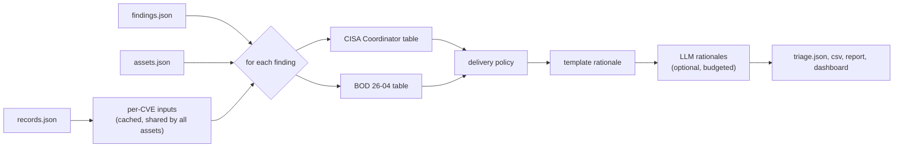

# Triage & Prioritization — low-level design

| Item | Value |
| --- | --- |
| Building block | Pillar 3 package `verdict` (command `verdict`): Decision (`verdict run`) and Asset context (`verdict.assets`, `verdict assets build`) |
| Status | v0.11.0 as built (decision logic unchanged since v0.9.0); later changes marked **Planned (v0.11.2)** or **Planned (v0.11.3)** |
| Place in the set | C4 level 3 of pillar 3 of the HLD ([`../hld/30-triage-prioritization.md`](../hld/30-triage-prioritization.md)); this version covers its Decision block (`verdict run`), the Asset context block (`verdict.assets`) is to be added. Goals, constraints and contracts: HLD. Servers, zones and flows: DAT |
| Code | `verdict/src/verdict/`, shared model in `a2vm/src/a2vm/models.py` |

This document says how verdict turns findings into decisions: its inputs and outputs, the rules
and their order, the defaults, the configuration, the failure modes and the tests. It is updated
in the same merge request as the code it describes.

## 1. Scope

verdict takes one decision per finding (one asset affected by one CVE) of one client and explains
it. It collects nothing: vulnerability records come from the intel stage, assets and findings from
the assets stage.

| verdict does | verdict does not |
| --- | --- |
| Compute the SSVC decision points of each CVE, with the source of each value | Fetch CVE records, KEV, EPSS or GTI (intel) |
| Read the asset attributes (exposure, mission, well-being, owner) set by the assets stage | Reconcile asset observations or set attributes (assets) |
| Apply the CISA Coordinator table, the BOD 26-04 table and the delivery policy | Match products or versions to CVEs (detect) |
| Flag rows that rest on an assumption or an estimate for analyst review | Send anything to the client (alert, after validation) |
| Write a rationale per decision, by template or by the local LLM | Keep a history between runs (planned with the history database, roadmap P1) |

The decision is deterministic: the same records, assets, findings and settings give the same
decisions. The LLM never decides (section 7).

## 2. Interfaces

### 2.1 Command

```text
verdict run <client.yaml>... [--settings config/settings.yaml] [--records work/records.json]
            [--assets work/assets] [--out output] [--no-llm]
```

| Exit code | Meaning |
| --- | --- |
| 0 | Every client was triaged (rows may still be flagged for review, or carry errors) |
| 2 | A profile, the records file or a client's assets or findings file is missing or invalid, or the files belong to another client |

One line per client on stdout: counts per decision, rows to review, errors, ignored CVEs, LLM calls and
fallbacks, output directory. LLM fallbacks are listed on stderr (first 20).

In the client pipeline, the `triage` job runs `verdict run "$A2VM_PROFILE" --settings
"$SETTINGS" --records work/records.json --assets work/assets --out output`.

### 2.2 Inputs

| File | Producer | Content | Schema |
| --- | --- | --- | --- |
| `client.yaml` | Client project | Profile: id, declared assets, attribute rules, default assumptions | `client_profile.schema.json` |
| `work/records.json` | intel | One `VulnRecord` per CVE requested, plus per-CVE errors | `vulnerability_records.schema.json` |
| `work/assets/<client>/assets.json` | assets | Consolidated assets with their attributes and the source of each | `assets.schema.json` |
| `work/assets/<client>/findings.json` | assets | Findings re-keyed to consolidated assets, and the declared assets found not affected | `findings.schema.json` |

All files are read through `a2vm.io`; a file whose client id differs from the profile's is
rejected (exit 2).

### 2.3 Outputs

Written to `<out>/<client id>/<YYYY-MM-DD>/`:

| File | Content | Reader |
| --- | --- | --- |
| `triage.json` | Every `TriageRow` in full, not-affected assets, errors, ignored CVEs, LLM model | Tools, history database (P1) |
| `triage.csv` | One row per CVE and asset, `;`-separated: decision, CVE, asset, owner, exposed, KEV, EPSS, CVSS, SSVC outcome, BOD timeline, exploitation, version status, affected versions, needs review, rationale | Analysts, spreadsheets |
| `report.md` | French report: counts, work per asset, ACT detail, ATTEND table (200 CVEs at most; rationales when 30 CVEs or fewer), not-affected assets, errors | Analysts, client after review |
| `dashboard.html` | Self-contained French dashboard | Analysts, client after review |
| `reporting.json` — **Planned (v0.11.2)** | Reporting dataset of the run, the only file the client portal reads (section 12); also copied to `<out>/<client id>/reporting.json` so that its path never changes | Client portal (Grafana) |

Rows are sorted ACT, ATTEND, TRACK, then by decreasing EPSS, CVE id and asset.

### 2.4 Main fields of a decision (`TriageRow`)

| Field | Values | Set from |
| --- | --- | --- |
| `exploitation`, `automatable`, `technical_impact` | `Assessed` (value, source, note) | Section 4.1 |
| `mission_wellbeing` | `low`, `medium`, `high` (`Assessed`) | Section 4.2 |
| `publicly_exposed` | bool | Asset `exposure` (section 5) |
| `ssvc_decision` | `track`, `track*`, `attend`, `act` | CISA Coordinator table |
| `bod_timeline` | `fix on system upgrade`, `60 days`, `14 days`, `3 days`, `3 days & forensic investigation` | BOD 26-04 table |
| `delivery_decision` | `ACT`, `ATTEND`, `TRACK` | Delivery policy (section 4.4) |
| `reasons` | French strings | First the SSVC mapping, then each escalation that fired |
| `needs_review`, `review_reasons` | bool, French strings | Section 4.5 |
| `assumptions` | French strings | Asset attributes taken from a default |
| `fixes` | `<package> <fixed version>` | Scanner observations |
| `rationale`, `rationale_source` | text; `template`, `llm (<model>)` or `template (<why>)` | Section 7 |
| `exposure`, `exposure_source`, `zone` | `open`, `controlled`, `small`; where it comes from; free label | Section 5 |

`publicly_exposed` is kept, derived from `exposure`. `triage.csv` carries `exposure`,
`exposure_source` and `zone`; the report's per-asset table shows them, e.g. "dmz · ouverte
(Internet), règle".

## 3. Processing



1. Read settings, profiles and records. With `--no-llm` or `llm.enabled: false`, no LLM client is
   created.
2. Per client: read assets and findings, reset the LLM budget, collect the scanner CVSS vectors
   (first `CVSS:` vector seen per CVE among the findings' observations).
3. Per finding: skip and count it when its CVE has no record (one error per CVE at the end); fail
   when its asset is unknown (a defect of the assets stage); otherwise compute the per-CVE inputs
   once (section 4.1) and the row (sections 4.2 to 4.5).
4. LLM rationales for the rows the settings select (section 7), then sort and write.

## 4. Decision model

### 4.1 Per-CVE decision points

Computed once per CVE and reused for every asset and client of the run.

| Decision point | Values | Sources, in order | When nothing is known |
| --- | --- | --- | --- |
| Exploitation | `none`, `poc`, `active` | Every source with an opinion; the highest value wins, a source never lowers another; ties go to the first listed: CISA KEV (`active`), GTI, CISA ADP (Vulnrichment), a reference tagged `exploit` (`poc`, flagged for review) | `none`, flagged for review |
| Automatable | `yes`, `no` | CISA ADP; else the CVSS heuristic on the record's best vector (CNA first, newest version), else on the scanner's vector (a v4 or v3 vector before a v2 one); else the LLM (flagged) | `yes` if `policy.unknown_inputs: conservative`, `no` if `optimistic`; flagged |
| Technical Impact | `partial`, `total` | Same as Automatable, from the same source | `total` / `partial`, same rule; flagged |

GTI is read through `a2vm.gti.ssvc_exploitation`: confirmed or wide exploitation gives
`active`; a publicly available or trivial exploit gives `poc`; reported or suspected exploitation
gives no value and flags the row for review unless another source already says `active`.

CVSS heuristic:

| Vector | Automatable `yes` when | Technical Impact `total` when |
| --- | --- | --- |
| CVSS 3.x | `AV:N`, `AC:L`, `PR:N`, `UI:N` | `C:H` and `I:H` |
| CVSS 4.0 | `AV:N`, `AC:L`, `AT:N`, `PR:N`, `UI:N` | `VC:H` and `VI:H` |
| CVSS 2.0 (scanner only, old CVEs) | `AV:N`, `AC:L`, `Au:N` (v2 has no user-interaction metric) | `C:C` and `I:C` |

A value taken from the heuristic is flagged for review: the heuristic is a stand-in for the CISA
assessment, not an equivalent.

### 4.2 Per-asset decision points

| Decision point | Rule |
| --- | --- |
| Mission and Well-Being Impact | `high` if `mission_prevalence` is `essential` or `public_wellbeing_impact` is `irreversible`; `low` if both are `minimal`; `medium` otherwise (including `minimal` mission with `material` well-being, which CISA leaves undefined) |
| Publicly exposed (BOD 26-04) | `exposure == open` (section 5) |

The asset attributes are set by the assets stage, first source wins: the profile declares it, a
profile rule matches the host name, FQDN or address, a scanner reported it, or the default
assumption (the profile's `defaults`, else the built-in worst case: `internet`, `essential`,
`minimal` well-being, owner unknown). A default is named in `assumptions` and flags the row.

### 4.3 SSVC tables

Both tables are the CERT/CC SSVC data files, shipped unchanged in `verdict/data/` with their
licence, and checked for completeness when loaded:

| Table | File | Inputs | Rows |
| --- | --- | --- | --- |
| CISA Coordinator v2.0.3 | `cisa_coordinator_2_0_3.csv` | Exploitation × Automatable × Technical Impact × Mission and Well-Being | 36 |
| CISA BOD 26-04 v1.0.0 | `cisa_bod_26_04_1_0_0.csv` | In KEV × Publicly Exposed × Automatable × Technical Impact | 16 |

The file's `public poc` is read as `poc`. Updating a table means replacing the file with a newer
CERT/CC version, in its own merge request, with the test expectations reviewed.

### 4.4 Delivery policy

The client report uses three levels. The policy turns the two SSVC outcomes into one level, in this
order, each step recorded in `reasons`:

| Step | Rule (setting) | Default |
| --- | --- | --- |
| 1 | Map the Coordinator outcome (`policy.decision_mapping`) | `act` → ACT, `attend` → ATTEND, `track*` → ATTEND, `track` → TRACK |
| 2 | BOD timeline starting with `3 days` → ACT (`escalations.bod_3_days_to_act`) | on |
| 3 | BOD timeline `14 days` and level TRACK → ATTEND (`escalations.bod_14_days_min_attend`) | on |
| 4 | EPSS ≥ threshold and level TRACK → ATTEND (`escalations.epss_attend_threshold`, `null` disables) | 0.1 |

The policy only raises a level; nothing lowers one. EPSS can move a row from TRACK to ATTEND and no
further.

### 4.5 Review flags

A row needs review when any of these holds, and each reason is listed in French:

- an exploitation value from a tagged reference, or no exploitation source at all;
- an unconfirmed exploitation report from GTI;
- Automatable and Technical Impact from the CVSS heuristic, the LLM or the policy default;
- a reason carried by the finding (e.g. a fuzzy product match kept without LLM confirmation, or
  a generic OpenVAS test citing many CVEs for an unidentified product);
- up to three asset attributes taken from a default.

Review does not change the decision: a flagged ACT stays ACT. The flag tells the analyst which
input to confirm before the report goes to the client.

## 5. Exposure

### 5.1 Model

| Attribute | Values | Use |
| --- | --- | --- |
| `exposure` | `open`, `controlled`, `small` (SSVC System Exposure) | `open` is "publicly exposed" for the BOD 26-04 table |
| `exposure_source` | `external-scan`, `declared`, `rule`, `<scanner>`, `assumed` | `assumed` flags the row; shown in the report |
| `zone` | free label (`dmz`, `lan`, `ot`, `admin`...) | Grouping and sorting in reports only |

Definitions, from SSVC: `open` — reachable from the internet or another widely accessible network,
access cannot plausibly be restricted; `controlled` — networked, access restricted or protected by
measures that reliably interrupt an attack; `small` — local service, or a highly controlled or
isolated network.

Compatibility: the profile schema accepts the former values, read as `internet` → `open`,
`internal` → `controlled`, `isolated` → `small` when the profile is loaded; `vulnops
validate` (the `validate` job) prints one deprecation warning per former value. The assets stage
and the alert stage apply the same reading to any value that bypasses the loader. The built-in
default is `open`, source `assumed`.

`zone` is set by a declared asset or a profile rule (`set: {zone: dmz}`), first match wins as for
the other attributes; it never defaults and has no effect on decisions.

Exposure feeds the BOD table only; the CISA Coordinator table has no exposure input. The value is
kept as SSVC defines it so that the CERT/CC deployer table, which uses System Exposure, can be
added later without changing the data.

### 5.2 Precedence

v0.9.0: `declared` > `rule` > `<scanner>` > `assumed`. **Planned (v0.11.2):** `external-scan` first.

An external scan only proves reachability: it can set `open`, never lower a value. An asset the
external scan does not reach keeps its declared value; absence from a scan is not evidence (source
filtering, scan window, host down).

### 5.3 External detection and published endpoints — **Planned (v0.11.2)**

The external scan runs in the client's `<client>-external` project, collection only (DAT,
"Exposure and external scans"). The internal pipeline brings its result in before the assets
stage:

1. The internal client project names the external project in a CI/CD variable,
   `A2VM_EXTERNAL_PROJECT`. The `collect` job downloads the latest successful `collect` artifact
   of that project's default branch with its job token (the external project allows the internal
   one in its job token allowlist).
2. The detection is accepted when its client id is the one the profile declares in
   `external.client`, and when it is younger than `external.max_age_days` (default 8). Otherwise
   the job ends in warning (exit 3) and the run goes on without it.
3. The assets stage maps each external host to an internal asset through the profile's
   `published` section:

   ```yaml
   external:
     client: example-external
     max_age_days: 8
   published:
     - endpoint: "www.example.org:443"   # host or address, optional port
       asset: rproxy01                   # declared asset that answers on the internet
       behind: [app01]                   # assets reached through it
       zone: dmz
   ```

   The observations of an external host matching `endpoint` join `asset`. `asset` and every asset
   in `behind` get `exposure: open`, source `external-scan`. Findings then merge with the internal
   ones on the same asset and CVE (one finding, observations from both sources), so verdict sees
   one row per asset and CVE.
4. An external host that matches no `published` entry becomes its own asset, `exposure: open`
   (source `external-scan`), and is reported as an exposure gap (section 5.4).

First iteration: a finding on an endpoint goes to `asset`. Attributing it to an asset in `behind`
when the scanner identifies that asset's product (version banner) is left for a later version.

### 5.4 Exposure gap — **Planned (v0.11.3)**

A gap is an external host that `published` does not list, or an asset declared `controlled` or
`small` that the external scan reaches. The assets stage writes the gaps to
`work/assets/<client>/exposure_gaps.json`; verdict lists them at the top of the report. The
immediate alert through the watch job, validated by the analyst like any alert, belongs to the
alert stage and is an open point of the DAT.

## 6. Configuration

`config/settings.yaml` of the A2VM version in use; a `settings.yaml` in the client project replaces it as a whole:

| Key | Default | Effect |
| --- | --- | --- |
| `policy.decision_mapping` | see 4.4 | Coordinator outcome → level; any other value than ACT, ATTEND, TRACK is rejected at load |
| `policy.escalations.bod_3_days_to_act` | `true` | Step 2 of 4.4 |
| `policy.escalations.bod_14_days_min_attend` | `true` | Step 3 of 4.4 |
| `policy.escalations.epss_attend_threshold` | `0.1` | Step 4 of 4.4; `null` disables |
| `policy.unknown_inputs` | `conservative` | `conservative` = `yes`/`total`, `optimistic` = `no`/`partial` |
| `policy.fuzzy_match_without_llm` | `review` | Read by detect: keep a fuzzy match flagged, or drop it |
| `llm.enabled` | `false` | Overridden by `A2VM_LLM_ENABLED` |
| `llm.tasks.ssvc_inputs` | `true` | LLM estimate of Automatable and Technical Impact |
| `llm.tasks.rationale` | `true` | LLM rationales |
| `llm.tasks.rationale_for` | `[ACT, ATTEND]` | Levels that get an LLM rationale; the others keep the template |
| `llm.tasks.max_calls` | `300` | LLM calls per client run, all tasks together |
| `llm.tasks.parallel` | `4` | Concurrent rationale requests |
| `llm.tasks.max_consecutive_errors` | `3` | Then the LLM is treated as down for the rest of the run |

**Planned (v0.11.2):** profile keys `external` and `published` (section 5.3), CI/CD variable
`A2VM_EXTERNAL_PROJECT`.

## 7. LLM

The local LLM has two optional tasks; neither takes a decision.

| Task | When | Output | Checks |
| --- | --- | --- | --- |
| `assess_ssvc_inputs` | No CISA ADP values and no CVSS vector (fresh CVEs), and a description exists | Automatable, Technical Impact, justification (JSON schema) | Schema; row always flagged for review |
| `write_rationale` | Rows whose level is in `rationale_for`; one call per CVE and level, covering every asset with that pair | French summary and action (JSON schema) | Guard: every CVE id and dotted number (version, score) in the text must appear in the facts or the description, and no other level than the row's may be named; else the template is kept |

Order of rationale calls: ACT before ATTEND, then internet-exposed first, KEV first, highest EPSS
first. Vendor text is passed inside `<untrusted>` tags; the model has no tools. Budget and circuit
breaker: after `max_calls` calls or `max_consecutive_errors` errors in a row, the remaining rows
keep the template and `rationale_source` says why. The run never fails because of the LLM.

## 8. Failure modes

| Situation | Behaviour |
| --- | --- |
| CVE without a record | Its findings are skipped; one error per CVE in `triage.json` and the report |
| CVE rejected by the CVE program, still cited by a source | Its findings are skipped; listed under "Ignorées" in the report and `ignored` in `triage.json`, not counted as an error |
| Finding pointing to an unknown asset | Run fails (defect of the assets stage) |
| Profile, records, assets or findings unreadable, or of another client | Exit 2 |
| LLM unreachable or slow | Template rationales and policy defaults, rows flagged; breaker after 3 errors |
| SSVC table incomplete | Fails at load (36 and 16 rows expected) |
| **Planned (v0.11.2):** external detection missing or older than `max_age_days` | Collect ends in warning; exposures stay as declared or assumed; the report says the external view is missing |

## 9. Tests

| Test file | Covers |
| --- | --- |
| `tests/test_ssvc_policy.py` | Table completeness, Coordinator outcomes, Mission and Well-Being, BOD timelines, policy mapping and escalations, invalid policy values |
| `tests/test_pipeline.py` | End-to-end run on fixtures: records, assets, findings to reports |
| `tests/test_detection_assets.py` | Asset reconciliation and attribute precedence feeding verdict; former exposure values and their warnings; zone and exposure source carried to the decision |
| `tests/test_gti.py` | GTI view to Exploitation, unconfirmed reports |

**Planned (v0.11.2, v0.11.3):**

- precedence: an external scan raises to `open`, never lowers; absence leaves the declared value;
- `published`: endpoint with and without port, `behind` assets set `open`, unmatched host
  becomes a gap;
- internal and external findings on the same asset and CVE give one row;
- external detection of another client id, or too old, is refused with a warning;
- the BOD timeline changes when an asset moves from `controlled` to `open`.

## 10. Open points

- Exposure gap: immediate alert through the watch job (proposed) or a section of the daily report
  only (DAT).
- `behind` attribution by product identification: after the first iteration.
- Reporting history: until the history database exists, the portal only sees the runs whose
  artifacts GitLab still keeps (30 days); trends over longer periods come with it.
- Whether `controlled` assets reached from a partner network should count as publicly exposed for
  BOD 26-04: no for now (only `open` counts).

## 11. Planned additions

Agreed for the next versions; each moves into the sections above when built.

| Addition | What verdict does | When |
| --- | --- | --- |
| Policy version and run manifest | Each decision carries the policy version; `triage.json` gets a manifest with the hash of every input and output and the versions of code, policy and SSVC tables. A CI test enumerates every combination leading to ACT; a policy change comes with a report of the decisions it changes | v0.9.x |
| Run checks | Before publication: share of decisions that change without a new policy, volume drop of a source, drop of assets at stable volume. Alert first; blocking once the history exists | v0.9.x (alert), P1 (blocking) |
| Risk acceptance | An `exceptions.yaml` in the client project: CVE, asset, justification, approver, expiry date. An accepted finding keeps its decision but leaves the lists to handle until expiry; changed by merge request approved by the risk approver | v0.9.x or P1 |
| Finding lifecycle | Stable identity (asset, CVE, component) and states: open, reclassified, remediation claimed, remediation verified, reopened, risk accepted. A finding closes only when a new observation confirms the absence | P1 (history database) |
| Downgrade alert | An exit from ACT without verified remediation, or a drop of exposure or criticality on an asset carrying exploited findings, raises a security event; the decision journal is append-only and hash-chained | P1 |

## 12. Reporting dataset — **Planned (v0.11.2)**

`reporting.json` is the contract between the platform and any restitution tool, starting with the
client portal (Grafana, HLD strategy §4). The portal reads this file and nothing else: not the
logs, not `triage.json`, not the job layout. Renaming a job or changing an internal file therefore
never breaks the portal; changing this file does, and follows the rules below.

### 12.1 Location and access

- Written by `verdict run` next to the other outputs, and copied to
  `<out>/<client id>/reporting.json` (stable path).
- The portal fetches it from the last successful daily pipeline of the tenant project, through the
  GitLab API: `GET /projects/:id/jobs/artifacts/main/raw/output/<client id>/reporting.json?job=triage`.
- Credentials: one GitLab access token per tenant (group or project token, scope `read_api`, role
  Reporter, expiry date set), stored in the portal, never in the tenant project. A token reads one
  tenant only.

### 12.2 Content (schema `a2vm.reporting/1`)

| Section | Fields |
| --- | --- |
| `run` | Tenant id and name, generation time, A2VM version, policy version, pipeline id and URL, sources used with their status and observation date (internal scans, external scan and its age, intel sources) |
| `totals` | Findings and assets counted by level (ACT, ATTEND, TRACK), rows flagged for review, decisions resting on an assumed input, not-affected assets, errors |
| `by_exposure` | Same counts per exposure (open, controlled, small) and per zone |
| `deadlines` | ACT and ATTEND findings by BOD 26-04 timeline, with the due date computed from the first observation; overdue and due within 7 days |
| `decisions` | One entry per decision: finding id, asset, zone, exposure and its source, CVE, short title, level, SSVC outcome, BOD timeline and due date, KEV, EPSS, review flag, short rationale |
| `assets` | One entry per asset: id, zone, exposure, owner, counts by level |

### 12.3 Rules

- Generated from the decisions of the run only; the portal recomputes no metric (HLD strategy §10,
  Reporting).
- Per tenant only: no data of another tenant, no licensed prose (Google Threat Intelligence), no
  LLM prompt, no secret.
- JSON Schema in the common contract (`a2vm/src/a2vm/schemas/reporting.schema.json`), checked on
  write and in CI. Within `/1`, fields are only added; a field removed or changed in meaning
  makes `/2`, and both versions are written during one release so that the portal can follow.
- Deterministic: the same run gives the same file, except the generation time.

### 12.4 Tests

Schema validation of the file produced on the fixtures; counts in `totals` equal to the rows of
`triage.json`; no field of another tenant; stable path written.
