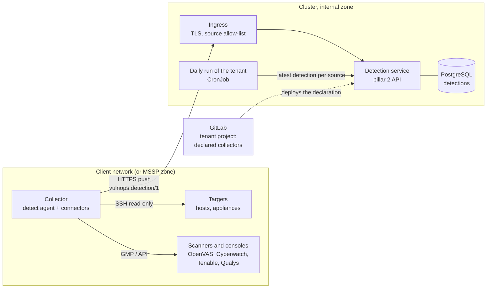

# Vulnerability Detection — low-level design

| Item | Value |
| --- | --- |
| Building block | Pillar 2 package `detect` (command `detect`): SSH collection, network scans (OpenVAS), import of scanner exports, declared inventory, external detection |
| Status | v0.16.2 as built, collectors and detection service included (§8) |
| Place in the set | C4 level 3 of pillar 2 of the HLD ([`../hld/20-vulnerability-detection.md`](../hld/20-vulnerability-detection.md)). Goals, constraints and contracts: HLD. Servers, zones and flows: DAT. Operating guides: [`../scanning.md`](../scanning.md), [`../openvas.md`](../openvas.md), [`../deployment.md`](../deployment.md) |
| Code | `detect/src/detect/`, shared model in `a2vm/src/a2vm/` |

This document says how detect turns what is installed and reachable into detection files: commands,
inputs and outputs, rules, configuration, failure modes and tests. It is updated in the same merge
request as the code it describes.

## 1. Scope

| detect does | detect does not |
| --- | --- |
| Run read-only scanners over SSH (Trivy, dnf updateinfo) and network scans (OpenVAS), or import their exports | Install, change or exploit anything on a target |
| Match the vulnerability records against the assets the client declares (products, versions) | Reconcile observations of several sources into assets (pillar 3, `verdict assets`) |
| Write, per client and source, the assets observed and the findings, each observation with its source and date | Set exposure, criticality or owner beyond what a source reports (pillar 3, strategy D10) |
| Bring the client's external detection into its internal run (source `external-scan`) | Decide a priority (pillar 3) |
| Read the tenant's CMDB as a source of assets (source `cmdb`, §3.5, v0.19.0) | Write to the CMDB: A2VM only reads it; its seed file is imported by a person |

detect imports only `a2vm` and itself (§1.1).

### 1.1 Interfaces with the other pillars

Interfaces of the pillar with the other pillars, the tenant's jobs and the analysts' tools. Kinds:
an **API** is an HTTP service in the tenant's namespace, its contract an OpenAPI file of
`a2vm/src/a2vm/schemas/openapi/`, reached with a bearer token of a role; an **exchange file** is a
JSON file of the run, versioned, checked against its JSON Schema of `a2vm/src/a2vm/schemas/` on
write and on read; a **library** is code of `a2vm` that several pillars run, owned by one pillar.
No pillar imports another (D12). `tests/test_interfaces.py` checks that every contract of the
repository is in this table of its pillar and in HLD §6.

| Way | Interface | Kind | Contract | Other side | Access | When the other side is missing |
| --- | --- | --- | --- | --- | --- | --- |
| Provides | Detection files (`<client>/<source>.json`, §2.3) | Exchange file | `detection.schema.json`, `vulnops.detection/1` | verdict (`verdict assets`) | File of the run | — |
| Provides | Detection service (`detect serve`, §8.2) | API | `detect.v1.yaml` | Collectors (`detect agent`, push, one token per connector); daily run (`detect fetch`, read token) | Collector and read tokens | Collector: the push waits in its spool; daily run: the source is left out with a warning (§8.4) |
| Provides | Matching of declared assets (§3.3) | Library, owned by detect | `a2vm.declared` (`a2vm.matching`, `a2vm.versions`) | via (the watch) | In process | — |
| Consumes | Vulnerability records, for `inventory` | Exchange file | `vulnerability_records.schema.json`, `vulnops.records/1` | via (`via collect`) | File of the run | No declared findings |
| Consumes | Client profile | Exchange file (tenant project) | `client_profile.schema.json` | Tenant project | File of the project or ConfigMap | Refused (exit 2) |
| Consumes | Triage of a run, for `detect cmdb export` (§3.5) | Exchange file | `triage.schema.json`, `a2vm.triage/1` | verdict (`verdict run`) | File of a run, read by an operator | No seed file |

The tenant's CMDB (iTop, §3.5), its EDRs (Wazuh, §3.6, v0.23.1; SentinelOne, §3.7, v0.23.3) and its
Cyberwatch (§3.8, v0.23.5) are outside A2VM: each is read by a connector of the collector over its API, with a read-only account of
the tenant, and is not a contract between pillars.

The matching of declared assets (product names, aliases, CPE, version ranges of the CVE record, LLM
proposal for fuzzy names) is code of `a2vm` since v0.16.2 so that the watch runs it without
detect; pillar 2 owns it: a change to it is reviewed as a change of detect and described in §3.3.

## 2. Interfaces

### 2.1 Commands

```text
detect plan targets.yaml [--profile client.yaml]
detect collect targets.yaml... [--raw work/scans] [--out work/detect] [--no-ssh]
detect import --client ID --source trivy|dnf-updateinfo|openvas FILE... [--min-qod 70] [--out work/detect]
detect inventory client.yaml... [--settings …] [--records work/records.json] [--out work/detect] [--no-llm]
detect external client.yaml --project PATH|ID [--ref main] [--job collect] [--out work/detect]
detect collectors collectors.yaml --tenant ID [--profile client.yaml]
detect serve --tenant ID --collectors collectors.yaml --digests FILE [--store DIR] [--keep 14] [--max-mb 200]
detect agent run [--config /etc/a2vm/collector/collector.yaml] [--connector NAME]
detect fetch --url URL --tenant ID --token-file FILE [--collectors collectors.yaml] [--source S]... [--timeout-seconds 600] [--out work/detect]
```

| Command | Exit codes |
| --- | --- |
| `plan` | 0; 2 targets file invalid or of another client than the profile |
| `collect` | 0 every scan succeeded; 3 some failed (partial collection, a warning); 1 none did |
| `import`, `inventory` | 0; 2 profile unreadable (`inventory`) |
| `external` | 0 added; 3 left out or partly (no `external` section, nothing found, another client, too old: a warning, the run goes on without it); 2 profile unreadable |
| `collectors` | 0; 2 declaration invalid, empty, or client id of the profile other than the tenant |
| `serve` | Runs until stopped; 2 declaration or digests invalid, store not writable |
| `agent run` | 0 everything pushed; 3 partial (a connector error, or a push kept in the spool); 1 nothing pushed and errors; 2 configuration invalid |
| `fetch` | 0 every expected source written; 3 some left out (missing, too old, invalid: a warning); 1 none, or the service unreachable or refusing; 2 declaration invalid |

One line per detection file written: client, source, assets observed, findings, not affected,
entries skipped and why.

Jobs of the client pipeline: `validate` runs `detect plan`; `collect` (runner tag
`A2VM_COLLECT_TAG`) runs `detect collect` when the project has a targets file and `detect external`
when `A2VM_EXTERNAL_PROJECT` is set, and keeps `work/detect/` (raw outputs are deleted); `detect`
runs `detect inventory` after `via collect`. In the cluster (`docs/kubernetes.md`), the CronJob runs
the same steps; its `collect` step is `detect fetch` in `collect.mode: intake` (§8.4).

### 2.2 Inputs

| Input | Content |
| --- | --- |
| Targets file (`targets.yaml`, `A2VM_TARGETS`) | `client`; `ssh` (user, identity file, options, timeout); `targets`: host, method (`trivy`, `dnf-updateinfo`), addresses, container images; optional `openvas` section |
| Scan key (`A2VM_SSH_KEY`, File variable) | Private key of the read-only scan account; normalised by the job (no CR, final newline) and checked before use |
| Client profile | Declared assets: vendor, product, aliases, CPE, versions, attributes; `external` section |
| `records.json` | Vulnerability records (pillar 1), for `inventory` |
| External project's artifacts | `work/detect/<external client>/*.json` of its last `collect` job |

### 2.3 Output: detection file

`<out>/<client>/<source>.json` (`vulnops.detection/1`), one per source (`inventory`, `trivy`,
`dnf-updateinfo`, `openvas`, `external-scan`):

| Part | Content |
| --- | --- |
| Observations | One per asset seen: kind (`host`, `image`, `declared`), reference, identifiers (FQDN, host name, addresses, image), OS, attributes the source reports, date |
| Findings | One per asset and CVE: status (`affected`, `under_investigation`), versions found, review reasons, and one observation per source and package or port: match, package, installed and fixed versions, source status, source severity, CVSS vector of the source |
| Not affected | Declared assets whose versions are all outside the affected ranges |
| Skipped | Counts of entries left out, by reason (not a CVE id, QoD below threshold, log level…) |

## 3. Sources

### 3.1 SSH collection (`collect`)

| Method | Command run on the target | Covers |
| --- | --- | --- |
| `trivy` (host) | `nice -n 19 ionice -c3 trivy rootfs --format json --scanners vuln --pkg-types os /` (15 min) | OS packages of Linux hosts |
| `trivy` (images of the host) | `trivy image … --pkg-types os,library`, NVIDIA CUDA directories skipped (30 min) | Container images: OS and language packages |
| `dnf-updateinfo` | `nice -n 19 ionice -c3 dnf -q updateinfo list --security --with-cve` | Rocky / RHEL hosts Trivy does not cover; only advisories with an update available |
| every host, after its method (v0.22.2) | `nice -n 19 ionice -c3 sh -c '. /etc/os-release …; rpm -qa --qf …'` (Rocky, RHEL), else `dpkg-query -W -f=…` (Debian, Ubuntu) | Every package installed, vulnerable or not: name, version, architecture, type and `purl`; since v0.23.0 its distribution (`distro`, `<ID>-<VERSION_ID>` of `/etc/os-release`), its source package (`source_package`: `%{SOURCERPM}`, `${Source}`), `source: ssh`, and a `purl` with namespace and distro (`pkg:rpm/rocky/openssl-libs@3.0.7-27.el9?arch=x86_64&distro=rocky-9.4&epoch=1`), kept in the host's observation (`components`, at most 20,000); a failure only loses them (a `WARN` line). Pillar 3 keeps the newest list with the asset (`components`, `components_seen`), the decision service answers `GET components`, the chat `find_component` (first brick of D20) |
| every host, after its packages (v0.24.0) | `nice -n 19 ionice -c3 ss -ltnu` | The sockets listening, TCP and UDP, numeric, without the processes (no root needed): the host's `services`, view `local`, each with its `bind` (`any`, `loopback` or an address). A host that listens on its loopback only is not reachable (`small`, pillar 3). A failure leaves them unknown (`services: null`, a `WARN` line) |

SSH runs in batch mode (no password, 15 s connection timeout, host keys accepted on first use).
Every command only reads, at the lowest CPU and I/O priority. One output = one asset; the host
name comes from the target, the FQDN and addresses from the targets file. Entries that are not
CVE ids (GHSA, vendor ids) are counted in `skipped`.

### 3.2 Network scan (OpenVAS)

The `openvas` section (`gmp` `tls://host:9390` or a Unix socket, `hosts`, `exclude`, scan
configuration "Full and fast", all IANA TCP ports, `min_qod` 70, `timeout_minutes` 240,
`reuse_hours` 6, `gmp_timeout_seconds` 300, `gmp_reconnects` 3) makes `collect` drive gvmd over
GMP: target and task named after the client, a finished scan younger than `reuse_hours` collected
instead of a new one, report downloaded in XML. Since v0.18.2, a read or an idempotent command
(`get_targets`, `get_tasks`, `get_task`, `stop_task`, `get_report`) that gvmd does not answer
within `gmp_timeout_seconds` (a timeout or a closed connection) is made again on a new, signed-in
connection, `gmp_reconnects` times for the whole scan; `start_task` is never sent twice (the task is
read again and a running scan followed); a refusal of gvmd is not retried.
The report is untrusted input, parsed with defusedxml (no entity expansion, no external entity).
One observation per host (address, name, OS when found); one finding per host and CVE, one
observation per port and NVT; results below the QoD threshold and log-level results are counted
in `skipped`. Safe checks stay on; the scan is still traffic the client must expect and agree to.
`detect import --source openvas` reads a report exported from the Greenbone interface the same way.

Since v0.24.0 each host observation carries the ports the scan found open (`services`, view
`network`): those of the results, of any severity, and of the report's `<ports>` block
(`general/tcp` is not a port). `zone` in the `openvas` section (or `--zone` of `detect import`, or
`zone` of a `file-import` connector) names the zone of the client's `zones` the scanner observes
from: `from_zone` of each service, the source of the flows pillar 3 observes between zones. A host
with open ports but no finding is observed too: the scan reached it.

### 3.3 Declared inventory (`inventory`)

The code is `a2vm.declared` (`DeclaredMatcher`), `a2vm.matching` and `a2vm.versions`, which the
watch of pillar 1 runs too (§1.1). For each record and each declared asset, `match_assets` compares the record's `affected`
blocks with the asset, best level first:

| Level | Rule |
| --- | --- |
| `cpe` | The asset's CPE vendor and product equal a CPE of the block |
| `exact` / `alias` | Normalised vendor and product equal the asset's (or one of its aliases) |
| `fuzzy` | Vendor similarity ≥ 0.85 and product similarity ≥ `fuzzy_threshold` (0.75), or one product name contains the other; never conclusive on its own |

Only the blocks matched at the best level give version ranges. `evaluate` then states,
for each deployed version, `affected`, `unaffected` or `unknown` (CNA first, ADP when the CNA is
not conclusive; vendor version strings ordered by a tolerant key). All versions unaffected: the
asset is listed as not affected; at least one affected: finding `affected`; otherwise
`under_investigation` with a review reason, also when the profile gives no version.

A fuzzy candidate goes to the LLM when it is enabled (section 5), else stays flagged for review
(`policy.fuzzy_match_without_llm: review`) or is dropped (`drop`). Products scanners do not see
(appliances, network devices, SaaS) are covered this way.

### 3.4 External detection (`external`)

The client's collection-only project (`<client>-external`), run by the cloud scanner, keeps
`work/detect/<external client>/*.json` in the artifacts of its `collect` job. `detect external`
downloads the latest of them through the GitLab API (job artifacts of the latest successful job,
project access token `A2VM_GITLAB_TOKEN` where the job token cannot read another project), checks
that they belong to the external client the profile names (`external.client`) and are younger
than `external.max_age_days`, and rewrites them as one detection of the internal client, source
`external-scan`. Archive paths are checked (no path outside the target directory). Pillar 3 then
maps each external host to an internal asset through `published` (LLD triage §5.3). Since v0.24.0
the services of the external hosts are seen from the internet (`from_zone: internet`).

### 3.5 CMDB (`cmdb`, iTop, v0.19.0)

Code: `detect/src/detect/cmdb.py`. The tenant's CMDB says what exists; pillar 3 compares it with
what the scanners saw (scan coverage, LLD triage §14.6) and takes from it the business criticality
and owner of each asset (LLD triage §14.3).

| Item | Design |
| --- | --- |
| Where it runs | A connector `type: itop` of the collector (§8.1), near the CMDB, its credentials in files of the collector; or `detect cmdb fetch --config itop.yaml --tenant <t>` for a test |
| Access | iTop REST API (`webservices/rest.php`, version 1.3), a local account of the tenant with the profiles *REST Services User* and one that reads without writing to CIs (*Document author* on iTop 3.2); TLS verified with `ca_file` |
| Read only | The client knows one operation, `core/get`, and refuses any other before sending: A2VM never writes to a CMDB |
| What is read | `SELECT PhysicalDevice` and `SELECT VirtualDevice` (every subclass: Server, VirtualMachine, Hypervisor, NetworkDevice, PC, Printer, NAS, IoTDevice of the extension `deploy/itop/a2vm-iot-device`...), `output_fields *+`, optionally `WHERE organization_name = '<organization>'`; `classes` and `exclude_classes` change them |
| Left out | Classes without a network existence (`Rack`, `Enclosure`, `PowerConnection`, `PowerSource`, `PDU`, `Farm`), a `Hypervisor` linked to its `Server` (the Server is that machine), an item without a name; counted in `skipped` |
| Observation | One `host` observation per item, ref `<class>::<key>`: `hostname` (and `fqdn`) when the name is a host name or an FQDN, `ips` from `managementip` and the addresses of the physical and logical interfaces (loopback and link-local left out), `identifiers.cmdb` = class, key, status, criticality, organisation, type (`device_type`, network device type or PC type); OS from its family and version |
| Attributes | `mission_prevalence` from `business_criticity` (high → essential, medium → support, low → minimal), `owner` from the first contact by name, else the organisation |
| Findings | None: the CMDB is an inventory, not a scan |
| Seed file | `detect cmdb export triage.json --organization <org>` lists the hosts of a run in coverage state `not-in-cmdb` (every host for a run without coverage) as a CSV for the CSV import of iTop (`name`, `org_id->name`, `status`, `managementip`, `business_criticity` empty, `description` with the sources, the OS and "likely a server" when an account scanned it): a person checks, chooses the class and imports |

### 3.6 Wazuh (`wazuh`, v0.23.1, HLD D20)

Code: `detect/src/detect/wazuh.py`. The software inventory of Wazuh's agents (syscollector) gives
the components of hosts the SSH collection may not reach; pillar 3 keeps them beside the others
(LLD triage §14.7) and the watch matches them against the package advisories (LLD
vulnerability-intelligence §3.4). Operator guide: [`../wazuh.md`](../wazuh.md).

| Item | Design |
| --- | --- |
| Where it runs | A connector `type: wazuh` of the collector (§8.1), its credentials in files of the collector; or `detect wazuh fetch --config wazuh.yaml --tenant <t>` for a test |
| Access, `api: indexer` (default) | The Wazuh indexer (OpenSearch, 9200), basic authentication of an internal user whose role reads `wazuh-states-inventory-*`; `POST /<index>/_search?scroll=2m` (`size` = `page_size`, 2000, sorted by `_doc`), `POST /_search/scroll`, `DELETE /_search/scroll` at the end. The global state indices of the recent versions: `wazuh-states-inventory-system-*` (agent id, name, address, `host.hostname`, `host.os`), `wazuh-states-inventory-packages-*` (`package.name`, `version`, `architecture`, `type`, `source`) |
| Access, `api: manager` | The manager's API (55000), every 4.x version: `POST /security/user/authenticate` (basic) for a token, then `GET /agents` (id, name, ip, status, last keep-alive, OS) and `GET /syscollector/<agent>/packages` agent by agent, 500 per page; a user with the role `readonly` |
| Read only | The client sends only searches and scrolls (indexer), or the authentication and GET requests (manager); anything else is refused before it leaves |
| Observation | One `host` observation per agent, ref `agent:<id>`: `hostname` (and `fqdn`) from the host name, else the agent name; `ips` from the agent's address (loopback left out); `os` `<platform> <version>`. Its date: the reading, or the last keep-alive of a disconnected agent; an agent never connected is left out |
| Components | Every package, source `wazuh`, built like those of SSH (§3.1): the distribution `<platform>-<major>[.<minor>]` (`rocky-9.4`, `ubuntu-22.04`, from `host.os`: the name mapped to the ID of `/etc/os-release`), the source package (`package.source`: an SRPM name or a Debian source), a `purl` for rpm and deb; other types (`win`, `pkg`...) kept without distribution nor `purl`, with their publisher (`vendor`, since v0.23.3), matched through the tenant's applications table (§3.7); at most 20,000 per agent |
| Findings | None: Wazuh's own vulnerability detection (`wazuh-states-vulnerabilities-*`) is not read |
| Failures | Indexer unreachable, user refused (401, 403), index missing (404: a version without the inventory indices, `api: manager` instead): the connector fails, the others run; an agent without packages is counted in `skipped` |

### 3.7 SentinelOne (`sentinelone`, v0.23.3, HLD D20)

Code: `detect/src/detect/sentinelone.py`. The application inventory of SentinelOne's agents gives
the components of the workstations and Windows servers, which no SSH collection reaches and whose
applications no distribution advisory names. Pillar 3 keeps them beside the others (LLD triage
§14.7); the watch matches them against the CVE records through the tenant's applications table
(`a2vm.applications`, LLD vulnerability-intelligence §3.4). Operator guide:
[`../sentinelone.md`](../sentinelone.md).

| Item | Design |
| --- | --- |
| Where it runs | A connector `type: sentinelone` of the collector (§8.1), the API token in a file of the collector; or `detect sentinelone fetch --config s1.yaml --tenant <t>` for a test |
| Account | An API token of a service user of the console, role Viewer, at the scope of the tenant (account or sites); `site_ids`, `account_ids` restrict the reads further. Header `Authorization: ApiToken <token>` |
| Access, `api: agents` (default) | `GET /web/api/v2.1/agents` (`isDecommissioned=false`, cursor pages of `page_size`, 500), then `GET /web/api/v2.1/agents/applications?ids=<agent>` agent by agent: name, version, publisher of each application. Every console |
| Access, `api: installed-applications` | The agents as above, then `GET /web/api/v2.1/installed-applications` by cursor pages (the Application Risk inventory, `agentId` of each item): fewer requests on a large fleet |
| Read only | The client sends only GET requests; anything else is refused before it leaves. A 429 is waited for (`Retry-After`, at most 60 s) three times, then the connector fails |
| Observation | One `host` observation per agent, ref `agent:<id>`: `hostname` from `computerName`, `fqdn` when the agent's `domain` is a DNS domain (not a NetBIOS one); `ips` from the network interfaces (loopback and link-local left out); `os` `<osName> <osRevision>`. Its date: the reading, or `lastActiveDate` of an inactive agent; a decommissioned agent is not read |
| Components | Every application, source `sentinelone`: name, version, publisher (`vendor`), type `win`, `pkg` or `application` (Windows, macOS, Linux); no distribution, no `purl`, no source package of its own; at most 20,000 per agent |
| Findings | None: SentinelOne's own vulnerability data (Application Risk's CVEs) is not read; it is not a scan (pillar 3: `NOT_SCANS`) |
| Failures | Console unreachable, token refused (401, 403: expired, or a role without the inventory), rate limit past the retries: the connector fails, the others run; an agent without applications is counted in `skipped` |
| Not verified on a real console | The field names of `/agents` and of the applications lists, taken from the documentation of the API; the first reading prints `sentinelone: <n> agents, applications listed on <m> (<api>)` |

### 3.8 Cyberwatch (`cyberwatch`, v0.23.5, HLD D20)

Code: `detect/src/detect/cyberwatch.py`. Cyberwatch is a scanner the tenant may already run (agents,
SSH, WinRM, network): A2VM reads what it found instead of scanning again. Unlike the EDRs it is a
scan: the asset counts as scanned (pillar 3) and its findings are triaged like OpenVAS's. Operator
guide: [`../cyberwatch.md`](../cyberwatch.md).

| Item | Design |
| --- | --- |
| Where it runs | A connector `type: cyberwatch` of the collector (§8.1), the two API keys in files of the collector; or `detect cyberwatch fetch --config cbw.yaml --tenant <t>` |
| Account | The API keys (access key, secret key) of a Cyberwatch user, sent as HTTP basic (API v3). Cyberwatch's documentation asks for a user of role Administrator to use the API: give it the tenant's groups only, A2VM reads only |
| Access | `GET <assets_path>?page=&per_page=` (default `/api/v3/vulnerabilities/servers`, pages of `page_size`, 100, until a short page), then `GET <asset_path>` per asset (default `/api/v3/vulnerabilities/servers/{id}`): two settings, as the paths changed between versions. A 429 is waited for three times |
| Read only | GET only; anything else is refused before it leaves |
| Behind a reverse proxy | `cert_file` and `key_file` (both or none, v0.23.17): the client certificate a reverse proxy in front of the master asks for, loaded into the SSL context with `ca_file` (`a2vm.tls.verify`). httpx 0.28 does not send `cert=` when `verify` is a path: every HTTP client of A2VM goes through `a2vm.tls`, a test keeps `cert=` and paths in `verify` out of the code. Without a certificate, the message of a 403 names this case |
| Shared master | Without `groups`, a WARN when the assets are in more than one Cyberwatch group; a push over 200 MiB is refused with its size and `groups` named |
| Observation | One `host` per asset, ref `server:<id>`: `hostname` and `fqdn` from its name, `ips` and a DNS name from `addresses` (loopback and link-local left out), `os` its name, attribute `cyberwatch_groups`; its date: `analyzed_at`, else `last_communication`. `groups` keeps the assets of the Cyberwatch groups named only |
| Components | `packages` of the asset when the detail gives them (an inactive one left out), else the current versions of its `updates`: name, version, publisher, type (rpm, deb, apk from Cyberwatch's type, else `win` or `application`, matched through the applications table) |
| Findings | One per CVE of `cve_announcements` still open (active, without `fixed_at`, not ignored in Cyberwatch unless `include_ignored`), status affected, match `scanner`: the package, the version found and the target version of the update that names it, Cyberwatch's level |
| Not verified on a real master | The paths and field names, taken from the integrations published for Cyberwatch 13; the first reading prints `cyberwatch: <n> assets, <m> open CVEs, components on <k>` |

### 3.9 Appliances and network devices (`snmp`, CMDB, v0.23.6, HLD D20)

Code: `detect/src/detect/snmp.py`, `detect/src/detect/firmware.py`, `detect/src/detect/cmdb.py`.
The exact version of a device without packages, as one component of type `firmware`. Neither source
is a scan: the asset is not counted as scanned, and no finding is made; the watch names the device
with the level of proof `embedded` (`a2vm.applications.firmware_matches`). Operator guide:
[`../appliances.md`](../appliances.md).

| Item | Design |
| --- | --- |
| Where it runs | A connector `type: snmp` of the collector (§8.1), the SNMP secrets in files of the collector; or `detect snmp fetch --config snmp.yaml --tenant <t>`. The CMDB: the `itop` connector of §3.5 |
| Account | SNMPv3 `authPriv` by default (SHA-2 and AES), `authNoPriv` with `priv_protocol: none`; SNMPv2c with a community for old devices |
| Access | GET of sysDescr, sysObjectID and sysName, then of the vendor's version object when sysObjectID names Fortinet (`fgSysVersion`), Palo Alto Networks (`panSysSwVersion`) or MikroTik (`mtxrFirmwareVersion`). No walk, no SET. `pysnmp` (extra `snmp` of the detect package), asynchronous, `concurrency` devices at once |
| Targets | Addresses, names or networks (CIDR, its hosts), less `exclude`; at most 4096 addresses per connector |
| Observation | One `host` per device that answers, ref `snmp:<target>`: `ips`, `hostname` and `fqdn` from sysName, `os` `<vendor> <product> <version>`, attribute `snmp_object_id`. A host whose sysDescr names an OS (Linux, Windows) is left out of the firmware: SSH or an agent says more |
| Component | `{name, version, type: firmware, vendor, cpe, source}`: the family recognised from sysDescr and sysObjectID gives the CPE (`cpe:2.3:o:fortinet:fortios`); an unknown family keeps its vendor and product, without CPE, for the applications table. From the CMDB: `brand_name`, `model_name`, `iosversion_name` of a NetworkDevice, the CPE only when the family is certain |
| Matching (watch) | The firmware with a CPE: the blocks of the record that carry its CPE, else its vendor and its product less the vendor and `Software`; in range: embedded; undecided: possible. A CNA block that lists exact versions only, without default status, is the vendor's list: a version not in it is not affected. A firmware without CPE: through the applications table, embedded once its row is validated |
| CSAF | The product status of a vendor's CSAF advisory (`known_affected`, `first_affected` with exact versions or `vers:` ranges; `fixed`, `first_fixed`, `known_not_affected` exact) as affected blocks per CVE (`via.alert.feeds.csaf_affected`); the watch puts them in place of the record's CNA blocks for the same products (`with_vendor_status`), in a copy |
| Not verified on real devices | The sysDescr of each family and the version objects, taken from the vendors' MIBs; the first reading prints `snmp: <n> targets, <m> devices, firmware known on <k>` |

### 3.10 Libraries: images, SBOMs and OSV (`sbom`, `osv`, v0.23.11, HLD D20)

Code: `detect/src/detect/sbom.py`, `detect/src/detect/osv.py`, `detect/src/detect/collect.py`
(`LOADED`). The libraries of the language ecosystems (`pkg:pypi`, `pkg:npm`, `pkg:maven`,
`pkg:golang`…), as components of type `library` with their `purl`. The packages of a distribution
(`pkg:rpm`, `pkg:deb`, `pkg:apk`) stay with the advisories of the distributions (§14.7 of the
triage LLD).

| Item | Design |
| --- | --- |
| Images | Trivy scans an image with `--list-all-pkgs`: the image's observation keeps every library it found and the image's digest (attribute `digest`, `RepoDigests` or `ImageID`). Trivy's own findings stay |
| SBOM files | A connector `type: sbom` of the collector reads the JSON files of `directory`, CycloneDX (`bomFormat`, nested components) or SPDX (`spdxVersion`, the `purl` external references). One asset per file: `assets: [{file, kind: host\|image, name}]`, else the SBOM's subject as an image. No finding: OSV matches. A file unreadable is counted in `skipped`. By hand: `detect sbom read --config sbom.yaml --tenant <t>` |
| OSV | `detect osv --detect <dir> --cache <dir>`, every daily run after the collection: every library with a `purl` of the tenant's detections. A vulnerability with a CVE (its id or an alias) becomes a finding of source `osv` (match `exact`, the first `fixed` event as fixed version); one known only by its GHSA or PYSEC id, or a malware record (`MAL-`), is counted in `skipped`. Writes `<dir>/<tenant>/osv.json`, yesterday's removed first. Three modes, `A2VM_OSV_MODE` (v0.23.12, below): `offline` (default), `api`, `off` (`A2VM_OSV_ENABLED=false` of v0.23.11 says the same) |
| Offline (v0.23.12) | No library leaves the tenant. The libraries are matched in the daily run against a copy of OSV (`a2vm.osvdb`): for each language ecosystem (PyPI, npm, Maven, Go, crates.io, RubyGems, NuGet, Packagist), an index of the records with a CVE, not withdrawn, with the versions OSV enumerates and the ranges. The index comes from the shared intelligence service (`GET /v1/osv/<ecosystem>`, role `read`, ETag: 304 when unchanged) when `A2VM_INTEL_URL` is set, else from OSV's archive (`<Ecosystem>/all.zip` on osv-vulnerabilities.storage.googleapis.com, ETag too), built in the run. Each index is kept in `--cache` (`/data/osv-cache` in the cluster): the service or the archive unreachable, yesterday's index is used, exit 3. A version is affected when it is among the versions OSV enumerates; else by a range `SEMVER` (semantic versions) or `ECOSYSTEM` without enumerated versions (`osvdb.compare`: numbers, pre-releases `dev`, `a`, `b`, `rc`, `SNAPSHOT` before the release, `post` after); a range `GIT` only: undecided, counted |
| The shared copy | `via intel-serve --osv-every-hours 6` (`intel.serve.osvEveryHours`) reads each archive again when its ETag changed, builds the index (a few MB gzipped) in `/data/intel/osv`, the archive deleted once read. Through the relay of the sources when there is one (`osv-vulnerabilities.storage.googleapis.com` in `A2VM_RELAY_HOSTS` and the relay's `hosts`). The service learns nothing of the tenants' libraries: every tenant reads every index |
| API (v0.23.11) | `A2VM_OSV_MODE=api`: each `purl@version` to api.osv.dev, `POST /v1/querybatch` (1,000 at once, the pages of an answer followed since v0.23.12), then `GET /v1/vulns/<id>` (cached 7 days). The tenant's inventory goes to Google: for a test, or a tenant that accepts it in writing |
| Not scans | `sbom` and `osv` list no asset as scanned (`NOT_SCANS`): an asset seen by them only is not counted as scanned |
| In memory | After the packages of a host, the collector reads `/proc/<pid>/maps` over SSH: a shared library deleted on disk (an update replaced it) and still mapped by a process. A component of type `in-memory`, the file as `name`, its processes as `processes` (`812 nginx, 813 nginx`): the update is not applied in memory until these processes restart. Best effort: without root, only the processes of the SSH user are read, the others are skipped; a failure only loses these components. The log says `WARN <host> [loaded]: <n> deleted libraries still in memory, restart needed` |
| Not applications | `library` and `in-memory` are not matched through the applications table (`a2vm.applications.is_application`) |

## 4. Configuration

| Key | Default | Effect |
| --- | --- | --- |
| `A2VM_TARGETS` | `targets.yaml` | Targets file of the client project |
| `A2VM_SSH_KEY` | — | Scan key (File variable); without it the SSH targets are skipped |
| `A2VM_COLLECT_TAG` | `llm-lan` | Runner that can reach the targets |
| `A2VM_EXTERNAL_PROJECT`, `A2VM_GITLAB_TOKEN` | — | External detection |
| `fuzzy_threshold` (settings) | 0.75 | Product similarity for a fuzzy candidate |
| `policy.fuzzy_match_without_llm` | `review` | `review` or `drop` |
| `llm.tasks.match_adjudication` | `true` | LLM proposal on fuzzy candidates |
| `openvas.*` (targets file) | section 3.2 | Network scan |
| `A2VM_COLLECTORS` | `collectors.yaml` | Declaration of the collectors (§8.3); with it, `deploy-k8s` deploys the detection service |
| `A2VM_COLLECTOR_TOKEN_<ID>`, `…_NEXT` | — | Token of each collector (masked); digests only reach the cluster |
| `A2VM_INTAKE_HOST`, `A2VM_INTAKE_ALLOW` | — | Push endpoint and the collectors' addresses allowed (ingress) |
| `A2VM_INTAKE_INGRESS_CONTROLLER`, `A2VM_INTAKE_CLUSTER_ISSUER` | `nginx`, — | How the allow-list is set (`nginx` annotations, `traefik` Middleware, `other`); cert-manager issuer of the certificate (v0.13.1) |
| `A2VM_OSV_MODE` | `offline` | `detect osv` in the daily run (§3.10): `offline` (a copy of OSV, no library sent), `api` (each library to api.osv.dev), `off`. `A2VM_OSV_ENABLED=false` (v0.23.11): `off` |
| `A2VM_COLLECT_MODE` | `intake` with collectors, else `local` | First step of the daily run in the cluster |
| `collector.yaml` (collector) | §8.1 | Collector id, tenant, service URL, token file, connectors |
| `type: itop` connector (collector) | §3.5 | `url`, `user`, `password_file`, `ca_file`, `organization`, `classes`, `exclude_classes`, `timeout_seconds` (60) |

## 5. LLM

| Task | When | Output | Safeguard |
| --- | --- | --- | --- |
| Product match proposal | A fuzzy candidate, when `llm.enabled` and `match_adjudication` | "likely" or "unlikely" with a justification (JSON schema) | Proposal only (since v0.11.2): the candidate is kept either way, flagged for review with the proposal and the similarity score; vendor text passed as untrusted data |

Several endpoints of the tenant's model: the shared LLM client moves to the next one when one is
down (v0.15.0, LLD triage-prioritization §7.1).

## 6. Failure modes

| Situation | Behaviour |
| --- | --- |
| A target unreachable, a scanner missing or timing out | That scan is listed in error; the others go on; `collect` exits 3 (1 when no scan succeeded) |
| Key pasted badly | The job stops with the reason before any connection |
| No targets file | No scanner collection; declared inventory only |
| OpenVAS unreachable or scan too long | Error for that scan; SSH results kept |
| CMDB unreachable, account refused, answer not JSON (v0.19.0) | The `itop` connector fails with the reason (`FAIL cmdb`), nothing pushed; the daily run uses the previous `cmdb` detection while younger than its `max_age_hours`, then goes on without CMDB (coverage judged without it) |
| gvmd silent for longer than `gmp_timeout_seconds` (v0.18.2) | New connection and the same call, `gmp_reconnects` times; then an error for that scan, which gvmd goes on running (the next run waits for it or collects it) |
| Hostile or malformed report | Rejected by the XML parser; error listed |
| External detection missing, of another client or too old | Left out with a warning (exit 3); exposures stay as declared or assumed |
| Version string not comparable | Status `unknown`, finding `under_investigation`, flagged for review: never dropped silently |
| Detection service unreachable from a collector (or 429, 5xx) | The detection is kept in the collector's spool, newest per source, pushed at the next run |
| Push refused (token, tenant, source, schema, age, size) | `4xx`, nothing stored, logged by the service and shown as `last_error` of the collector; a spooled detection refused this way is set aside (`.rejected`) |
| A source missing or too old at the daily run | Left out with a warning (`fetch` exit 3); no detection at all stops the run |
| A large detection (100 MB and more) | Validation takes the service a minute or more: the agent and `fetch` wait `timeout_seconds` (600); a retry is recognised by its idempotency key before any decompression or validation; the gzip body is stored as received |
| Two daily runs on one tenant volume (one started by hand) | The second stops at `collect`: the first holds a lock on the volume, released at the end or when a step fails; a lock older than the run's deadline is taken over |

## 7. Tests

| Test file | Covers |
| --- | --- |
| `tests/test_versions_matching.py` | Version ordering, ranges and default status, CNA precedence, a real PAN-OS record, fuzzy and alias matching |
| `tests/test_detection_assets.py` | Real Trivy and dnf outputs, non-CVE entries skipped, collection plan and commands, collection with a fake SSH, extra addresses, client id check (and the assets stage, LLD triage §14) |
| `tests/test_openvas.py` | Report parsing, QoD threshold, hostile XML refused, import, hosts reconciled with SSH collection, GMP flow (create, reuse, wait, collect a recent report, start again), configuration errors, generic multi-CVE tests flagged |
| `tests/test_external.py` | External detection: client check, age, rewrite as `external-scan`, artifact download (prefix, zip-slip, URL, tokens, 404, 403) |
| `tests/test_profile_guard.py` | Profile validity and errors |
| `tests/test_intake.py` | Declaration and digests, token rotation; store (idempotency, retention per source and collector, ids); acceptance of a push in order, nothing stored on refusal; status and last error; HTTP routes, health, malformed requests, 500; push and fetch over HTTP, merge of two collectors, max age per source, no path from the service's answer; agent configuration, file import, spool and set-aside, another client never pushed |
| `tests/test_v0133.py` | A retry answered without validation, gzip stored as received, trailing data refused, size and time logged, client waits, one run at a time |
| `tests/test_v0130.py` | Deploy script (digests the service accepts, read token kept, weak token refused, nothing printed), deploy job and chart (intake and local modes, service unprivileged, push path only, network policy) |
| `tests/test_detect_api_contract.py` | OpenAPI contract well formed, tenant and authentication on every call |

## 8. Collectors and the detection service (D15 step 2, v0.13.0)

Status: **as built in v0.13.0**; §8.7 lists where the build differs from the design and what
comes later. Operating guide: [`../collectors.md`](../collectors.md). Before, `collect` ran where
the pipeline runs (a runner that reaches the targets); in the cluster it would have to reach every
client network, and every target would have to allow the cluster's addresses. The work is split:
**collectors** run near the networks and **push** their results to the **detection service**
of pillar 2 in the cluster. The cluster never connects to a client machine; a target allows
only the collector of its network.



### 8.1 Collector

| Item | Design |
| --- | --- |
| What | `detect agent`: the `detect` image run near a network, on a VM of the client or of the MSSP (in the lab, the tenants' runner VM), as a container started by systemd; later in a cluster of the client |
| Connectors | One per source, all producing `vulnops.detection/1`: `ssh-trivy`, `ssh-dnf` (the current SSH collection), `openvas-gmp` (the current network scan), `file-import` (scanner exports dropped in a folder), `itop` (the tenant's CMDB, source `cmdb`, v0.19.0); later `cyberwatch-api`, `tenable-api`, `qualys-api`. A connector is a class with a name, its settings and `run() -> Detection`; adding a scanner adds a connector, never a change of the contract |
| Configuration | `collector.yaml` on the collector: its id, its tenant, its connectors with their targets and schedule (cron), the detection service URL; secrets (scan key, GMP certificates, API keys, its push token) in files readable by the agent only |
| Schedule | Its own: each connector runs on its cron; GitLab does not trigger it |
| Push | After each run: `POST /v1/tenants/{tenant}/detections`, gzip, with its token; on failure the detection is kept in a local spool and pushed again with backoff (the newest per source wins); a run that produced nothing new pushes nothing |
| Network | Outbound HTTPS to the detection service only; no inbound port |
| Journal | A line when a connector starts and ends, one line per target as it ends (`ok` with the findings, or `FAIL` with the reason, and the time taken; since v0.18.2), one line per push |

### 8.2 Detection service

The pillar 2 service in the cluster (the same `detect` image, `detect serve`). API v1
(`a2vm/src/a2vm/schemas/openapi/detect.v1.yaml`):

| Call | Caller | Effect |
| --- | --- | --- |
| `POST /v1/tenants/{tenant}/detections` | Collector | Validates and stores one detection; `202` with its id; `Idempotency-Key` (the collector's run id) makes a retry harmless |
| `GET /v1/tenants/{tenant}/detections/latest?source=` | Daily run, later verdict | The latest accepted detection of each source and collector (or of one source), with its age |
| `GET /v1/tenants/{tenant}/detections/{id}` | Same | One detection |
| `GET /v1/tenants/{tenant}/collectors` | Operators, dashboards | Each declared collector: last push per source, age, last error; since v0.23.9 the agent's version and the connector of the last push (headers `X-A2VM-Agent`, `X-A2VM-Connector` of the push, kept in memory) |
| `GET /v1/tenants/{tenant}/status` | The chat's tool server (v0.23.9) | The service's version and the collectors as above |
| `POST /v1/tenants/{tenant}/poll` | Collectors, every 5 minutes (v0.23.10) | Body `{timers: [{connector, next_run, last_run}], results: [{id, outcome, detail}]}`: the connectors' timers kept (in memory, shown by `collectors` as `timers`), the outcome of the actions carried out; answer `{actions: [{id, action, connector}]}`, the requests confirmed for this collector, now taken (LLD triage §16.10). Published by the ingress beside the push |
| `GET /healthz`, `GET /readyz` | Kubernetes | Liveness and readiness |

Acceptance of a push, in order (any failure: `4xx`, nothing stored, logged):

1. The token is valid, belongs to a declared collector, and that collector belongs to `{tenant}`.
2. The body is `vulnops.detection/1` (schema), below the size limit (default 200 MB uncompressed).
3. `client_id` in the body equals `{tenant}`; `source` is one the collector is declared for.
4. `generated_at` is not in the future and not older than the source's `max_age_hours`.

Stored per detection: tenant, collector, source, `generated_at`, `received_at`, digest, the
document (PostgreSQL, JSONB or a large object; files on a volume in v0.13.0, §8.7). Retention: the
last N per source and collector (default 14).
Later, each accepted detection publishes `detection.received` on the event bus (D15 step 6).

### 8.3 Declaration in the tenant project (GitLab)

The tenant project declares its collectors, versioned with its profile, in `collectors.yaml`:

```yaml
collectors:
  - id: homelab-lan
    description: LAN collector (collector01.lab.example)
    sources: [trivy, dnf-updateinfo, openvas]
    max_age_hours: 30
```

The job `deploy-k8s` hands the declaration to the detection service, with a digest of each
collector's token (CI/CD variable `A2VM_COLLECTOR_TOKEN_<ID>`, masked; the service keeps only the
digest). Adding, moving or removing a collector is a commit in the tenant project; the collector
itself is installed on its VM with the same token (runbook, later a deployment job).

### 8.4 Daily run

The CronJob's first step no longer collects: `detect fetch` reads from the detection service the
latest detection of each declared source, refuses one older than `max_age_hours` (as `detect
external` does today), and writes them to `work/detect`; the following steps are unchanged.
`collect.mode: local` keeps the present behaviour for a cluster installed inside the client's
network. `deploy-k8s` sets `intake` when the tenant project has a `collectors.yaml`
(`A2VM_COLLECT_MODE=local` keeps the run collecting while the collectors are tried side by side).
Each source is checked against the largest `max_age_hours` of the collectors declared for it.

### 8.5 Security

| Threat | Measure |
| --- | --- |
| A forged or replayed push | Token per collector, bound to one tenant and its sources, stored as a digest; idempotency key and age check; TLS |
| A collector pushing for another tenant | Tenant of the token = tenant of the path = `client_id` of the body |
| A hostile or oversized body | Schema validation before storage, size limit, nothing from the body used as a path or a command |
| Exposure of the intake endpoint | Ingress reachable only from the collectors' addresses (allow-list on the ingress); later mutual TLS with a certificate per collector from the internal CA |
| A stolen token | Rotation: two valid tokens per collector during a change; revocation by removing it from `collectors.yaml` |
| Reading another tenant's detections | Read calls authenticated by service identity (Kubernetes service account), tenant checked, database row-level security |

### 8.6 Migration

1. v0.13.0: detection service and `detect agent` with the existing connectors; the homelab
   collector on the runner VM of the lab; the daily run of the cluster reads from the service. The
   pipeline mode (`collect` in GitLab) stays for development.
2. The cloud scanner becomes the external collector of the tenants (`external-scan` pushed
   instead of pulled from the external project), once the intake is published to it.
3. New connectors (Cyberwatch, Tenable, Qualys) as clients bring them.

Settled at the review: 200 MB and the last 14 detections per source and collector by default
(chart values `intake.maxMb`, `intake.keep`); one collector per tenant and network, a tenant may
have several. Still open: publication of the intake endpoint to collectors outside the MSSP
network (reverse proxy with mutual TLS).

### 8.7 As built in v0.13.0

| Item | Built | Later |
| --- | --- | --- |
| Store | Files on a volume of the service (`<tenant>/<source>/<id>.json.gz` and its receipt, written by rename), one replica; since v0.18.0, with the tenant's database, PostgreSQL behind the same interface (`detect/intake/pgstore.py`: schema `detect`, tables `detections` and `push_keys`, row-level security per tenant), several replicas | — |
| Latest | Per source **and collector**, retention too: two collectors of one tenant may push the same source; `detect fetch` merges their latest detections into `<source>.json` | — |
| Read calls | Bearer token of the tenant's daily run, kept by the service as a digest (`read <sha256>` in the digests), made and kept by `deploy-k8s`; one service per tenant namespace, other tenants answered 404 | Kubernetes service accounts, row-level security |
| Connectors | `targets` (SSH Trivy, SSH dnf and OpenVAS GMP, from a targets file: the present collection), `file-import` (one source per folder, each file imported once, renamed `.imported`) and, since v0.19.0, `itop` (the tenant's CMDB, §3.5) | `cyberwatch-api`, `tenable-api`, `qualys-api`, other CMDBs (ServiceNow) |
| Schedule | A systemd timer per connector on the collector (`docs/collectors.md`), not a cron in `collector.yaml` | — |
| Installation | By hand or with `deploy/collector/install-collector.sh` (since v0.13.2): configuration, GMP account on the scanner host, image, units | A deployment job (§8.3) |
| Idempotency key | Derived by the agent from the collector, the source and the digest of the body: a retry of the same detection is a duplicate, answered (since v0.13.3) right after the token check, from the receipt alone | — |
| Last error | Kept in memory per collector and source until a push is accepted (a restart forgets it; the log keeps it) | In the database |
| Exposure | Ingress publishing `POST /v1/tenants/<tenant>/detections` only (`pathType: Exact`), allow-list of the collectors' addresses by ingress-nginx annotations or, since v0.13.1, a Traefik `ipAllowList` Middleware (the controller must see the real addresses: `externalTrafficPolicy: Local` behind a LoadBalancer); certificate from a cert-manager issuer when given; NetworkPolicy: from the ingress controller's namespace and the tenant's daily run only, no egress | Mutual TLS per collector |
| Events | — | `detection.received` on the bus (D15 step 6) |

## 9. Open points

- Other scanners (Tenable, Qualys, Cyberwatch), assets derived from SIEMs and client exports.
- The full package list of each host, for the watch on CVEs not yet found (pillar 1).
- `behind` attribution by product identification (with pillar 3).
