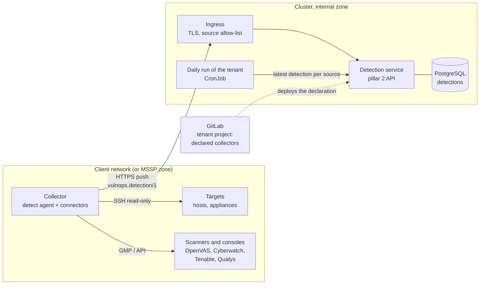

# Vulnerability Detection — low-level design

| Item | Value |
| --- | --- |
| Building block | Pillar 2 package `detect` (command `detect`): SSH collection, network scans (OpenVAS), import of scanner exports, declared inventory, external detection |
| Status | v0.16.2 as built, collectors and detection service included (§8) |
| Place in the set | C4 level 3 of pillar 2 of the HLD ([`../hld/20-vulnerability-detection.md`](../hld/20-vulnerability-detection.md)). Goals, constraints and contracts: HLD. Servers, zones and flows: DAT. Operating guides: [`../scanning.md`](../scanning.md), [`../openvas.md`](../openvas.md), [`../deployment.md`](../deployment.md) |
| Code | `detect/src/detect/`, shared model in `a2vm/src/a2vm/` |

This document says how detect turns what is installed and reachable into detection files: commands,
inputs and outputs, rules, configuration, failure modes and tests. It is updated in the same merge
request as the code it describes.

## 1. Scope

| detect does | detect does not |
| --- | --- |
| Run read-only scanners over SSH (Trivy, dnf updateinfo) and network scans (OpenVAS), or import their exports | Install, change or exploit anything on a target |
| Match the vulnerability records against the assets the client declares (products, versions) | Reconcile observations of several sources into assets (pillar 3, `verdict assets`) |
| Write, per client and source, the assets observed and the findings, each observation with its source and date | Set exposure, criticality or owner beyond what a source reports (pillar 3, strategy D10) |
| Bring the client's external detection into its internal run (source `external-scan`) | Decide a priority (pillar 3) |

detect imports only `a2vm` and itself (§1.1).

### 1.1 Interfaces with the other pillars

Interfaces of the pillar with the other pillars, the tenant's jobs and the analysts' tools. Kinds:
an **API** is an HTTP service in the tenant's namespace, its contract an OpenAPI file of
`a2vm/src/a2vm/schemas/openapi/`, reached with a bearer token of a role; an **exchange file** is a
JSON file of the run, versioned, checked against its JSON Schema of `a2vm/src/a2vm/schemas/` on
write and on read; a **library** is code of `a2vm` that several pillars run, owned by one pillar.
No pillar imports another (D12). `tests/test_interfaces.py` checks that every contract of the
repository is in this table of its pillar and in HLD §6.

| Way | Interface | Kind | Contract | Other side | Access | When the other side is missing |
| --- | --- | --- | --- | --- | --- | --- |
| Provides | Detection files (`<client>/<source>.json`, §2.3) | Exchange file | `detection.schema.json`, `vulnops.detection/1` | verdict (`verdict assets`) | File of the run | — |
| Provides | Detection service (`detect serve`, §8.2) | API | `detect.v1.yaml` | Collectors (`detect agent`, push, one token per connector); daily run (`detect fetch`, read token) | Collector and read tokens | Collector: the push waits in its spool; daily run: the source is left out with a warning (§8.4) |
| Provides | Matching of declared assets (§3.3) | Library, owned by detect | `a2vm.declared` (`a2vm.matching`, `a2vm.versions`) | via (the watch) | In process | — |
| Consumes | Vulnerability records, for `inventory` | Exchange file | `vulnerability_records.schema.json`, `vulnops.records/1` | via (`via collect`) | File of the run | No declared findings |
| Consumes | Client profile | Exchange file (tenant project) | `client_profile.schema.json` | Tenant project | File of the project or ConfigMap | Refused (exit 2) |

The matching of declared assets (product names, aliases, CPE, version ranges of the CVE record, LLM
proposal for fuzzy names) is code of `a2vm` since v0.16.2 so that the watch runs it without
detect; pillar 2 owns it: a change to it is reviewed as a change of detect and described in §3.3.

## 2. Interfaces

### 2.1 Commands

```text
detect plan targets.yaml [--profile client.yaml]
detect collect targets.yaml... [--raw work/scans] [--out work/detect] [--no-ssh]
detect import --client ID --source trivy|dnf-updateinfo|openvas FILE... [--min-qod 70] [--out work/detect]
detect inventory client.yaml... [--settings …] [--records work/records.json] [--out work/detect] [--no-llm]
detect external client.yaml --project PATH|ID [--ref main] [--job collect] [--out work/detect]
detect collectors collectors.yaml --tenant ID [--profile client.yaml]
detect serve --tenant ID --collectors collectors.yaml --digests FILE [--store DIR] [--keep 14] [--max-mb 200]
detect agent run [--config /etc/a2vm/collector/collector.yaml] [--connector NAME]
detect fetch --url URL --tenant ID --token-file FILE [--collectors collectors.yaml] [--source S]... [--timeout-seconds 600] [--out work/detect]
```

| Command | Exit codes |
| --- | --- |
| `plan` | 0; 2 targets file invalid or of another client than the profile |
| `collect` | 0 every scan succeeded; 3 some failed (partial collection, a warning); 1 none did |
| `import`, `inventory` | 0; 2 profile unreadable (`inventory`) |
| `external` | 0 added; 3 left out or partly (no `external` section, nothing found, another client, too old: a warning, the run goes on without it); 2 profile unreadable |
| `collectors` | 0; 2 declaration invalid, empty, or client id of the profile other than the tenant |
| `serve` | Runs until stopped; 2 declaration or digests invalid, store not writable |
| `agent run` | 0 everything pushed; 3 partial (a connector error, or a push kept in the spool); 1 nothing pushed and errors; 2 configuration invalid |
| `fetch` | 0 every expected source written; 3 some left out (missing, too old, invalid: a warning); 1 none, or the service unreachable or refusing; 2 declaration invalid |

One line per detection file written: client, source, assets observed, findings, not affected,
entries skipped and why.

Jobs of the client pipeline: `validate` runs `detect plan`; `collect` (runner tag
`A2VM_COLLECT_TAG`) runs `detect collect` when the project has a targets file and `detect external`
when `A2VM_EXTERNAL_PROJECT` is set, and keeps `work/detect/` (raw outputs are deleted); `detect`
runs `detect inventory` after `via collect`. In the cluster (`docs/kubernetes.md`), the CronJob runs
the same steps; its `collect` step is `detect fetch` in `collect.mode: intake` (§8.4).

### 2.2 Inputs

| Input | Content |
| --- | --- |
| Targets file (`targets.yaml`, `A2VM_TARGETS`) | `client`; `ssh` (user, identity file, options, timeout); `targets`: host, method (`trivy`, `dnf-updateinfo`), addresses, container images; optional `openvas` section |
| Scan key (`A2VM_SSH_KEY`, File variable) | Private key of the read-only scan account; normalised by the job (no CR, final newline) and checked before use |
| Client profile | Declared assets: vendor, product, aliases, CPE, versions, attributes; `external` section |
| `records.json` | Vulnerability records (pillar 1), for `inventory` |
| External project's artifacts | `work/detect/<external client>/*.json` of its last `collect` job |

### 2.3 Output: detection file

`<out>/<client>/<source>.json` (`vulnops.detection/1`), one per source (`inventory`, `trivy`,
`dnf-updateinfo`, `openvas`, `external-scan`):

| Part | Content |
| --- | --- |
| Observations | One per asset seen: kind (`host`, `image`, `declared`), reference, identifiers (FQDN, host name, addresses, image), OS, attributes the source reports, date |
| Findings | One per asset and CVE: status (`affected`, `under_investigation`), versions found, review reasons, and one observation per source and package or port: match, package, installed and fixed versions, source status, source severity, CVSS vector of the source |
| Not affected | Declared assets whose versions are all outside the affected ranges |
| Skipped | Counts of entries left out, by reason (not a CVE id, QoD below threshold, log level…) |

## 3. Sources

### 3.1 SSH collection (`collect`)

| Method | Command run on the target | Covers |
| --- | --- | --- |
| `trivy` (host) | `nice -n 19 ionice -c3 trivy rootfs --format json --scanners vuln --pkg-types os /` (15 min) | OS packages of Linux hosts |
| `trivy` (images of the host) | `trivy image … --pkg-types os,library`, NVIDIA CUDA directories skipped (30 min) | Container images: OS and language packages |
| `dnf-updateinfo` | `nice -n 19 ionice -c3 dnf -q updateinfo list --security --with-cve` | Rocky / RHEL hosts Trivy does not cover; only advisories with an update available |

SSH runs in batch mode (no password, 15 s connection timeout, host keys accepted on first use).
Every command only reads, at the lowest CPU and I/O priority. One output = one asset; the host
name comes from the target, the FQDN and addresses from the targets file. Entries that are not
CVE ids (GHSA, vendor ids) are counted in `skipped`.

### 3.2 Network scan (OpenVAS)

The `openvas` section (`gmp` `tls://host:9390` or a Unix socket, `hosts`, `exclude`, scan
configuration "Full and fast", all IANA TCP ports, `min_qod` 70, `timeout_minutes` 240,
`reuse_hours` 6) makes `collect` drive gvmd over GMP: target and task named after the client, a
finished scan younger than `reuse_hours` collected instead of a new one, report downloaded in XML.
The report is untrusted input, parsed with defusedxml (no entity expansion, no external entity).
One observation per host (address, name, OS when found); one finding per host and CVE, one
observation per port and NVT; results below the QoD threshold and log-level results are counted
in `skipped`. Safe checks stay on; the scan is still traffic the client must expect and agree to.
`detect import --source openvas` reads a report exported from the Greenbone interface the same way.

### 3.3 Declared inventory (`inventory`)

The code is `a2vm.declared` (`DeclaredMatcher`), `a2vm.matching` and `a2vm.versions`, which the
watch of pillar 1 runs too (§1.1). For each record and each declared asset, `match_assets` compares the record's `affected`
blocks with the asset, best level first:

| Level | Rule |
| --- | --- |
| `cpe` | The asset's CPE vendor and product equal a CPE of the block |
| `exact` / `alias` | Normalised vendor and product equal the asset's (or one of its aliases) |
| `fuzzy` | Vendor similarity ≥ 0.85 and product similarity ≥ `fuzzy_threshold` (0.75), or one product name contains the other; never conclusive on its own |

Only the blocks matched at the best level give version ranges. `evaluate` then states,
for each deployed version, `affected`, `unaffected` or `unknown` (CNA first, ADP when the CNA is
not conclusive; vendor version strings ordered by a tolerant key). All versions unaffected: the
asset is listed as not affected; at least one affected: finding `affected`; otherwise
`under_investigation` with a review reason, also when the profile gives no version.

A fuzzy candidate goes to the LLM when it is enabled (section 5), else stays flagged for review
(`policy.fuzzy_match_without_llm: review`) or is dropped (`drop`). Products scanners do not see
(appliances, network devices, SaaS) are covered this way.

### 3.4 External detection (`external`)

The client's collection-only project (`<client>-external`), run by the cloud scanner, keeps
`work/detect/<external client>/*.json` in the artifacts of its `collect` job. `detect external`
downloads the latest of them through the GitLab API (job artifacts of the latest successful job,
project access token `A2VM_GITLAB_TOKEN` where the job token cannot read another project), checks
that they belong to the external client the profile names (`external.client`) and are younger
than `external.max_age_days`, and rewrites them as one detection of the internal client, source
`external-scan`. Archive paths are checked (no path outside the target directory). Pillar 3 then
maps each external host to an internal asset through `published` (LLD triage §5.3).

## 4. Configuration

| Key | Default | Effect |
| --- | --- | --- |
| `A2VM_TARGETS` | `targets.yaml` | Targets file of the client project |
| `A2VM_SSH_KEY` | — | Scan key (File variable); without it the SSH targets are skipped |
| `A2VM_COLLECT_TAG` | `llm-lan` | Runner that can reach the targets |
| `A2VM_EXTERNAL_PROJECT`, `A2VM_GITLAB_TOKEN` | — | External detection |
| `fuzzy_threshold` (settings) | 0.75 | Product similarity for a fuzzy candidate |
| `policy.fuzzy_match_without_llm` | `review` | `review` or `drop` |
| `llm.tasks.match_adjudication` | `true` | LLM proposal on fuzzy candidates |
| `openvas.*` (targets file) | section 3.2 | Network scan |
| `A2VM_COLLECTORS` | `collectors.yaml` | Declaration of the collectors (§8.3); with it, `deploy-k8s` deploys the detection service |
| `A2VM_COLLECTOR_TOKEN_<ID>`, `…_NEXT` | — | Token of each collector (masked); digests only reach the cluster |
| `A2VM_INTAKE_HOST`, `A2VM_INTAKE_ALLOW` | — | Push endpoint and the collectors' addresses allowed (ingress) |
| `A2VM_INTAKE_INGRESS_CONTROLLER`, `A2VM_INTAKE_CLUSTER_ISSUER` | `nginx`, — | How the allow-list is set (`nginx` annotations, `traefik` Middleware, `other`); cert-manager issuer of the certificate (v0.13.1) |
| `A2VM_COLLECT_MODE` | `intake` with collectors, else `local` | First step of the daily run in the cluster |
| `collector.yaml` (collector) | §8.1 | Collector id, tenant, service URL, token file, connectors |

## 5. LLM

| Task | When | Output | Safeguard |
| --- | --- | --- | --- |
| Product match proposal | A fuzzy candidate, when `llm.enabled` and `match_adjudication` | "likely" or "unlikely" with a justification (JSON schema) | Proposal only (since v0.11.2): the candidate is kept either way, flagged for review with the proposal and the similarity score; vendor text passed as untrusted data |

Several endpoints of the tenant's model: the shared LLM client moves to the next one when one is
down (v0.15.0, LLD triage-prioritization §7.1).

## 6. Failure modes

| Situation | Behaviour |
| --- | --- |
| A target unreachable, a scanner missing or timing out | That scan is listed in error; the others go on; `collect` exits 3 (1 when no scan succeeded) |
| Key pasted badly | The job stops with the reason before any connection |
| No targets file | No scanner collection; declared inventory only |
| OpenVAS unreachable or scan too long | Error for that scan; SSH results kept |
| Hostile or malformed report | Rejected by the XML parser; error listed |
| External detection missing, of another client or too old | Left out with a warning (exit 3); exposures stay as declared or assumed |
| Version string not comparable | Status `unknown`, finding `under_investigation`, flagged for review: never dropped silently |
| Detection service unreachable from a collector (or 429, 5xx) | The detection is kept in the collector's spool, newest per source, pushed at the next run |
| Push refused (token, tenant, source, schema, age, size) | `4xx`, nothing stored, logged by the service and shown as `last_error` of the collector; a spooled detection refused this way is set aside (`.rejected`) |
| A source missing or too old at the daily run | Left out with a warning (`fetch` exit 3); no detection at all stops the run |
| A large detection (100 MB and more) | Validation takes the service a minute or more: the agent and `fetch` wait `timeout_seconds` (600); a retry is recognised by its idempotency key before any decompression or validation; the gzip body is stored as received |
| Two daily runs on one tenant volume (one started by hand) | The second stops at `collect`: the first holds a lock on the volume, released at the end or when a step fails; a lock older than the run's deadline is taken over |

## 7. Tests

| Test file | Covers |
| --- | --- |
| `tests/test_versions_matching.py` | Version ordering, ranges and default status, CNA precedence, a real PAN-OS record, fuzzy and alias matching |
| `tests/test_detection_assets.py` | Real Trivy and dnf outputs, non-CVE entries skipped, collection plan and commands, collection with a fake SSH, extra addresses, client id check (and the assets stage, LLD triage §14) |
| `tests/test_openvas.py` | Report parsing, QoD threshold, hostile XML refused, import, hosts reconciled with SSH collection, GMP flow (create, reuse, wait, collect a recent report, start again), configuration errors, generic multi-CVE tests flagged |
| `tests/test_external.py` | External detection: client check, age, rewrite as `external-scan`, artifact download (prefix, zip-slip, URL, tokens, 404, 403) |
| `tests/test_profile_guard.py` | Profile validity and errors |
| `tests/test_intake.py` | Declaration and digests, token rotation; store (idempotency, retention per source and collector, ids); acceptance of a push in order, nothing stored on refusal; status and last error; HTTP routes, health, malformed requests, 500; push and fetch over HTTP, merge of two collectors, max age per source, no path from the service's answer; agent configuration, file import, spool and set-aside, another client never pushed |
| `tests/test_v0133.py` | A retry answered without validation, gzip stored as received, trailing data refused, size and time logged, client waits, one run at a time |
| `tests/test_v0130.py` | Deploy script (digests the service accepts, read token kept, weak token refused, nothing printed), deploy job and chart (intake and local modes, service unprivileged, push path only, network policy) |
| `tests/test_detect_api_contract.py` | OpenAPI contract well formed, tenant and authentication on every call |

## 8. Collectors and the detection service (D15 step 2, v0.13.0)

Status: **as built in v0.13.0**; §8.7 lists where the build differs from the design and what
comes later. Operating guide: [`../collectors.md`](../collectors.md). Before, `collect` ran where
the pipeline runs (a runner that reaches the targets); in the cluster it would have to reach every
client network, and every target would have to allow the cluster's addresses. The work is split:
**collectors** run near the networks and **push** their results to the **detection service**
of pillar 2 in the cluster. The cluster never connects to a client machine; a target allows
only the collector of its network.



### 8.1 Collector

| Item | Design |
| --- | --- |
| What | `detect agent`: the `detect` image run near a network, on a VM of the client or of the MSSP (in the lab, the tenants' runner VM), as a container started by systemd; later in a cluster of the client |
| Connectors | One per source, all producing `vulnops.detection/1`: `ssh-trivy`, `ssh-dnf` (the current SSH collection), `openvas-gmp` (the current network scan), `file-import` (scanner exports dropped in a folder); later `cyberwatch-api`, `tenable-api`, `qualys-api`. A connector is a class with a name, its settings and `run() -> Detection`; adding a scanner adds a connector, never a change of the contract |
| Configuration | `collector.yaml` on the collector: its id, its tenant, its connectors with their targets and schedule (cron), the detection service URL; secrets (scan key, GMP certificates, API keys, its push token) in files readable by the agent only |
| Schedule | Its own: each connector runs on its cron; GitLab does not trigger it |
| Push | After each run: `POST /v1/tenants/{tenant}/detections`, gzip, with its token; on failure the detection is kept in a local spool and pushed again with backoff (the newest per source wins); a run that produced nothing new pushes nothing |
| Network | Outbound HTTPS to the detection service only; no inbound port |

### 8.2 Detection service

The pillar 2 service in the cluster (the same `detect` image, `detect serve`). API v1
(`a2vm/src/a2vm/schemas/openapi/detect.v1.yaml`):

| Call | Caller | Effect |
| --- | --- | --- |
| `POST /v1/tenants/{tenant}/detections` | Collector | Validates and stores one detection; `202` with its id; `Idempotency-Key` (the collector's run id) makes a retry harmless |
| `GET /v1/tenants/{tenant}/detections/latest?source=` | Daily run, later verdict | The latest accepted detection of each source and collector (or of one source), with its age |
| `GET /v1/tenants/{tenant}/detections/{id}` | Same | One detection |
| `GET /v1/tenants/{tenant}/collectors` | Operators, dashboards | Each declared collector: last push per source, age, last error |
| `GET /healthz`, `GET /readyz` | Kubernetes | Liveness and readiness |

Acceptance of a push, in order (any failure: `4xx`, nothing stored, logged):

1. The token is valid, belongs to a declared collector, and that collector belongs to `{tenant}`.
2. The body is `vulnops.detection/1` (schema), below the size limit (default 200 MB uncompressed).
3. `client_id` in the body equals `{tenant}`; `source` is one the collector is declared for.
4. `generated_at` is not in the future and not older than the source's `max_age_hours`.

Stored per detection: tenant, collector, source, `generated_at`, `received_at`, digest, the
document (PostgreSQL, JSONB or a large object; files on a volume in v0.13.0, §8.7). Retention: the
last N per source and collector (default 14).
Later, each accepted detection publishes `detection.received` on the event bus (D15 step 6).

### 8.3 Declaration in the tenant project (GitLab)

The tenant project declares its collectors, versioned with its profile, in `collectors.yaml`:

```yaml
collectors:
  - id: homelab-lan
    description: LAN collector (collector01.lab.example)
    sources: [trivy, dnf-updateinfo, openvas]
    max_age_hours: 30
```

The job `deploy-k8s` hands the declaration to the detection service, with a digest of each
collector's token (CI/CD variable `A2VM_COLLECTOR_TOKEN_<ID>`, masked; the service keeps only the
digest). Adding, moving or removing a collector is a commit in the tenant project; the collector
itself is installed on its VM with the same token (runbook, later a deployment job).

### 8.4 Daily run

The CronJob's first step no longer collects: `detect fetch` reads from the detection service the
latest detection of each declared source, refuses one older than `max_age_hours` (as `detect
external` does today), and writes them to `work/detect`; the following steps are unchanged.
`collect.mode: local` keeps the present behaviour for a cluster installed inside the client's
network. `deploy-k8s` sets `intake` when the tenant project has a `collectors.yaml`
(`A2VM_COLLECT_MODE=local` keeps the run collecting while the collectors are tried side by side).
Each source is checked against the largest `max_age_hours` of the collectors declared for it.

### 8.5 Security

| Threat | Measure |
| --- | --- |
| A forged or replayed push | Token per collector, bound to one tenant and its sources, stored as a digest; idempotency key and age check; TLS |
| A collector pushing for another tenant | Tenant of the token = tenant of the path = `client_id` of the body |
| A hostile or oversized body | Schema validation before storage, size limit, nothing from the body used as a path or a command |
| Exposure of the intake endpoint | Ingress reachable only from the collectors' addresses (allow-list on the ingress); later mutual TLS with a certificate per collector from the internal CA |
| A stolen token | Rotation: two valid tokens per collector during a change; revocation by removing it from `collectors.yaml` |
| Reading another tenant's detections | Read calls authenticated by service identity (Kubernetes service account), tenant checked, database row-level security |

### 8.6 Migration

1. v0.13.0: detection service and `detect agent` with the existing connectors; the homelab
   collector on the runner VM of the lab; the daily run of the cluster reads from the service. The
   pipeline mode (`collect` in GitLab) stays for development.
2. The cloud scanner becomes the external collector of the tenants (`external-scan` pushed
   instead of pulled from the external project), once the intake is published to it.
3. New connectors (Cyberwatch, Tenable, Qualys) as clients bring them.

Settled at the review: 200 MB and the last 14 detections per source and collector by default
(chart values `intake.maxMb`, `intake.keep`); one collector per tenant and network, a tenant may
have several. Still open: publication of the intake endpoint to collectors outside the MSSP
network (reverse proxy with mutual TLS).

### 8.7 As built in v0.13.0

| Item | Built | Later |
| --- | --- | --- |
| Store | Files on a volume of the service (`<tenant>/<source>/<id>.json.gz` and its receipt, written by rename), one replica; since v0.18.0, with the tenant's database, PostgreSQL behind the same interface (`detect/intake/pgstore.py`: schema `detect`, tables `detections` and `push_keys`, row-level security per tenant), several replicas | — |
| Latest | Per source **and collector**, retention too: two collectors of one tenant may push the same source; `detect fetch` merges their latest detections into `<source>.json` | — |
| Read calls | Bearer token of the tenant's daily run, kept by the service as a digest (`read <sha256>` in the digests), made and kept by `deploy-k8s`; one service per tenant namespace, other tenants answered 404 | Kubernetes service accounts, row-level security |
| Connectors | `targets` (SSH Trivy, SSH dnf and OpenVAS GMP, from a targets file: the present collection) and `file-import` (one source per folder, each file imported once, renamed `.imported`) | `cyberwatch-api`, `tenable-api`, `qualys-api` |
| Schedule | A systemd timer per connector on the collector (`docs/collectors.md`), not a cron in `collector.yaml` | — |
| Installation | By hand or with `deploy/collector/install-collector.sh` (since v0.13.2): configuration, GMP account on the scanner host, image, units | A deployment job (§8.3) |
| Idempotency key | Derived by the agent from the collector, the source and the digest of the body: a retry of the same detection is a duplicate, answered (since v0.13.3) right after the token check, from the receipt alone | — |
| Last error | Kept in memory per collector and source until a push is accepted (a restart forgets it; the log keeps it) | In the database |
| Exposure | Ingress publishing `POST /v1/tenants/<tenant>/detections` only (`pathType: Exact`), allow-list of the collectors' addresses by ingress-nginx annotations or, since v0.13.1, a Traefik `ipAllowList` Middleware (the controller must see the real addresses: `externalTrafficPolicy: Local` behind a LoadBalancer); certificate from a cert-manager issuer when given; NetworkPolicy: from the ingress controller's namespace and the tenant's daily run only, no egress | Mutual TLS per collector |
| Events | — | `detection.received` on the bus (D15 step 6) |

## 9. Open points

- Other scanners (Tenable, Qualys, Cyberwatch), assets derived from SIEMs and client exports.
- The full package list of each host, for the watch on CVEs not yet found (pillar 1).
- `behind` attribution by product identification (with pillar 3).
