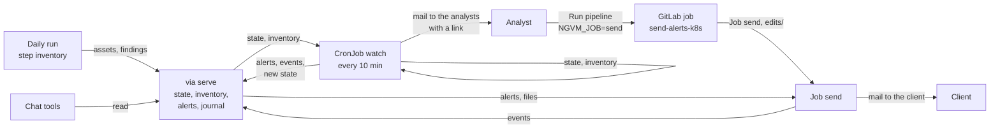
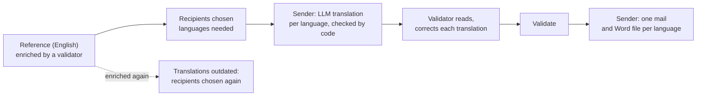

# VIA, Vulnerability Intelligence — low-level design

| Item | Value |
| --- | --- |
| Building block | Pillar 1 package `via` (command `via`): intel (`via.intel`, `via collect`) alert (`via.alert`, `via watch`, `via send` and their checks) and the watch service (`via.service`: `via serve`, `via service watch|send|push-inventory`, v0.16.0; review page and sender, v0.17.0) |
| Status | v0.17.1 as built |
| Place in the set | C4 level 3 of pillar 1 of the HLD ([`../hld/10-vulnerability-intelligence.md`](../hld/10-vulnerability-intelligence.md)). Goals, constraints and contracts: HLD. Servers, zones and flows: DAT. Operating guides: [`../alerts.md`](../alerts.md), [`../alert-word.md`](../alert-word.md), [`../gti.md`](../gti.md) |
| Code | `via/src/via/`, shared model and settings in `ngvm/src/ngvm/` |

This document says how VIA builds vulnerability records and how its watch turns new publications
into alert sheets validated by an analyst: commands, inputs and outputs, rules, configuration,
failure modes and tests. It is updated in the same merge request as the code it describes.

## 1. Scope

| VIA does | VIA does not |
| --- | --- |
| Build one record per CVE from the CVE record (CNA and CISA ADP containers), CISA KEV, FIRST EPSS and, when licensed, Google Threat Intelligence | Know a client when building records: `via collect` is tenant-independent |
| Watch the catalogue of sources every 10 minutes and keep what concerns each client | Decide a priority (pillar 3): its remediation delay is a first recommendation from the common SSVC tables |
| Draft an alert sheet per item that concerns the client, in the team's layout, in Markdown, HTML and optionally Word | Send anything to a client without an analyst running the send job |
| Mail the analysts the sheets to validate, then the client the validated ones; journal every step | Keep a history beyond the journal file (history database, P1) |

VIA imports only `ngvm` and itself (strategy D12) and runs alone in its image (§1.1).

### 1.1 Interfaces with the other pillars

Interfaces of the pillar with the other pillars, the tenant's jobs and the analysts' tools. Kinds:
an **API** is an HTTP service in the tenant's namespace, its contract an OpenAPI file of
`ngvm/src/ngvm/schemas/openapi/`, reached with a bearer token of a role; an **exchange file** is a
JSON file of the run, versioned, checked against its JSON Schema of `ngvm/src/ngvm/schemas/` on
write and on read; a **library** is code of `ngvm` that several pillars run, owned by one pillar.
No pillar imports another (D12). `tests/test_interfaces.py` checks that every contract of the
repository is in this table of its pillar and in HLD §6.

| Way | Interface | Kind | Contract | Other side | Access | When the other side is missing |
| --- | --- | --- | --- | --- | --- | --- |
| Provides | Vulnerability records (`records.json`) | Exchange file | `vulnerability_records.schema.json`, `vulnops.records/1` | detect (`detect inventory`), verdict (`verdict run`) | File of the run | — |
| Provides | Watch service (`via serve`, §3.7, §3.8) | API | `via.v1.yaml` | Daily run (step `inventory`), watch, send job and sender (role `run`); tool server of the chat (role `read`) | Run and read tokens | The daily run warns and goes on; the chat says the alerts are not available |
| Provides | Shared intelligence service (`via intel-serve`, §3.10, D17) | API | `intel.v1.yaml` | Every tenant's daily run (`via collect`), watch and send, the watch team's sender (role `radar`); the tool server of each tenant's chat (the radar, v0.23.2); one `read` token per tenant | Read and radar tokens | `via collect` reads the sources itself and says so; the watch's source `intel` fails for the passage (warning, error after 3 in a row); a radar event not published is said in the sender's log |
| Consumes | Last daily inventory (`assets.json`, `findings.json`, §3.4) | Exchange file | `assets.schema.json` `vulnops.assets/1`, `findings.schema.json` `vulnops.findings/2` | verdict (`verdict assets`), through the watch service or the runner cache | Run token (Kubernetes); runner cache or artifacts (GitLab) | Declared assets only, said in the log and the sheet |
| Provides | Compact findings for the watch (`watch-findings.json`, §3.4, v0.23.19) | Exchange file | `watch_findings.schema.json` `ngvm.watch_findings/1` | The watch service and the watch, from the daily run's step `inventory` | Run token | The watch names the assets of its previous inventory, or the declared assets only; the step says which |
| Consumes | Matching of declared assets | Library, owned by detect | `ngvm.declared` (LLD vulnerability-detection §1.1) | — | In process | — (always installed with ngvm) |
| Consumes | CISA SSVC tables and remediation delay | Library | `ngvm.ssvc` (LLD triage-prioritization §4.3) | — | In process | — |
| Consumes | Components matched against package advisories (D20, v0.23.0) | Library, owned by verdict | `ngvm.packages` (LLD triage-prioritization §14.7) | — | In process | — (always installed with ngvm) |
| Consumes | Applications matched through the tenant's applications table (D20, v0.23.3) | Library, owned by verdict | `ngvm.applications` (LLD triage-prioritization §14.7) | — | In process | — (always installed with ngvm); an empty table matches nothing |
| Consumes | Section `sla` of the profile, checked when the profile is read | Library | `ngvm.sla` (LLD triage-prioritization §17), through `ngvm.profile` | — | In process | — |
| Consumes | Client profile, contacts | Exchange file (tenant project) | `client_profile.schema.json`, `contacts.schema.json` | Tenant project | Files of the project or ConfigMap | Refused at start (exit 2) |

The watch matches each new item against the declared assets with `ngvm.declared` (version-aware,
the same code as `detect inventory`), names the assets of the last daily inventory, and writes the
CISA BOD 26-04 delay with `ngvm.ssvc.remediation_delay` (Automatable and Technical Impact from the
CISA ADP, else the CVSS vector, else `policy.unknown_inputs`). The triage of the next daily run may
refine that delay; the decision stays the triage's. Until v0.16.1 these two came from detect and
verdict through Python entry points (`ngvm.extensions`), which forced every pillar into the via
image; they were removed in v0.16.2.

## 2. Intel: `via collect`

### 2.1 Command

```text
via collect [--settings config/settings.yaml] [--cve ID]... [--cve-file FILE] [--since 26h|2d|ISO]
            [--include-updated] [--detect work/detect] [--fixtures DIR] [--out work/records.json]
```

CVEs requested, in this order and without duplicates: the explicit ones (`--cve`, `--cve-file`),
those found by scanners in the detection files (`--detect`), then those published since
`--since` (cvelistV5 delta log; `--include-updated` adds updated records) and the KEV additions
since that day. Exit 2 when no CVE is selected; otherwise 0, the per-CVE failures being listed in
the file. In the client pipeline, the `via` job runs `via collect --detect work/detect --since 26h`
(or `--cve` for each id of `TRIAGE_CVES`).

### 2.2 Sources

| Source | URL (settings key) | Cache | Content kept |
| --- | --- | --- | --- |
| CVE record | cvelistV5 on GitHub, `cves/{year}/{bucket}/{id}.json` (`cve_record_url`) | `cve_cache_hours`, 12 h | Description, CWE and names, every CVSS metric (4.0, 3.1, 3.0) with its source, `affected` blocks (CNA and ADP) with versions and CPEs, references with tags, CISA ADP SSVC (exploitation, automatable, technical impact) and KEV marker |
| Delta log | cvelistV5 `deltaLog.json` (`delta_log_url`) | 1 h | New (and updated) CVE ids since a date |
| CISA KEV | `known_exploited_vulnerabilities.json` (`kev_url`) | `feed_cache_hours`, 6 h | Catalogue entry (date added, required action, due date) |
| FIRST EPSS | `api.first.org/data/v1/epss` (`epss_url`), CVE ids by chunks | 6 h | Score and percentile |
| Google Threat Intelligence | VirusTotal API v3 `collections/vulnerability--cve-…` (`gti_url`), key in `GTI_API_KEY` | `gti_cache_hours`, 24 h | Exploitation state, exploit availability, risk rating, consequence, mitigations; prose for analysts only |
| Red Hat security data (v0.23.0) | `access.redhat.com/hydra/rest/securitydata/cve/<CVE>.json` (`redhat_url`) | `packages_cache_hours`, 12 h, a 404 too | The packages of each RHEL main release: the lowest fix (`affected_release`), else the state (`package_state`: affected, will not fix, fix deferred, under investigation, not affected); no EUS, no layered product, no module, no container |
| OSV, Debian and Ubuntu (v0.23.0) | `api.osv.dev/v1/vulns/DEBIAN-<CVE>`, `UBUNTU-<CVE>` (`osv_url`) | `packages_cache_hours`, 12 h, a 404 too | The ranges of each source package per release (`Debian:12`, `Ubuntu:22.04:LTS`; Ubuntu Pro left out) |

The package advisories (`sources.packages_sources`, default `redhat`, `debian`, `ubuntu`) are read
only when asked (`collect(..., packages=True)`: the watch, when the last inventory lists packages;
the shared service when a request carries `packages: true`), by CVE id only: no client's package
leaves. Each becomes an entry of `VulnRecord.packages` (`via.intel.packages`): `distro` (family and
release: `rhel:9`, `debian:12`, `ubuntu:22.04`), `name` (the source package), `introduced`,
`fixed`, `last_affected`, `state` (`fixed`, `affected`, `investigating`, `not_affected`),
`advisory`, `url`, `source` (`redhat`, `osv`). A source that fails loses only its advisories (a
`packages:` note). Red Hat's advisories apply to RHEL and to its rebuilds (Rocky Linux, AlmaLinux)
of the same major release, by version: a rebuild may lag behind the fix by a few days.

Every request goes through one HTTP client (proxy and CA from the environment) and a file cache
under `cache_dir` (`.cache`), keyed by the URL. Records are fetched in parallel
(`fetch_workers`, 8). With `--fixtures`, every source reads local files (tests, demos).

### 2.3 Rules

- One `VulnRecord` per CVE; a record not found, unreadable or rejected by the CVE program becomes
  an error entry of the file (`CVE rejected` is reported as ignored by pillar 3, not as an error).
- `best_cvss()`: the CNA's metric first, newest CVSS version first; the other metrics are kept.
- GTI (when `gti_enabled` and the key is set): one lookup per CVE, most urgent first, at most
  `gti_max_calls` network lookups per run (cache hits are free); a 401/403 stops GTI for the run.
  Only the CVE id leaves; the licensed prose is never sent to an LLM nor copied into a client
  deliverable.
- The record keeps its dates (since v0.15.2): `published` and `updated` (`datePublished`, `dateUpdated`
  of the CVE record), `epss_date` (the day of the EPSS score); the KEV entry keeps `dateAdded` and
  `dueDate`. Fields added to `vulnops.records/1`, optional.
- Output: `records.json` (`vulnops.records/1`): the ids requested, the records, the
  errors. Pillars 2 and 3 read it through `ngvm.io`.

## 3. Alert: the watch

### 3.1 Commands

```text
via watch client.yaml [--settings …] [--sources watch-sources.yaml] [--state .watch/state.json]
          [--out alerts] [--inventory auto|none|DIR] [--contacts contacts.yaml] [--journal FILE]
          [--fixtures DIR] [--no-llm]
via send client.yaml [--alerts alerts] [--only N|ID ...] [--edits edits] [--journal FILE]
         [--contacts contacts.yaml]
via check-sources [--sources …]    via contacts client.yaml    via test-mail [--to …]
via check-template [templates/alert.docx]
```

| Command | Exit codes |
| --- | --- |
| `watch` | 0 done; 2 profile unreadable or no asset matcher installed; 3 a source failed several runs in a row, a Word sheet failed, the contacts file is invalid or a mail to the analysts failed (warning: the alerts of the run are kept) |
| `send` | 0 sent (or nothing to send); 1 a chosen alert does not exist (nothing sent), or an alert has no recipient, an edited sheet is refused, its PDF cannot be made or its mail failed; 2 profile or contacts unreadable |

Jobs of the client pipeline: `watch` on the 10-minute schedule (`NGVM_JOB=watch`), then the
manual `send-alerts` (the analyst's validation) and `test-mail`; `validate` runs `via contacts`
and `via check-template` on every push.

### 3.2 Discovery

The catalogue (`config/watch-sources.yaml`, or the client project's own) lists the sources, each
with a kind, a category (institutional, vendor, research) and whether it is enabled:

| Kind | What is new |
| --- | --- |
| `certfr` | CERT-FR alerts and advisories (RSS, then the JSON view of each publication) |
| `kev` | CVEs added to CISA KEV |
| `cvelist` | New CVE records (delta log); `cna` entries label the records of vendors that publish as CNA without a feed |
| `rss` | Any RSS 2.0, Atom or RDF feed |
| `csaf` | CSAF providers, read from their `changes.csv` (CISA advisories since v0.11.3) |

The state file (`.watch/state.json`, kept in the runner cache `watch-state`) remembers per source
the ids already seen (3 000 at most), the newest CSAF timestamp, the CVEs alerted and the date,
and the consecutive failures. The first run of a source records its state and alerts on nothing;
a source gives at most 40 new items per run. A source is reported in error only after
`NGVM_SOURCE_FAILURES` (3) failed runs in a row; before, a warning.

### 3.3 Relevance and level

For the new items, the records of their CVEs are collected (section 2). An item concerns the
client when at least one of these holds:

1. the asset matcher of pillar 2 finds one of its CVEs on a declared asset of the profile;
2. a product it names matches a declared asset or the client's watchlist (`alerts.watchlist`):
   whole words, and only names precise enough to search in free text (several words, or five
   letters or more);
3. one of its CVEs is a finding of the last daily inventory (section 3.4);
4. the packages listed on a host of the last daily inventory hold a version its package
   advisories say is affected, or a package named like a product of the record sits on a
   distribution they do not cover yet (D20, v0.23.0, section 3.4).

An item whose every CVE was alerted in the last 14 days is skipped, except a KEV addition. Its
level is `urgent` when one reason holds, else `info`: exploited (KEV, or GTI confirmed), an urgent
source publication, exploitation or proof of concept reported by CISA ADP, a critical CVE (KEV,
exploited, or CVSS 9.0+) on an asset exposed `open` (a host exposed by its packages included). `info` alerts are drafted only when the
profile asks for them (`alerts.level: all`).

### 3.4 Last daily inventory

`--inventory auto`: the copy the daily `triage` job leaves in the runner cache (key `inventory`,
`work/assets/<client>/`), else the artifacts of the project's last successful `triage` job through
the GitLab API (project access token `NGVM_GITLAB_TOKEN`, required on GitLab CE). An inventory older
than 8 days is still used, with a warning in the job log. Only the exchange files of the common contract are read; the alert sheet
then lists the assets concerned with zone, exposure, installed and fixed versions, owner, source
and inventory date.

On Kubernetes the daily run's step `inventory` sends it to the watch service (`via service
push-inventory`): the assets without their scan dates (v0.23.18) and, since v0.23.19, the findings
compact (`watch-findings.json`, `ngvm.watch_findings/1`, `via.alert.inventory.for_watch`): per asset,
each finding as `[cve, status, affected versions, [[source, package, installed, fixed], ...]]`, what
the sheet shows. 26,000 findings were 120 MB in `vulnops.findings/2` and 75 MB slimmed: over the 50 MB
the service accepts (`watch.maxMb`, `NGVM_WATCH_MAX_MB`), the watch had no inventory at all. The
service replaces the inventory whole, says it in its `status` (date, assets, findings), and the step
says what the watch keeps when it is refused. `load` reads the compact file, else `findings.json`
(GitLab mode, the runner cache or the artifacts).

Since v0.23.0 (HLD D20) the hosts whose packages are listed (`components`, with their source and
date) are matched against the package advisories of each record (`ngvm.packages`): the source
package of each component, or its own name, on the family of its distribution (`distro`, else the
asset's OS for a v0.22.2 listing), its version compared the way rpm or dpkg does. Each asset of
the sheet then carries a level of proof (column Proof):

| Level | When |
| --- | --- |
| confirmed | A scan or an authenticated check of the last daily run sees the flaw (a finding) |
| exposed | A listed package is in an affected range (a fix exists: its version; else "no fix yet"), with the date of the listing; or a version declared in the profile is in the range of the CVE record |
| possible | The product is there, its version against the record not decided: a package named like a product of the record on a distribution the advisories do not cover (yet: a new CVE often comes before its advisories), a distribution still investigating, a declared asset without a version, a product named by the publication |

An asset confirmed by a scan is not repeated as exposed. The level is evidence for the analyst; it
decides nothing (HLD D4), and pillar 3 takes the decision at the next daily run.

Since v0.23.3 the applications of an EDR (SentinelOne, the Windows and macOS agents of Wazuh: LLD
vulnerability-detection §3.6, §3.7) are matched too. They are not packages of a distribution: no
advisory names them, only the CVE records do, by vendor and product. Each tenant keeps an
**applications table** (`ngvm.applications`): one row per application, its name reduced to a key
(`<publisher>|<product>`: versions, architectures, languages, update numbers left out, `Mozilla
Firefox (x64 fr)` by `Mozilla` is `mozilla|mozilla firefox`), and the CPE vendor and product it is
(`cpe:2.3:a:mozilla:firefox`).

| Row | Who | Effect on the watch |
| --- | --- | --- |
| new | The watch service, when an inventory brings an application it does not know | None |
| proposed | The tenant's LLM, a few per passage of the watch (`NGVM_APPLICATIONS_PER_PASSAGE`, 40, the most widespread first): a CPE, or none (a driver, a runtime, an update) | Possible ("mapping to validate") when the record names that product and the version is in its range or undecided |
| validated | A validator on the review page (§3.8): the proposal, or a CPE typed | Exposed when the version is in an affected range of the record's blocks naming that vendor and product (by their CPE, else by their names), with the fixed version (`lessThan`); possible ("version not decided") when the record does not decide; nothing out of every range |
| rejected | A validator: not a product of CVE records | None |

A row decided by an analyst is never changed by the LLM; an application gone from the inventory
keeps its row and its decision (0 hosts). The table lives in the watch service (files:
`applications.json`; PostgreSQL: `via.applications`, migration 2), filled on each `POST inventory`,
read by the watch with the inventory (`GET applications`), the LLM's proposals sent back after the
passage (`POST applications/proposals`). In the GitLab mode there is no service to keep proposals:
the watch reads `applications.yaml` of the tenant project (`{vendor, name, cpe}`, each line
validated by the merge request that adds it, no `cpe`: rejected) and says how many applications
have none. As for the packages, the level decides nothing (D4).

### 3.5 Alert sheet

`fiche.build` writes, in English since v0.17.1 (the reference, §3.9) and in the team's layout:
what makes it urgent, the client's assets concerned, CVE, affected product (versions, "no fix found
to date" when none), vulnerability type (CWE), CVSS (score, rating, vector), main impact,
exploitation status (known exploitation, public exploit, fix, workaround), description, recommended
delay (`ngvm.ssvc`, §1.1) and links. Labels come from the catalogue `via.alert.i18n` (English,
French), never from a model. Identifiers, scores, versions, dates and links are written by code;
the LLM writes only the title, the main impact, the description and a one-sentence product
description, in English (section 5). Text the sources give in another language (a CERT-FR
publication's affected systems and risks) is quoted as given. Outputs per alert in `alerts/`:
`<id>.md`, `<id>.html`, `index.json` (id, level, title, prose source, CVEs) and, when the
profile's `alerts.attach` asks for `docx` or `pdf`, the Word sheet `<id>.docx` in English and, for
each language of the contacts, `<id>.ctx.<lang>.json`: the facts of the Word file laid out in that
language, which the sender completes with the prose validated in it (§3.9); tags:
[`../alert-word.md`](../alert-word.md).

### 3.6 Validation and sending

1. The watch mails each sheet to the analysts (`NGVM_ANALYST_TO`), with the alert number in the
   pipeline, its id, the client recipients, how to send it and how to edit it; the Word file is
   attached.
2. The analyst may commit `edits/<id>.md` (replaces the text) and `edits/<id>.docx` (replaces the
   Word file) on the default branch; an edited text citing a CVE the alert does not is refused.
3. The analyst runs `send-alerts`, for every alert of the pipeline or those named in
   `NGVM_SEND_ONLY` (numbers or ids; an unknown one sends nothing). Recipients: `contacts.yaml` by
   level (`receive`, `active`) and the profile's `alerts.recipients`. Attachments: the Word file
   and/or a PDF made from it by LibreOffice in the job.
4. Mail: SMTP or Microsoft Graph (`NGVM_MAIL_TRANSPORT`); without `NGVM_SMTP_HOST`, a `.eml` is
   written instead (dry run).

Journal: `drafted`, `analysts`, `sent`, `send-failed` events, one JSON line each, appended to
`.watch/alerts-log.jsonl` (5 000 lines kept) and copied into the job artifacts; `sent.json` lists
the mails of the send job.

### 3.7 The watch on Kubernetes (v0.16.0)

With `NGVM_RUN_MODE=kubernetes` on the tenant project, the watch leaves GitLab: what the runner
cache and the artifacts kept is kept by the watch service of the tenant, `via serve`, in its
namespace (contract `ngvm/schemas/openapi/via.v1.yaml`, chart `templates/watch.yaml`).



| Part | What it does |
| --- | --- |
| `via serve` | The only writer, on its own volume (one replica) or, since v0.18.0 with the tenant's database, in PostgreSQL (`via/service/pgstore.py`: schema `via`, row-level security per tenant, a passage of the watch in one transaction; several replicas): the watch's state (opaque to it), the last inventory of the daily run, each passage that drafted alerts (`index.json` and the sheets), the journal. Runs older than `watch.keepDays` (30) are removed; the journal keeps its last 5,000 lines. Roles: `run` (the tenant's jobs) and `read` (the chat's tools: alerts and sheets, never the state nor the files to send). Sends nothing |
| Daily run, step `inventory` | After `triage`, `via service push-inventory`: `assets.json` of the run without the scan dates and, since v0.23.19, its findings compact (`watch-findings.json`, `ngvm.watch_findings/1`; checked against `vulnops.assets/1` and that schema, the tenant's own; `vulnops.findings/2` still accepted). The inventory replaces the previous one whole. A failure is a warning, and the step says what the watch keeps (the service's `status`: the inventory's date and size, or none) |
| CronJob `watch` | Every 10 minutes, one at a time: `via service watch` gets the state (none: this passage records the baseline, as a first watch in GitLab) and the inventory, runs the same `via watch` as the pipeline, then gives the service the new state, the events and the alerts' files. If the service cannot be reached the state is not saved: the next passage sees the same items again. Exit 3 (a source down, a mail failed) is a warning |
| Analysts' mail | As in GitLab, with in place of the pipeline's job a link to a new pipeline of the tenant project, `NGVM_JOB=send` and `NGVM_SEND_ONLY=<alert id>` filled in (`NGVM_SEND_PIPELINE_URL`, `NGVM_SEND_REF`, set by the chart) |
| GitLab job `send-alerts-k8s` | Runs in that pipeline: keeps only the characters of alert ids from `NGVM_SEND_ONLY`, hands `edits/` of the branch to the cluster as a ConfigMap, renders the send Job from the values of the deployed release (`helm get values`, `--show-only templates/watch.yaml`), waits for it and shows its log |
| Job `send` | `via service send`: the named alerts (none named: the pending alerts of the latest passage) and their files from the service, the same `via send` (edits, recipients, attachments), the events back to the journal. An alert already sent is refused unless `--again`; an unknown id sends nothing |
| Chat | `list_alerts`, `get_alert` of the tool server read the service (LLD triage-prioritization §16.1) |

Tokens: `via-run-token` (daily run, watch, send) and `via-read-token` (the tool server) in the
Secret `ngvm-tenant`, their digests in `ngvm-via`, made once by `deploy-k8s`. The watch's files:
`contacts.yaml`, `watch-sources.yaml` (chart `files.*`) and `templates/alert*.docx` (ConfigMap
`ngvm-alert-template`), copied beside the profile in each pod. Mail: the non-secret settings in
`env`, `smtp-password` and `graph-client-secret` from the Secret. The watch needs via and ngvm only
(§1.1): the via image holds no other pillar since v0.16.2. Limit: a PDF attachment needs
LibreOffice, which the via image does not hold; a profile with `alerts.attach: [pdf]` gets its
alerts refused at sending ("PDF … not sent") on Kubernetes: Word only, or the GitLab mode.

### 3.8 Review page and sender (v0.17.0)

With `NGVM_ALERTS_HOST` and the analysts' sign-in (`NGVM_OIDC_*`, `docs/sign-in.md`), the
validation leaves GitLab too: the analysts' mail links to the alert on a review page served by
`via serve`, and a sender mails what a validator validated.

| Part | What it does |
| --- | --- |
| oauth2-proxy (`ngvm-<tenant>-review`) | Behind the ingress; signs the analyst in with the tenant's identity provider (authorization code, PKCE), lets in the members of the readers' and validators' groups only, and passes `X-Forwarded-Email` and `X-Forwarded-Groups` to the page. A Keycloak full group path names the same group as its last part |
| Review page (`via serve --review-port 8081`, `via.service.review`) | Reached from oauth2-proxy only (NetworkPolicy), so its identity headers are trusted there and nowhere else. List of the alerts (to process: pending, validated, failed; or by status), one alert with its sheet (as corrected, if so) and its history. A validator corrects the sheet (Markdown of the watch; a CVE the alert does not concern is refused, as in `via send`), validates it for sending, or dismisses it; a reader reads. Every form carries an HMAC of the analyst and the alert (`review-key`) and must come from the page's origin; Content-Security-Policy `default-src 'none'`, no script |
| Journal | `edited`, `validated`, `dismissed` with `by` (the analyst's e-mail), beside the jobs' events. Status: the last of validated, dismissed, sent, send-failed; none: pending |
| Sender (`ngvm-<tenant>-sender`) | `via service send --validated --every 30`: one replica; each pass takes the validated alerts, their files and corrected sheets (`GET …/alerts/{alert}/edit`), runs the same `via send` (recipients, attachments, a corrected sheet replaces the text of the mail, the Word file stays the watch's), and gives the events back. A failed sending leaves the alert `failed` until a validator validates it again: never a loop, never twice |
| Analysts' mail | Links to `https://<review host>/alerts/<id>` (`NGVM_REVIEW_URL`); without the page, to the prefilled pipeline as in §3.7 |
| Chat | `get_alert` gives the corrected sheet; `list_alerts` the new statuses |
| Applications (v0.23.3) | `/applications`: the tenant's applications table by state (proposed first), with the publisher, the name, the hosts, versions and sources of each, the LLM's proposal and its reason, the decision and who made it. A validator validates the proposal or a CPE typed (`cpe:2.3:a:<vendor>:<product>`, further fields dropped), marks it as no product, or resets it to new; a reader reads. Each form carries an HMAC of the analyst and the row; the decision is kept in the row (`decided_by`, `decided_at`, `note`) and logged |

Who did what is in the journal; `via serve` and the page hold no mail secret and no Kubernetes
right; only the sender mails. The GitLab path of §3.7 (`send-alerts-k8s`) stays for a tenant
without sign-in.

### 3.9 English reference and translations (v0.17.1)

NGVM writes in English (HLD D16). The sheet the watch drafts is the English reference; each contact
of `contacts.yaml` has a `language` (ISO 639-1, default `en`). On the review page:



| Step | What happens |
| --- | --- |
| Enrich | A validator edits the English reference (event `edited`; status back to `pending`). |
| Choose | A validator ticks the recipients among the contacts of the alert's level (and the profile's `alerts.recipients`, in English); event `translation-requested` with `to`, `languages` (every language but English) and the hash of the reference; status `translating`. |
| Translate | The sender (`via.alert.translate`), at its next pass: the tenant's LLM translates the reference into each language asked for; code then checks the structure (same lines, same kinds), that every CVE id and URL of the reference is there, and that no version, score or CVE id was added (`ngvm.llm.guard`); in a language of the catalogue, it sets the headings and the asset table's header from the catalogue. Refused: the reason is shown, and a validator can write the translation by hand. Events `translated`, `translation-failed`. |
| Check | A validator reads each translation beside the reference and corrects it (event `translation-edited`). A translation is *fresh* while the reference keeps the hash it was made from; enriching the reference outdates it. |
| Validate | Only when every language asked for is fresh; event `validated` with the recipients. |
| Send | The sender groups the recipients by language and mails each group its version: the reference in English, the validated translation otherwise. The Word file of a language is the facts laid out by the watch in it (`<id>.ctx.<lang>.json`) with the title, main impact and description of the version validated in it (`word.with_text`), in the template `templates/alert.<lang>.docx`, else `alerts.word_template`, else `templates/alert.docx`, else the neutral template of the language. A language outside the catalogue (English, French) gets the translated mail and an English Word file. Events `sent`, `send-failed` per language; one language failed leaves the alert `failed` until it is validated again. |

The page translates nothing and reaches no model: only the sender calls the LLM, the tenant's
approved endpoint. The GitLab path (`send-alerts`, `send-alerts-k8s`) sends the English reference
to every recipient.


### 3.10 The shared intelligence service (v0.22.0, HLD D17)

`via intel-serve`, one replica in the namespace of the watch team (`ngvm-via`, chart value
`intel.serve.enabled` of the tenant `via`), contract `intel.v1.yaml`, code `via/intel/service.py`:

| Call | Role | What |
| --- | --- | --- |
| `POST /v1/records` | `read` | The records of up to 5000 CVE ids: `collect_direct`, one collection at a time (one cache, one GTI quota for every tenant) |
| `POST /v1/technologies` | `read` | The technologies a tenant watches (vendor, product, CPE); kept with the time they were last sent, never who sent them, dropped after 48 hours |
| `GET /v1/feed?since=` | `read` | The items after the mark, the next mark; items kept 30 days, 5000 at most. Since v0.23.2 also `until`, `kind` (radar, gti), `level`, `cve`, and `since`/`until` as a day or a date and time: the tool server of each tenant's chat asks the radar's events of a period (`list_radar_events`, LLD triage §16.1); the intel pod's network policy lets the tenants' `tools` pods in |
| `POST /v1/radar/events` | `radar` | A validated radar event; the same id again replaces it, after every reader's mark |
| `GET /v1/records/new` | `read` | The CVE records published or updated in a period (v0.23.4, the chat's `list_new_cves`): cvelistV5's deltaLog (about 30 days, read at most every 9 minutes), the latest change of each CVE, newest first; `since`, `until`, `change`, `kev`, `min_cvss` (those two read every record of the period), a page of 50 at most whose records are given in short |
| `GET /v1/osv/<ecosystem>` | `read` | The index of OSV for one language ecosystem (v0.23.12, `ngvm.osvdb`, LLD detection §3.10): rebuilt every `--osv-every-hours` (6) from OSV's archive when its ETag changed, gzipped JSON with an ETag (304 when the reader's copy is the same), 503 before the first build. The tenants' daily runs match their libraries against it at home: the service receives no library |

Every tenant names the service in `NGVM_INTEL_URL` and holds a `read` token (file
`NGVM_INTEL_TOKEN_FILE`; chart: `intel.url`, key `intel-token`). Then `via collect` asks it for the
records (`collect_shared`) and, when it cannot answer, reads the sources itself (a note), unless
`intel_fallback: false` (v0.23.4, `NGVM_INTEL_FALLBACK=false`: a tenant that must never reach the
Internet; the run then fails with "the sources are not read"); the watch
sends its technologies (declared products and watchlist) at most every 12 hours, and reads the feed
as a source of kind `intel` (§3.2): a radar event is an item whose products are its affected systems,
matched like any publication (§3.3), urgent when the radar said so; a GTI item carries GTI's facts.

GTI enabled (`NGVM_GTI_ENABLED`, `GTI_API_KEY` of the watch team), the service searches every
`--gti-every-hours` (6) the vulnerabilities GTI changed in the last two days on each technology
watched (`GET collections?filter=collection_type:vulnerability AND vulnerable_product:"…" AND
vulnerable_vendor:"…" AND last_modification_date:<day>+`, budget `gti_max_calls`), and puts each new
one in the feed with GTI's facts (exploitation state, exploit availability, risk rating) and a link,
never its prose. Only the technology's name leaves towards GTI.

### 3.11 The radar of the watch team (v0.22.0)

A profile with `alerts.mode: radar` (the tenant `via`, no asset) runs the same watch, review page and
sender, but `via.alert.radar` replaces the relevance of §3.3: the items of every source become
events, and the team is alerted on the events whose magnitude passes a threshold, whoever they
concern. Guide: [`../radar.md`](../radar.md).

| Step | Rule |
| --- | --- |
| Sources | The catalogue, plus the sources marked `radar_only` (research and news sites, to check with `via check-sources` before enabling them) and the GTI search `gti-radar` (kind `gti`, GTI enabled only: vulnerabilities with exploitation confirmed or wide, tagged zero-day, or rated critical, changed since the last day; each one once per exploitation state). A client's watch never reads them |
| Event | An item joins the event of the last `window_hours` (72) that shares a CVE; else whose title shares at least two words and most of the shorter title (stop words left out); else, the item carrying CVE ids, the event without one whose sources name the same product or whose title words hold it. Else a new event |
| Weight of an item | KEV, exploitation confirmed by GTI, or a source whose publications are all urgent (CERT-FR alerts): 3; any other: 1; a CVSS of 9 or more: +1 |
| Markers | Found in the titles, summaries and record descriptions, English and French: exploited in the wild 3 (also when KEV or GTI says so), zero-day 2, without authentication 1, remote code execution 1, proof of concept 1 |
| Magnitude | The strongest weight + the markers + 2 per other independent source (6 at most) |
| Alert | When the magnitude reaches `info` (4) or `urgent` (7) (`alerts.radar` of the profile); again when it moves up a level; once more when the event gets its first CVE ids. Events kept `keep_days` (14) after their last item |
| Sheet | The same headings as every alert (translations check them): why (magnitude, signals, number of sources), not matched to a client's assets, the strongest source's text, every source in the links |
| Validation | On the review page, by the team; the sender then publishes the event to the shared service (`NGVM_INTEL_URL`, token file `NGVM_INTEL_RADAR_TOKEN_FILE`): title, public summary, CVE ids, products, markers, links, magnitude. Each client's watch matches it with its own assets (§3.10) |

The magnitude is deterministic (D11); the LLM writes the sheet's prose, guarded as any sheet. Since
v0.22.2 it also proposes, for the events about to be alerted (at most `llm_calls` per passage):
the product of a publication that names none (`radar_product`, vendor and product), and the open
event a new one may be the same news as (`radar_same_event`, among at most five recent events that
share words with it; an id not among them is dropped). Both are kept in `proposals` of the event
with the model and shown on the sheet "to check"; they gather nothing and change no score. Since
v0.22.2 the score takes each source's own weight and markers, the best source counting, and a
publication with more than `bulk_cves` CVEs (10) never gathers by a shared CVE.

### 3.12 The analysts' Teams channel (v0.22.0)

Every alert the watch drafts is also posted to a Teams webhook when one is set: the file
`NGVM_TEAMS_WEBHOOK_FILE` (chart: key `teams-webhook` of the tenant's secret) or the masked CI/CD
variable `NGVM_TEAMS_WEBHOOK`. The message is an Adaptive Card (accepted by the Workflows of Teams
and by the older incoming webhooks): level, title, CVE ids, tenant, the radar's magnitude, a button
to the review page (or the pipeline). No sheet: the analysts read and validate on the page. A failure
is an error of the passage (exit 3) and stops the other posts of that passage; the address never
appears in a log.

### 3.13 The way out to the Internet (v0.23.4)

Design: [`../hld/proposals/intel-placement.md`](../hld/proposals/intel-placement.md), topology R.
Every request to a public source goes through one httpx client (`via.intel.sources.Sources`):
records, deltaLog, KEV, EPSS, CERT-FR, the watch's feeds and CSAF documents (found in providers'
metadata), package advisories.

| Item | Design |
| --- | --- |
| Relay of the sources | `sources.relay_url`, `relay_hosts`, `relay_token_file` (`NGVM_RELAY_URL`, `NGVM_RELAY_HOSTS`, `NGVM_RELAY_TOKEN_FILE` or `NGVM_RELAY_TOKEN`). One request hook of the client rewrites `https://<host>/<path>` into `<relay>/<host>/<path>` for a host listed, with the header `X-NGVM-Relay-Token`, before each request, redirects included; any other URL is left alone. A request with `Authorization`, `X-Apikey` or `Proxy-Authorization` (GTI) never goes through it. The relay must be https. `Relay.routes` counts the requests by route; `via check-sources` shows the route of each source; the watch and `via collect` log the relay (`describe_relay`, never the token) |
| The relay itself | `deploy/relay/` (Terraform Scaleway, cloud-init, Caddy): one `handle_path` per host in one `route` block, after the checks (address allowlist 403, token 401, credentials 400, a method other than GET or HEAD 405); the token removed before the upstream and from the log; Let's Encrypt |
| Outgoing proxy | The httpx clients honour `HTTPS_PROXY`, `NO_PROXY` and `SSL_CERT_FILE` (default `trust_env`): the LLM, the shared service, Microsoft Graph, Teams, GTI. Chart `proxy.https`, `proxy.noProxy` (added to `.svc`, `.cluster.local`, `localhost`, `127.0.0.1`), `proxy.ca` (key `ca-bundle` of the tenant's Secret: the system CAs and the proxy's, made by `deploy-k8s` from `NGVM_PROXY_CA`); in the daily run, the watch's jobs and the intel pod. SMTP goes direct (or through a relay of mail) |
| A tenant that never reads the sources | `intel_fallback: false` (`NGVM_INTEL_FALLBACK`): the shared service unreachable fails `via collect`; the watch catalogue of such a tenant keeps the sources of kind `intel` only |

## 4. Configuration

| Key | Default | Effect |
| --- | --- | --- |
| `sources.*` (settings) | section 2.2 | URLs, caches, workers, GTI switch and budget, the package advisories read (`packages_sources`, v0.23.0) |
| `NGVM_GTI_ENABLED`, `GTI_API_KEY` | off | GTI enrichment |
| `alerts.level` (profile) | `urgent` | `all` also drafts `info` alerts |
| `alerts.recipients` (profile) | — | Always receive every alert |
| `alerts.attach`, `alerts.word_template` (profile) | — | `docx` and/or `pdf`; template path |
| `alerts.watchlist` (profile) | — | Products watched whether detected or not ("vendor product") |
| `NGVM_ANALYST_TO` | — | Analysts who validate |
| `NGVM_SEND_ONLY` | all | Alerts sent by the send job (on Kubernetes: ids; none: the pending alerts of the latest passage) |
| `NGVM_RUN_MODE` (tenant `.gitlab-ci.yml`) | `gitlab` | `kubernetes`: the watch on Kubernetes (3.7) |
| `NGVM_SOURCE_FAILURES` | 3 | Failed runs in a row before a source is in error |
| `NGVM_GITLAB_TOKEN` | job token | Reads the last triage artifacts (GitLab CE needs a project token) |
| `NGVM_INTEL_URL`, `NGVM_INTEL_TOKEN_FILE` | — | The shared intelligence service and the tenant's read token (3.10) |
| `NGVM_INTEL_RADAR_TOKEN_FILE` | — | The watch team's sender: publishes the validated radar events (3.11) |
| `alerts.mode`, `alerts.radar` (profile) | `client` | `radar`: the radar of the watch team, its thresholds (3.11) |
| `NGVM_TEAMS_WEBHOOK_FILE`, `NGVM_TEAMS_WEBHOOK` | — | The analysts' Teams webhook (3.12) |
| Mail variables | — | [`../alerts.md`](../alerts.md) |

## 5. LLM

| Task | When | Output | Checks and fallback |
| --- | --- | --- | --- |
| Sheet prose | Each alert, when `llm.enabled` | Main impact (one sentence), description (two paragraphs), product description (one sentence), JSON schema | Guard: any CVE id, version or score absent from the facts rejects the text; then the source text is used and the sheet says where its prose comes from |
| CPE of an application (v0.23.3, §3.4) | A passage of the watch on Kubernetes, for the rows still new, 20 per call, 40 per passage | CPE vendor and product, or none, and one sentence, JSON schema | A malformed CPE is no proposal; a failed call leaves the rows new for the next passage; a proposal names a host as possible only, a validator decides (D11). Without an LLM the rows wait for an analyst |

Vendor and advisory texts are passed as untrusted data; the model has no tools; GTI prose is never
sent. The watch never fails because of the LLM.

Several endpoints of the tenant's model: the shared LLM client moves to the next one when one is
down (v0.15.0, LLD triage-prioritization §7.1).

## 6. Failure modes

| Situation | Behaviour |
| --- | --- |
| A source unreachable or changed | Skipped for the run, a warning; an error after 3 failed runs in a row (exit 3); the other sources go on |
| First run, or state lost | Baseline recorded, no alert |
| A feed that resets itself | 40 new items per source and run at most |
| No inventory (cache empty, artifacts expired, token refused) | Declared assets only; the log says why |
| Word template broken | The sheet is mailed without the Word file; error listed (exit 3); `validate` checks the template on push |
| Mail to the analysts fails | Alerts kept in the artifacts, error (exit 3), event journaled |
| Edited sheet citing another CVE, or empty; PDF impossible | That alert is not sent (exit 1), the others are |
| Applications table unreachable or empty (v0.23.3) | The applications of the EDRs match nothing; packages and declared assets as before |

## 7. Tests

| Test file | Covers |
| --- | --- |
| `tests/test_alert.py` | CERT-FR feed, baseline then alerts, `info` alerts only with `level: all`, sheet prose by the LLM and its guard, Graph transport, contacts by level, inventory (cache, artifacts, old one flagged), analysts' mail numbering and journal, choice of alerts, test mail |
| `tests/test_feeds.py` | RSS, Atom, RDF, CSAF index, watch with a catalogue, `check-sources`, catalogue validity |
| `tests/test_gti.py` | GTI view and exploitation mapping, enrichment round trip, disabled by default, request and key, refused key, budget, sheet uses GTI facts and never its prose |
| `tests/test_word.py` | CVSS calculator and vector words, template check, Word sheet attached and edits used, client template wins, PDF from the Word sheet, no PDF without LibreOffice |
| `tests/test_v0113.py` | Source failures in a row, CSAF index of CISA (and the include ref check of `validate`) |
| `tests/test_v0220.py` | Radar: markers, events, magnitude, CVE joining an event, payload, radar watch on fixtures; shared service: records, tokens, fallback of `via collect`, technologies kept 48 hours, feed marks, radar events, GTI search on the technologies (no prose); a tenant's watch reading the feed; technologies sent twice a day; publication of a validated event; Teams card, no address in errors |

## 8. Open points

- Watch on CVEs not yet in the last inventory: needs the full package list of each host.
- Pillar 1 as a service: the record API is the shared service (v0.22.0); the collection still runs
  in each tenant's daily run, through it.
- The technologies sent to the shared service: also the packages the daily inventory found.
- Translation into the tenant's reporting language.
- Vulners, vendor CSAF beyond CISA, OpenCTI.
