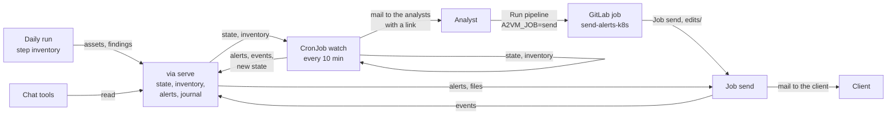

# VIA, Vulnerability Intelligence — low-level design

| Item | Value |
| --- | --- |
| Building block | Pillar 1 package `via` (command `via`): intel (`via.intel`, `via collect`) alert (`via.alert`, `via watch`, `via send` and their checks) and the watch service (`via.service`: `via serve`, `via service watch|send|push-inventory`, v0.16.0; review page and sender, v0.17.0) |
| Status | v0.17.0 as built |
| Place in the set | C4 level 3 of pillar 1 of the HLD ([`../hld/10-vulnerability-intelligence.md`](../hld/10-vulnerability-intelligence.md)). Goals, constraints and contracts: HLD. Servers, zones and flows: DAT. Operating guides: [`../alerts.md`](../alerts.md), [`../alert-word.md`](../alert-word.md), [`../gti.md`](../gti.md) |
| Code | `via/src/via/`, shared model and settings in `a2vm/src/a2vm/` |

This document says how VIA builds vulnerability records and how its watch turns new publications
into alert sheets validated by an analyst: commands, inputs and outputs, rules, configuration,
failure modes and tests. It is updated in the same merge request as the code it describes.

## 1. Scope

| VIA does | VIA does not |
| --- | --- |
| Build one record per CVE from the CVE record (CNA and CISA ADP containers), CISA KEV, FIRST EPSS and, when licensed, Google Threat Intelligence | Know a client when building records: `via collect` is tenant-independent |
| Watch the catalogue of sources every 10 minutes and keep what concerns each client | Decide a priority (pillar 3): its remediation delay is a first recommendation from the common SSVC tables |
| Draft an alert sheet per item that concerns the client, in the team's layout, in Markdown, HTML and optionally Word | Send anything to a client without an analyst running the send job |
| Mail the analysts the sheets to validate, then the client the validated ones; journal every step | Keep a history beyond the journal file (history database, P1) |

VIA imports only `a2vm` and itself (strategy D12) and runs alone in its image (§1.1).

### 1.1 Interfaces with the other pillars

Interfaces of the pillar with the other pillars, the tenant's jobs and the analysts' tools. Kinds:
an **API** is an HTTP service in the tenant's namespace, its contract an OpenAPI file of
`a2vm/src/a2vm/schemas/openapi/`, reached with a bearer token of a role; an **exchange file** is a
JSON file of the run, versioned, checked against its JSON Schema of `a2vm/src/a2vm/schemas/` on
write and on read; a **library** is code of `a2vm` that several pillars run, owned by one pillar.
No pillar imports another (D12). `tests/test_interfaces.py` checks that every contract of the
repository is in this table of its pillar and in HLD §6.

| Way | Interface | Kind | Contract | Other side | Access | When the other side is missing |
| --- | --- | --- | --- | --- | --- | --- |
| Provides | Vulnerability records (`records.json`) | Exchange file | `vulnerability_records.schema.json`, `vulnops.records/1` | detect (`detect inventory`), verdict (`verdict run`) | File of the run | — |
| Provides | Watch service (`via serve`, §3.7, §3.8) | API | `via.v1.yaml` | Daily run (step `inventory`), watch, send job and sender (role `run`); tool server of the chat (role `read`) | Run and read tokens | The daily run warns and goes on; the chat says the alerts are not available |
| Consumes | Last daily inventory (`assets.json`, `findings.json`, §3.4) | Exchange file | `assets.schema.json` `vulnops.assets/1`, `findings.schema.json` `vulnops.findings/2` | verdict (`verdict assets`), through the watch service or the runner cache | Run token (Kubernetes); runner cache or artifacts (GitLab) | Declared assets only, said in the log and the sheet |
| Consumes | Matching of declared assets | Library, owned by detect | `a2vm.declared` (LLD vulnerability-detection §1.1) | — | In process | — (always installed with a2vm) |
| Consumes | CISA SSVC tables and remediation delay | Library | `a2vm.ssvc` (LLD triage-prioritization §4.3) | — | In process | — |
| Consumes | Client profile, contacts | Exchange file (tenant project) | `client_profile.schema.json`, `contacts.schema.json` | Tenant project | Files of the project or ConfigMap | Refused at start (exit 2) |

The watch matches each new item against the declared assets with `a2vm.declared` (version-aware,
the same code as `detect inventory`), names the assets of the last daily inventory, and writes the
CISA BOD 26-04 delay with `a2vm.ssvc.remediation_delay` (Automatable and Technical Impact from the
CISA ADP, else the CVSS vector, else `policy.unknown_inputs`). The triage of the next daily run may
refine that delay; the decision stays the triage's. Until v0.16.1 these two came from detect and
verdict through Python entry points (`a2vm.extensions`), which forced every pillar into the via
image; they were removed in v0.16.2.

## 2. Intel: `via collect`

### 2.1 Command

```text
via collect [--settings config/settings.yaml] [--cve ID]... [--cve-file FILE] [--since 26h|2d|ISO]
            [--include-updated] [--detect work/detect] [--fixtures DIR] [--out work/records.json]
```

CVEs requested, in this order and without duplicates: the explicit ones (`--cve`, `--cve-file`),
those found by scanners in the detection files (`--detect`), then those published since
`--since` (cvelistV5 delta log; `--include-updated` adds updated records) and the KEV additions
since that day. Exit 2 when no CVE is selected; otherwise 0, the per-CVE failures being listed in
the file. In the client pipeline, the `via` job runs `via collect --detect work/detect --since 26h`
(or `--cve` for each id of `TRIAGE_CVES`).

### 2.2 Sources

| Source | URL (settings key) | Cache | Content kept |
| --- | --- | --- | --- |
| CVE record | cvelistV5 on GitHub, `cves/{year}/{bucket}/{id}.json` (`cve_record_url`) | `cve_cache_hours`, 12 h | Description, CWE and names, every CVSS metric (4.0, 3.1, 3.0) with its source, `affected` blocks (CNA and ADP) with versions and CPEs, references with tags, CISA ADP SSVC (exploitation, automatable, technical impact) and KEV marker |
| Delta log | cvelistV5 `deltaLog.json` (`delta_log_url`) | 1 h | New (and updated) CVE ids since a date |
| CISA KEV | `known_exploited_vulnerabilities.json` (`kev_url`) | `feed_cache_hours`, 6 h | Catalogue entry (date added, required action, due date) |
| FIRST EPSS | `api.first.org/data/v1/epss` (`epss_url`), CVE ids by chunks | 6 h | Score and percentile |
| Google Threat Intelligence | VirusTotal API v3 `collections/vulnerability--cve-…` (`gti_url`), key in `GTI_API_KEY` | `gti_cache_hours`, 24 h | Exploitation state, exploit availability, risk rating, consequence, mitigations; prose for analysts only |

Every request goes through one HTTP client (proxy and CA from the environment) and a file cache
under `cache_dir` (`.cache`), keyed by the URL. Records are fetched in parallel
(`fetch_workers`, 8). With `--fixtures`, every source reads local files (tests, demos).

### 2.3 Rules

- One `VulnRecord` per CVE; a record not found, unreadable or rejected by the CVE program becomes
  an error entry of the file (`CVE rejected` is reported as ignored by pillar 3, not as an error).
- `best_cvss()`: the CNA's metric first, newest CVSS version first; the other metrics are kept.
- GTI (when `gti_enabled` and the key is set): one lookup per CVE, most urgent first, at most
  `gti_max_calls` network lookups per run (cache hits are free); a 401/403 stops GTI for the run.
  Only the CVE id leaves; the licensed prose is never sent to an LLM nor copied into a client
  deliverable.
- The record keeps its dates (since v0.15.2): `published` and `updated` (`datePublished`, `dateUpdated`
  of the CVE record), `epss_date` (the day of the EPSS score); the KEV entry keeps `dateAdded` and
  `dueDate`. Fields added to `vulnops.records/1`, optional.
- Output: `records.json` (`vulnops.records/1`): the ids requested, the records, the
  errors. Pillars 2 and 3 read it through `a2vm.io`.

## 3. Alert: the watch

### 3.1 Commands

```text
via watch client.yaml [--settings …] [--sources watch-sources.yaml] [--state .watch/state.json]
          [--out alerts] [--inventory auto|none|DIR] [--contacts contacts.yaml] [--journal FILE]
          [--fixtures DIR] [--no-llm]
via send client.yaml [--alerts alerts] [--only N|ID ...] [--edits edits] [--journal FILE]
         [--contacts contacts.yaml]
via check-sources [--sources …]    via contacts client.yaml    via test-mail [--to …]
via check-template [templates/alert.docx]
```

| Command | Exit codes |
| --- | --- |
| `watch` | 0 done; 2 profile unreadable or no asset matcher installed; 3 a source failed several runs in a row, a Word sheet failed, the contacts file is invalid or a mail to the analysts failed (warning: the alerts of the run are kept) |
| `send` | 0 sent (or nothing to send); 1 a chosen alert does not exist (nothing sent), or an alert has no recipient, an edited sheet is refused, its PDF cannot be made or its mail failed; 2 profile or contacts unreadable |

Jobs of the client pipeline: `watch` on the 10-minute schedule (`A2VM_JOB=watch`), then the
manual `send-alerts` (the analyst's validation) and `test-mail`; `validate` runs `via contacts`
and `via check-template` on every push.

### 3.2 Discovery

The catalogue (`config/watch-sources.yaml`, or the client project's own) lists the sources, each
with a kind, a category (institutional, vendor, research) and whether it is enabled:

| Kind | What is new |
| --- | --- |
| `certfr` | CERT-FR alerts and advisories (RSS, then the JSON view of each publication) |
| `kev` | CVEs added to CISA KEV |
| `cvelist` | New CVE records (delta log); `cna` entries label the records of vendors that publish as CNA without a feed |
| `rss` | Any RSS 2.0, Atom or RDF feed |
| `csaf` | CSAF providers, read from their `changes.csv` (CISA advisories since v0.11.3) |

The state file (`.watch/state.json`, kept in the runner cache `watch-state`) remembers per source
the ids already seen (3 000 at most), the newest CSAF timestamp, the CVEs alerted and the date,
and the consecutive failures. The first run of a source records its state and alerts on nothing;
a source gives at most 40 new items per run. A source is reported in error only after
`A2VM_SOURCE_FAILURES` (3) failed runs in a row; before, a warning.

### 3.3 Relevance and level

For the new items, the records of their CVEs are collected (section 2). An item concerns the
client when at least one of these holds:

1. the asset matcher of pillar 2 finds one of its CVEs on a declared asset of the profile;
2. a product it names matches a declared asset or the client's watchlist (`alerts.watchlist`):
   whole words, and only names precise enough to search in free text (several words, or five
   letters or more);
3. one of its CVEs is a finding of the last daily inventory (section 3.4).

An item whose every CVE was alerted in the last 14 days is skipped, except a KEV addition. Its
level is `urgent` when one reason holds, else `info`: exploited (KEV, or GTI confirmed), an urgent
source publication, exploitation or proof of concept reported by CISA ADP, a critical CVE (KEV,
exploited, or CVSS 9.0+) on an asset exposed `open`. `info` alerts are drafted only when the
profile asks for them (`alerts.level: all`).

### 3.4 Last daily inventory

`--inventory auto`: the copy the daily `triage` job leaves in the runner cache (key `inventory`,
`work/assets/<client>/`), else the artifacts of the project's last successful `triage` job through
the GitLab API (project access token `A2VM_GITLAB_TOKEN`, required on GitLab CE). An inventory older
than 8 days is still used, with a warning in the job log. Only the exchange files of the common contract are read; the alert sheet
then lists the assets concerned with zone, exposure, installed and fixed versions, owner, source
and inventory date.

### 3.5 Alert sheet

`fiche.build` writes, in French and in the team's layout: what makes it urgent, the client's
assets concerned, CVE, product concerned (versions, "aucun correctif disponible à ce jour" when
none), vulnerability type (CWE), CVSS (score, rating, vector), main impact, exploitation state
(known exploitation, public exploit, fix, workaround), description, recommended delay (`a2vm.ssvc`,
§1.1) and links. Identifiers, scores, versions, dates and links are written by code;
the LLM writes only the main impact, the description and a one-sentence product description
(section 5). Outputs per alert in `alerts/`: `<id>.md`, `<id>.html`, `index.json` (id, level,
title, prose source, CVEs) and, when the profile's `alerts.attach` asks for `docx` or `pdf`, the
Word sheet `<id>.docx` rendered from the client's template (`templates/alert.docx`) or the neutral
one; tags: [`../alert-word.md`](../alert-word.md).

### 3.6 Validation and sending

1. The watch mails each sheet to the analysts (`A2VM_ANALYST_TO`), with the alert number in the
   pipeline, its id, the client recipients, how to send it and how to edit it; the Word file is
   attached.
2. The analyst may commit `edits/<id>.md` (replaces the text) and `edits/<id>.docx` (replaces the
   Word file) on the default branch; an edited text citing a CVE the alert does not is refused.
3. The analyst runs `send-alerts`, for every alert of the pipeline or those named in
   `A2VM_SEND_ONLY` (numbers or ids; an unknown one sends nothing). Recipients: `contacts.yaml` by
   level (`receive`, `active`) and the profile's `alerts.recipients`. Attachments: the Word file
   and/or a PDF made from it by LibreOffice in the job.
4. Mail: SMTP or Microsoft Graph (`A2VM_MAIL_TRANSPORT`); without `A2VM_SMTP_HOST`, a `.eml` is
   written instead (dry run).

Journal: `drafted`, `analysts`, `sent`, `send-failed` events, one JSON line each, appended to
`.watch/alerts-log.jsonl` (5 000 lines kept) and copied into the job artifacts; `sent.json` lists
the mails of the send job.

### 3.7 The watch on Kubernetes (v0.16.0)

With `A2VM_RUN_MODE=kubernetes` on the tenant project, the watch leaves GitLab: what the runner
cache and the artifacts kept is kept by the watch service of the tenant, `via serve`, in its
namespace (contract `a2vm/schemas/openapi/via.v1.yaml`, chart `templates/watch.yaml`).



| Part | What it does |
| --- | --- |
| `via serve` | One replica on its own volume, the only writer: the watch's state (opaque to it), the last inventory of the daily run, each passage that drafted alerts (`index.json` and the sheets), the journal. Runs older than `watch.keepDays` (30) are removed; the journal keeps its last 5,000 lines. Roles: `run` (the tenant's jobs) and `read` (the chat's tools: alerts and sheets, never the state nor the files to send). Sends nothing |
| Daily run, step `inventory` | After `triage`, `via service push-inventory`: `assets.json` and `findings.json` of the run (checked against `vulnops.assets/1`, `vulnops.findings/2`, the tenant's own). A failure is a warning: the watch keeps the previous inventory |
| CronJob `watch` | Every 10 minutes, one at a time: `via service watch` gets the state (none: this passage records the baseline, as a first watch in GitLab) and the inventory, runs the same `via watch` as the pipeline, then gives the service the new state, the events and the alerts' files. If the service cannot be reached the state is not saved: the next passage sees the same items again. Exit 3 (a source down, a mail failed) is a warning |
| Analysts' mail | As in GitLab, with in place of the pipeline's job a link to a new pipeline of the tenant project, `A2VM_JOB=send` and `A2VM_SEND_ONLY=<alert id>` filled in (`A2VM_SEND_PIPELINE_URL`, `A2VM_SEND_REF`, set by the chart) |
| GitLab job `send-alerts-k8s` | Runs in that pipeline: keeps only the characters of alert ids from `A2VM_SEND_ONLY`, hands `edits/` of the branch to the cluster as a ConfigMap, renders the send Job from the values of the deployed release (`helm get values`, `--show-only templates/watch.yaml`), waits for it and shows its log |
| Job `send` | `via service send`: the named alerts (none named: the pending alerts of the latest passage) and their files from the service, the same `via send` (edits, recipients, attachments), the events back to the journal. An alert already sent is refused unless `--again`; an unknown id sends nothing |
| Chat | `list_alerts`, `get_alert` of the tool server read the service (LLD triage-prioritization §16.1) |

Tokens: `via-run-token` (daily run, watch, send) and `via-read-token` (the tool server) in the
Secret `a2vm-tenant`, their digests in `a2vm-via`, made once by `deploy-k8s`. The watch's files:
`contacts.yaml`, `watch-sources.yaml` (chart `files.*`) and `templates/alert.docx` (ConfigMap
`a2vm-alert-template`), copied beside the profile in each pod. Mail: the non-secret settings in
`env`, `smtp-password` and `graph-client-secret` from the Secret. The watch needs via and a2vm only
(§1.1): the via image holds no other pillar since v0.16.2. Limit: a PDF attachment needs
LibreOffice, which the via image does not hold; a profile with `alerts.attach: [pdf]` gets its
alerts refused at sending ("PDF … not sent") on Kubernetes: Word only, or the GitLab mode.

### 3.8 Review page and sender (v0.17.0)

With `A2VM_ALERTS_HOST` and the analysts' sign-in (`A2VM_OIDC_*`, `docs/sign-in.md`), the
validation leaves GitLab too: the analysts' mail links to the alert on a review page served by
`via serve`, and a sender mails what a validator validated.

| Part | What it does |
| --- | --- |
| oauth2-proxy (`a2vm-<tenant>-review`) | Behind the ingress; signs the analyst in with the tenant's identity provider (authorization code, PKCE), lets in the members of the readers' and validators' groups only, and passes `X-Forwarded-Email` and `X-Forwarded-Groups` to the page. A Keycloak full group path names the same group as its last part |
| Review page (`via serve --review-port 8081`, `via.service.review`) | Reached from oauth2-proxy only (NetworkPolicy), so its identity headers are trusted there and nowhere else. List of the alerts (to process: pending, validated, failed; or by status), one alert with its sheet (as corrected, if so) and its history. A validator corrects the sheet (Markdown of the watch; a CVE the alert does not concern is refused, as in `via send`), validates it for sending, or dismisses it; a reader reads. Every form carries an HMAC of the analyst and the alert (`review-key`) and must come from the page's origin; Content-Security-Policy `default-src 'none'`, no script |
| Journal | `edited`, `validated`, `dismissed` with `by` (the analyst's e-mail), beside the jobs' events. Status: the last of validated, dismissed, sent, send-failed; none: pending |
| Sender (`a2vm-<tenant>-sender`) | `via service send --validated --every 30`: one replica; each pass takes the validated alerts, their files and corrected sheets (`GET …/alerts/{alert}/edit`), runs the same `via send` (recipients, attachments, a corrected sheet replaces the text of the mail, the Word file stays the watch's), and gives the events back. A failed sending leaves the alert `failed` until a validator validates it again: never a loop, never twice |
| Analysts' mail | Links to `https://<review host>/alerts/<id>` (`A2VM_REVIEW_URL`); without the page, to the prefilled pipeline as in §3.7 |
| Chat | `get_alert` gives the corrected sheet; `list_alerts` the new statuses |

Who did what is in the journal; `via serve` and the page hold no mail secret and no Kubernetes
right; only the sender mails. The GitLab path of §3.7 (`send-alerts-k8s`) stays for a tenant
without sign-in.


## 4. Configuration

| Key | Default | Effect |
| --- | --- | --- |
| `sources.*` (settings) | section 2.2 | URLs, caches, workers, GTI switch and budget |
| `A2VM_GTI_ENABLED`, `GTI_API_KEY` | off | GTI enrichment |
| `alerts.level` (profile) | `urgent` | `all` also drafts `info` alerts |
| `alerts.recipients` (profile) | — | Always receive every alert |
| `alerts.attach`, `alerts.word_template` (profile) | — | `docx` and/or `pdf`; template path |
| `alerts.watchlist` (profile) | — | Products watched whether detected or not ("vendor product") |
| `A2VM_ANALYST_TO` | — | Analysts who validate |
| `A2VM_SEND_ONLY` | all | Alerts sent by the send job (on Kubernetes: ids; none: the pending alerts of the latest passage) |
| `A2VM_RUN_MODE` (tenant `.gitlab-ci.yml`) | `gitlab` | `kubernetes`: the watch on Kubernetes (3.7) |
| `A2VM_SOURCE_FAILURES` | 3 | Failed runs in a row before a source is in error |
| `A2VM_GITLAB_TOKEN` | job token | Reads the last triage artifacts (GitLab CE needs a project token) |
| Mail variables | — | [`../alerts.md`](../alerts.md) |

## 5. LLM

| Task | When | Output | Checks and fallback |
| --- | --- | --- | --- |
| Sheet prose | Each alert, when `llm.enabled` | Main impact (one sentence), description (two paragraphs), product description (one sentence), JSON schema | Guard: any CVE id, version or score absent from the facts rejects the text; then the source text is used and the sheet says where its prose comes from |

Vendor and advisory texts are passed as untrusted data; the model has no tools; GTI prose is never
sent. The watch never fails because of the LLM.

Several endpoints of the tenant's model: the shared LLM client moves to the next one when one is
down (v0.15.0, LLD triage-prioritization §7.1).

## 6. Failure modes

| Situation | Behaviour |
| --- | --- |
| A source unreachable or changed | Skipped for the run, a warning; an error after 3 failed runs in a row (exit 3); the other sources go on |
| First run, or state lost | Baseline recorded, no alert |
| A feed that resets itself | 40 new items per source and run at most |
| No inventory (cache empty, artifacts expired, token refused) | Declared assets only; the log says why |
| Word template broken | The sheet is mailed without the Word file; error listed (exit 3); `validate` checks the template on push |
| Mail to the analysts fails | Alerts kept in the artifacts, error (exit 3), event journaled |
| Edited sheet citing another CVE, or empty; PDF impossible | That alert is not sent (exit 1), the others are |

## 7. Tests

| Test file | Covers |
| --- | --- |
| `tests/test_alert.py` | CERT-FR feed, baseline then alerts, `info` alerts only with `level: all`, sheet prose by the LLM and its guard, Graph transport, contacts by level, inventory (cache, artifacts, old one flagged), analysts' mail numbering and journal, choice of alerts, test mail |
| `tests/test_feeds.py` | RSS, Atom, RDF, CSAF index, watch with a catalogue, `check-sources`, catalogue validity |
| `tests/test_gti.py` | GTI view and exploitation mapping, enrichment round trip, disabled by default, request and key, refused key, budget, sheet uses GTI facts and never its prose |
| `tests/test_word.py` | CVSS calculator and vector words, template check, Word sheet attached and edits used, client template wins, PDF from the Word sheet, no PDF without LibreOffice |
| `tests/test_v0113.py` | Source failures in a row, CSAF index of CISA (and the include ref check of `validate`) |

## 8. Open points

- Watch on CVEs not yet in the last inventory: needs the full package list of each host.
- Pillar 1 as a service (record API, scheduled collection and watch) on the container runtime (D3).
- Translation into the tenant's reporting language.
- Vulners, vendor CSAF beyond CISA, OpenCTI.
