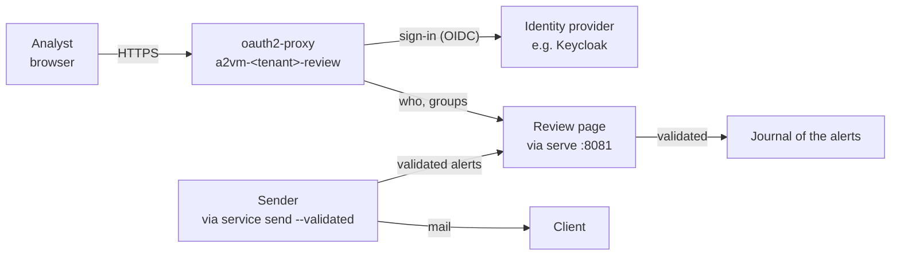

# Sign-in of the analysts and review page of the alerts

Since v0.17.0 the analysts of a tenant sign in with the tenant's identity provider (OIDC) to the
chat (`docs/chat.md`) and to the review page of the alerts, where a validator corrects a sheet,
validates it for sending or dismisses it. Their rights come from the directory's groups:

| Group | Chat | Review page |
| --- | --- | --- |
| Readers (`A2VM_OIDC_READERS`) | Yes | Read the alerts and their sheets |
| Validators (`A2VM_OIDC_VALIDATORS`) | Yes | Also enrich the English reference, choose the recipients, check and correct the translations, validate (the sender mails each language its version within a minute) and dismiss |
| Admins (`A2VM_OIDC_ADMINS`, optional) | Admin of Open WebUI | — |
| Anyone else | Refused | Refused |



Keycloak is described here; any provider with OIDC discovery and a groups claim works the same way.
Nothing in A2VM depends on Keycloak.

## 1. Keycloak: the client of the tenant

In the realm linked to the directory (Active Directory through *User federation*):

1. *User federation* > the LDAP provider: **Trust Email** on (the directory's e-mails are taken as
   verified: oauth2-proxy refuses an unverified e-mail), and a **group-ldap-mapper** that brings
   the A2VM groups (the readers' and the validators'), *Mode* `READ_ONLY`.
2. *Clients* > *Create client*: type OpenID Connect, client ID `a2vm-<tenant>`; *Client
   authentication* on; *Standard flow* on; *Direct access grants* off.
3. *Valid redirect URIs*: `https://<chat host>/oauth/oidc/callback` and
   `https://<review host>/oauth2/callback`; *Web origins*: the two `https://<host>`;
   *Valid post logout redirect URIs*: `https://<chat host>/*`.
4. *Advanced* > *Proof Key for Code Exchange Code Challenge Method*: `S256`.
5. *Client scopes* > `a2vm-<tenant>-dedicated` > *Add mapper* > *By configuration* > **Group
   Membership**: name and *Token Claim Name* `groups`, **Full group path off**, *Add to ID token*,
   *Add to access token* and *Add to userinfo* on.
6. *Credentials*: copy the client secret straight into the GitLab variable
   `A2VM_OIDC_CLIENT_SECRET` (§2); it is never written elsewhere.

Check with a member of each group: *Clients* > the client > *Client scopes* > *Evaluate*, user,
*Generated ID token*: `email`, `email_verified: true` and `groups: ["<group>"]` are there.

## 2. Variables of the tenant project

| Key | Value | Options |
| --- | --- | --- |
| `A2VM_OIDC_ISSUER` | Issuer URL, e.g. `https://auth.example.org/realms/a2vm` (Keycloak: the realm's URL) | Visible |
| `A2VM_OIDC_CLIENT_ID` | `a2vm-<tenant>` | Visible |
| `A2VM_OIDC_CLIENT_SECRET` | The client secret | Masked, protected |
| `A2VM_OIDC_READERS` | Groups that use the chat and read the alerts, comma-separated | Visible |
| `A2VM_OIDC_VALIDATORS` | Groups that also correct, validate and send | Visible |
| `A2VM_OIDC_ADMINS` | Optional: groups that administer the chat; empty: the local admin of `docs/chat.md` §3 stays the only one, with the login form | Visible |
| `A2VM_OIDC_CA` | Optional: the CA of the provider's certificate, when it is not public | File |
| `A2VM_OIDC_EGRESS` | Optional: `cidr:port,...` of the provider, when the job cannot resolve its host | Visible |
| `A2VM_OIDC_IN_CLUSTER` | Optional: `true` when the provider runs in the cluster behind its ingress controller | Visible |
| `A2VM_ALERTS_HOST` | Host of the review page (with `A2VM_RUN_MODE: kubernetes`) | Visible |
| `A2VM_ALERTS_ALLOW` | Optional: the analysts' networks (CIDR) | Visible |

The ingress controller, class and certificate issuer are the chat's (`A2VM_CHAT_*`, else
`A2VM_INTAKE_*`); `A2VM_ALERTS_TLS_SECRET` names a certificate of its own. `deploy-k8s` makes
the key of oauth2-proxy's cookie and the key of the page's forms once and keeps them in the Secret
`a2vm-tenant` (`oidc-cookie-secret`, `review-key`), with `oidc-client-secret` and `oidc-ca`.

## 3. Deploy and check

Push the project (or *Run pipeline*): `deploy-k8s` prints the issuer, the groups and where the
provider is (`sign-in: …`), and the review page's address. Then:

```bash
NS=a2vm-lab
kubectl -n $NS get deploy,ingress -l 'app.kubernetes.io/component in (review,send,chat)'
kubectl -n $NS logs deploy/a2vm-lab-review --tail=20
```

- **Chat**: the sign-in page shows the provider's button; a reader or a validator gets in, anyone
  else gets "access prohibited". The accounts made by the admin before v0.17.0 stay; an analyst
  signing in with the provider gets an account of their own.
- **Review page** (`https://<review host>`): the list of the alerts to process; a validator sees
  *Enrich the reference*, the recipients with their language, *Choose these recipients and
  translate*, then *Validate and send* once each translation is checked (v0.17.1), and *Dismiss*.
  After a validation the sender's log shows the sending within a minute:

  ```bash
  kubectl -n $NS logs deploy/a2vm-lab-sender --tail=20
  ```

- **Analysts' mail**: the link of each alert opens it on the review page.

`oauth2-proxy` logs a refused sign-in with its reason (group, unverified e-mail, certificate).

## 4. What is closed

| Item | Setting |
| --- | --- |
| Who | Members of the readers' or the validators' groups only, at every sign-in (oauth2-proxy `--allowed-group`, Open WebUI `OAUTH_ALLOWED_ROLES`) |
| Flow | Authorization code with PKCE (S256), confidential client, secret from a file at start, never in a pod's spec |
| Page | Reached only from oauth2-proxy (NetworkPolicy on port 8081), which overwrites the identity headers it passes; actions for validators only; every form carries a token bound to the analyst and the alert, and must come from the page's own origin; no script on the page (Content-Security-Policy) |
| Journal | Every correction, validation and dismissal with who and when; the sending with its recipients |
| Sending | Only the sender mails, only validated alerts, once; the page and `via serve` hold no mail secret |
| Accounts | Open WebUI never joins a provider account to an existing local account by its e-mail |

Without `A2VM_ALERTS_HOST`, the analysts' mail keeps the link to the prefilled GitLab pipeline
(`docs/kubernetes.md` §4); without `A2VM_OIDC_ISSUER`, the chat keeps its local accounts.
